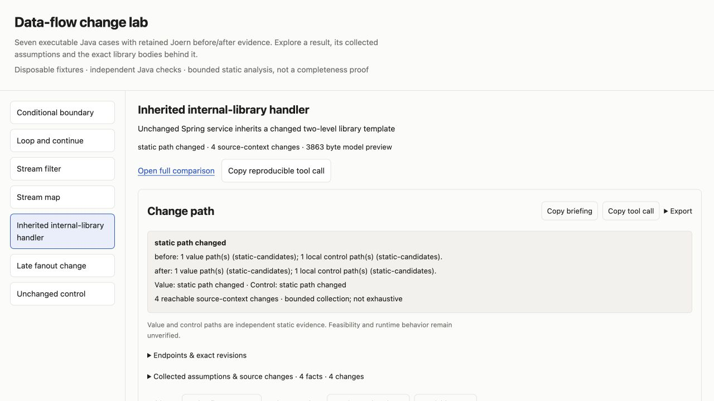
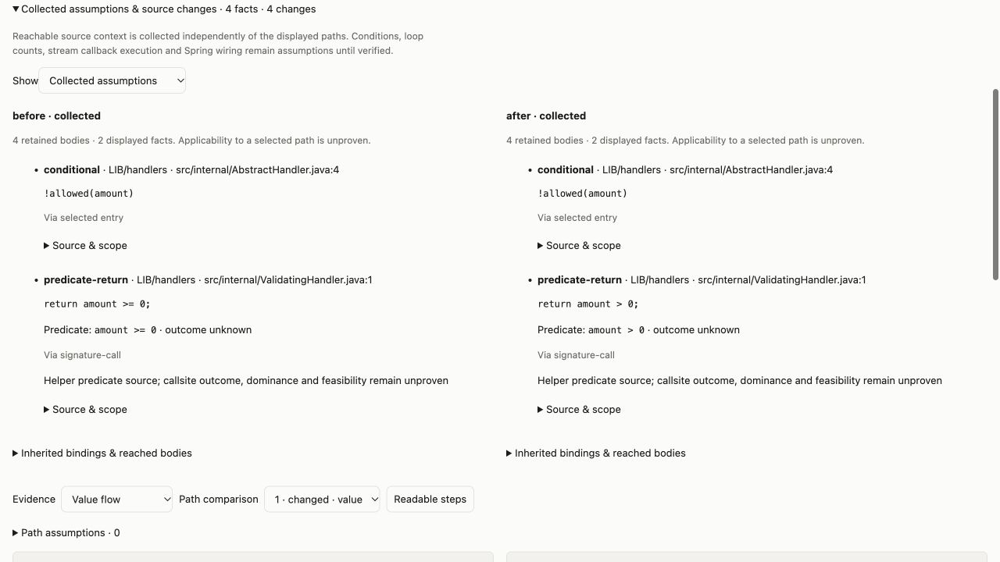

# Data-flow change lab

Seven actual Java cases: a conditional boundary, a loop with `continue`, a stream filter, a stream mapping lambda, an unchanged Spring-style service inheriting a two-level internal-library handler, a late fanout change, and an unchanged control.

Set `DT_SEMANTIC_LIVE_URL` and `DT_SEMANTIC_LIVE_TOKEN` to an owned Joern worker, then run:

```sh
node dev/demo-flow-stress.js work/flow-stress-demo
```

Use an empty disposable home. The script creates two real Git repositories, indexes exact service/library commits together, compiles and runs an independent Java oracle for both revisions, runs all semantic traces, and opens a local demo server. Follow its printed URL. Each case has native tool graphs, collected assumptions, source changes, complete JSON/export controls and an exact replay call.

To serve retained results without contacting Joern again:

```sh
node dev/demo-flow-stress.js --report work/flow-stress-demo
```

For automated verification use `test/semantic-flow-stress.live.test.js` with the same worker variables. The annotation used by the fixture is a tiny local `@Service` declaration; it does not boot Spring. Library source pins and an explicitly selected receiver expose inherited logic without asserting Spring bean/proxy wiring. Loop walks are not unrolled, and stream callback invocation is not inferred from a source predicate. All named changes in this finite corpus are checked; arbitrary-program completeness remains unproven.



Open **Collected assumptions & source changes**, then choose **Source changes** for paired expressions or **Collected assumptions** for unresolved predicates, loop bounds and pipeline stages. **Inherited bindings & reached bodies** exposes the exact library and service methods. Receiver-bound compositions are labeled above the graph and retain each local segment separately.



The [retained verification summary](../../docs/benchmarks/flow-stress-verification.json) records per-case statuses, source/query/enrichment digests, model-preview sizes and both Java oracle outcomes. It omits disposable server URLs and credentials. The default run needs Node 22+, Git, `javac`/`java`, and a configured Joern worker; serving an existing report only needs the local application dependencies.
