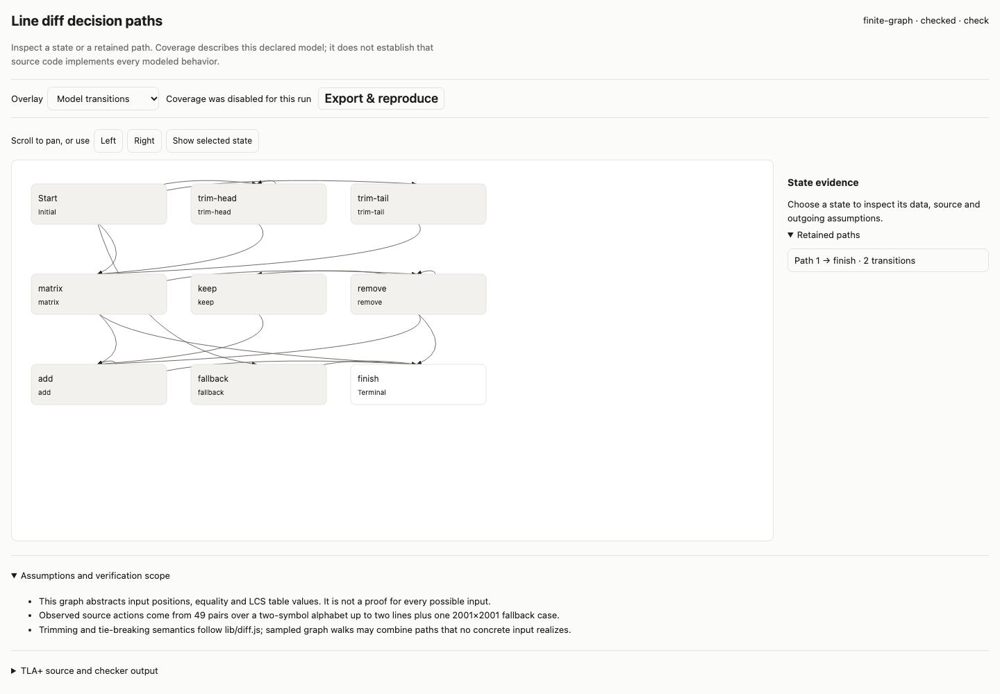
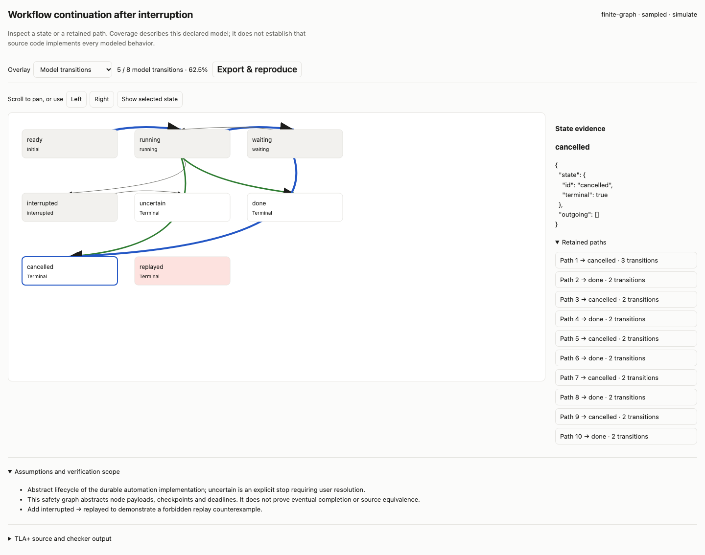

# Developer studio showcase

This lab demonstrates both diff decisions and durable workflow recovery, plus
the editor, task memory, dependency review and shareable backend-powered pages.
All service names and data in the screenshots are synthetic local fixtures.

## Open an interactive instance

```sh
node demo/studio/serve.js
```

Sign in at the printed Admin URL with the printed **demo-only token**, then open
the Studio/editor/page links from its output. One task and a real local Git
workspace are prepared. Find and attach `DEMO-42`, inspect the saved note, review
Gradle versions, edit source, run `git status`, inspect both named model graphs,
and click the explicit backend health API action. No model call is configured.
The shared page definition opens without execution; its live Pages link provides
the action controls. Ctrl+C stops the instance and removes only its disposable
configuration. Set `DT_DEMO_PORT` to select a local port.

## Run the complete browser story

```sh
node dev/check-studio-browser.js work/studio-showcase
node demo/check-editor.js work/editor-showcase
node dev/check-named-views-events-browser.js work/pages-showcase
node demo/workflow-continuation.js
```

The scripts create disposable configuration, real local Git repositories and
local HTTP services, exercise authorized browser actions and write screenshots
and JSON reports to the selected ignored work folders. They do not use deployment
credentials. The last script demonstrates three loop iterations, two parallel
branches, an explicit delayed local mock completion, and recovery of the same
task-backed program from a second chat.

## Case 1: diff decision coverage

Open **Developer studio → Check logic & assumptions → Explore diff decisions**,
then run. Inspect a state or retained path, switch between model transitions and
source observations, hide the overlay, and export the model. Run again with
`coverage:false` to retain the graph without coverage measurements.



The [JSON definition](diff-lines/model.json) comes from 50 executions of the
actual `diffLines` function, with before/after reconstruction checks. It includes
trimming, matrix, keep/remove/add and the large-input matrix-budget fallback.
The graph merges decisions and abstracts positions/LCS values. It does not prove
arbitrary inputs; sampled paths may combine decisions from different inputs.

Portable exports: [TLA+](diff-lines/LogicModel.tla), [TLC config](diff-lines/LogicModel.cfg).

## Case 2: workflow interruption and replay

Choose **Simulate workflow continuation**, review the seed/step/trace bounds and
run. Inspect the retained paths to completion, cancellation or explicit uncertain
effect resolution. Toggle the overlay to compare coverage on and off.



The [safe definition](workflow-continuation/model.json) stops uncertain effects.
The [unsafe variant](workflow-replay-counterexample/model.json) adds an
`interrupted → replayed` transition. Run it with `logic_model`'s `model` argument
to retain the forbidden-state counterexample. This is a finite safety abstraction
of the runtime: actual kill/restart, concurrent resume, HTTP cancellation and
cross-chat recovery are verified separately in the workflow/continuation tests.

Portable safe exports: [TLA+](workflow-continuation/LogicModel.tla),
[TLC config](workflow-continuation/LogicModel.cfg).
Unsafe exports: [TLA+](workflow-replay-counterexample/LogicModel.tla),
[TLC config](workflow-replay-counterexample/LogicModel.cfg).

## Use real TLC

```sh
node dev/setup-tlc.js
```

Use the printed `DT_TLC_JAR` and `DT_TLC_SHA256` settings, then:

```sh
node cli.js tool logic_model '{"action":"run","template":"diff-lines","engine":"tlc","coverage":true}'
node cli.js tool logic_model '{"action":"run","template":"workflow-continuation","engine":"tlc","mode":"simulate","seed":42,"coverage":false}'
node --test test/logic-model.test.js
```

The last test uses real TLC only when its pinned jar settings are supplied;
otherwise that one integration test explicitly skips. The runtime never fetches
or executes arbitrary uploaded TLA+ modules. For external trusted checking, run
the exported module/config from their directory with your TLC installation.

For the full click-through workflow and permission boundaries, see the
[Developer studio guide](../../docs/developer-studio.md).
