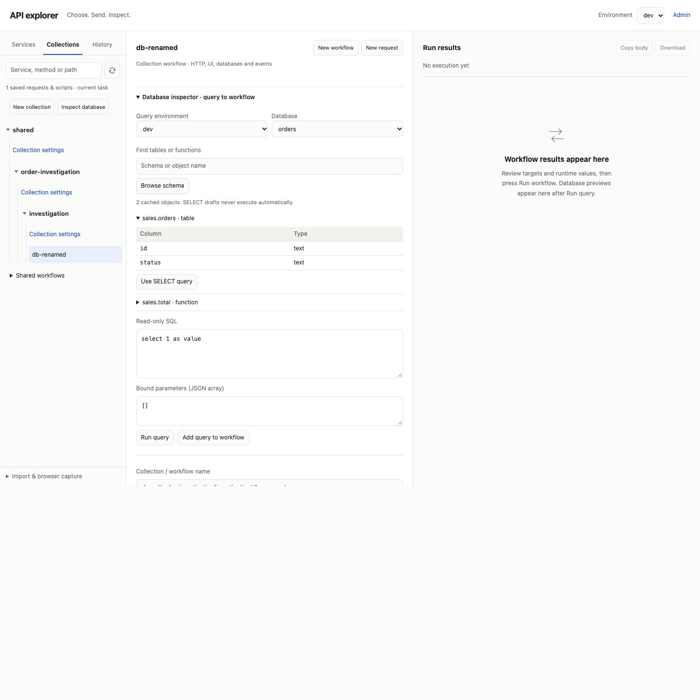
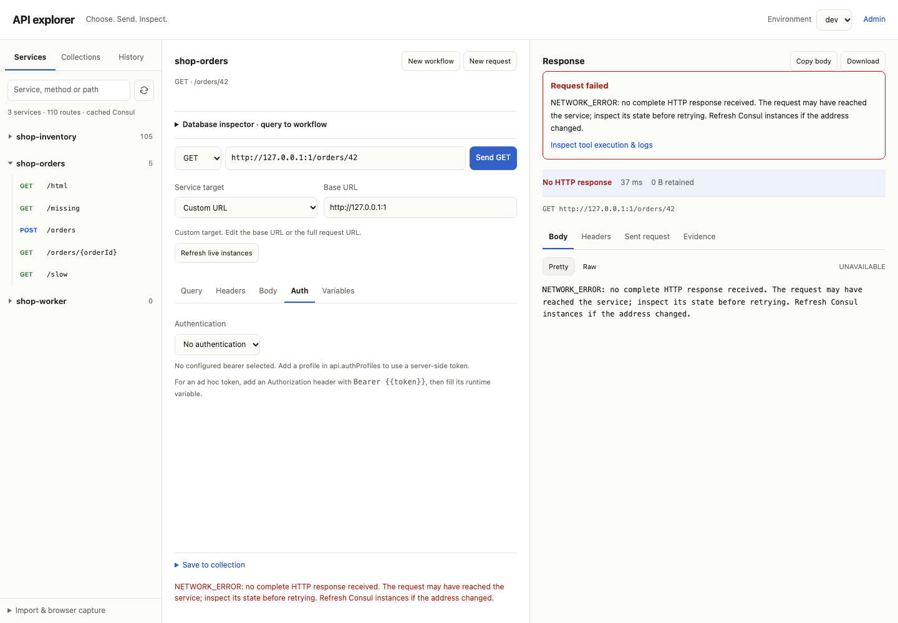
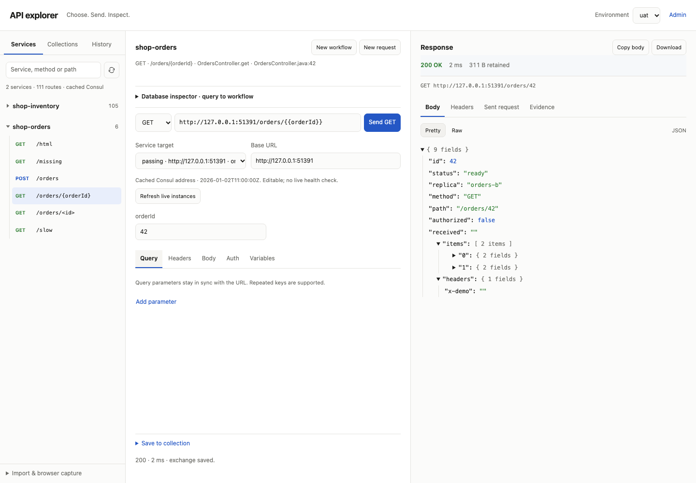
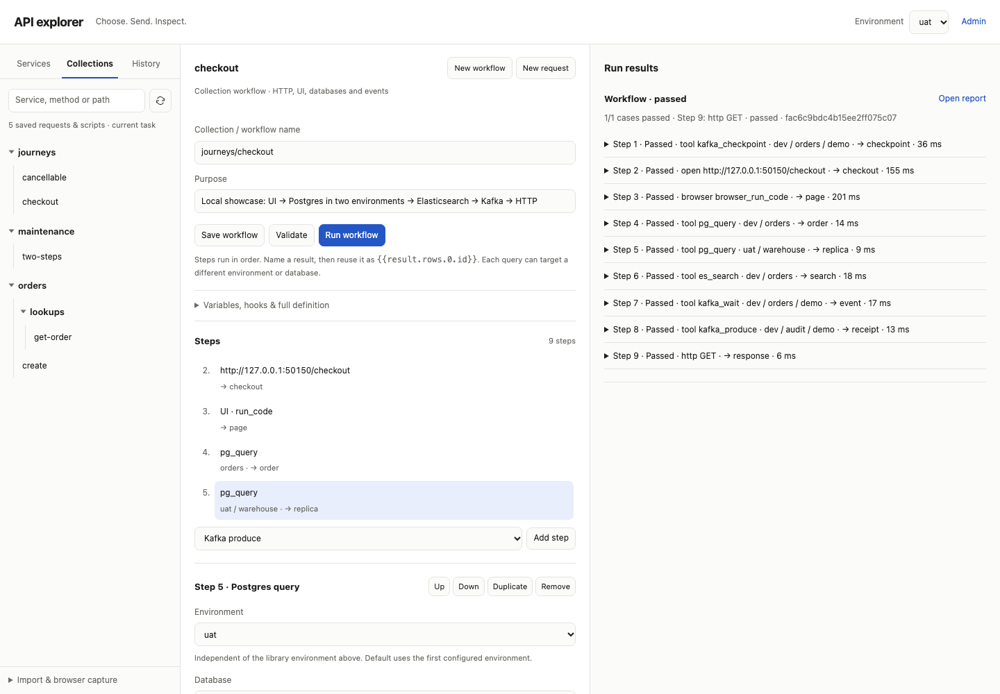

# Browser traffic and reusable API requests

The API client connects Playwright UI inspection, observed network exchanges, cached service endpoints and existing scripts/collections. Every step is a separate tool. Importing or inspecting traffic does not replay requests. Sending a request is an explicit `api_request_replay` call or the API client's **Send METHOD** button.

Open WebUI receives a sandboxed response explorer by default. It includes status, timing, safe request/response headers, collapsible JSON, handler candidates, provenance, omissions and downloads. The separate `client` URL opens the editable API client; link it directly in chat. Sandboxed views have no network capability, and a popup from an embedded sandbox may inherit its restrictions. The view therefore offers **Copy API client URL**, while the top-level client uses the normal trusted `/api/tool/*` endpoints. The client keeps runtime parameter values in page memory, never local storage.

For a reproducible screenshot-to-service-to-field diagram, open the [UI trace workbench](ui-trace.md). It joins captured exchanges to exact retained Joern paths and catalog fields, with editable replay steps and explicit SQL.

## Failed requests and changed instances

A network failure retains a sanitized exchange with no HTTP status, elapsed time, a bounded diagnostic code (for example `ECONNREFUSED`, `ENOTFOUND`, `TIMEOUT`), and an execution id. The response panel shows the failure and a link to Admin execution logs; **History** and `api_exchange_get` reopen it after reload. The API/MCP error includes this exchange. Raw exception messages and credentials are omitted. A failed connection or interrupted response does not prove that a mutation had no effect; nothing is automatically replayed. A browser-to-backend transport failure also replaces stale response content with visible feedback; if the backend could not be reached, no server-side log can be guaranteed.

The main **Refresh library** button in Services refreshes Consul service names and the selected service's instances with at most two requests, issued together. It invalidates other cached addresses; their instances load lazily when selected. **Refresh live instances** refreshes only the selected service. Discovered targets follow fresh passing replicas; manually typed URLs/base URLs remain pinned. Instance evidence expires after 15 seconds. Send resolves a discovered service again when its evidence is expired or invalidated, preserving the reviewed method, path, query, body and variables. No mutation is retried. Failed refreshes preserve prior evidence and show an error. Models use `api_instances_refresh {env,service,catalog:true}`; omit `service` to refresh names only. Neither refresh probes `/version` nor rebuilds passports.

## Performance and live command transport

Trusted application pages, including API Explorer and Admin, load a shared WebSocket tool client from the backend. Tool POSTs are multiplexed over `/api/tool-events`: accepted, progress and terminal result/error frames identify each command. Send is one command; preparation runs on the backend. The API explorer shows admission, connection, headers, body and saving progress, elapsed time, cancellation and failures. Existing UI event subscriptions use the same socket and reconnect with their last cursor. HTTP/SSE compatibility remains available if the connection cannot be established; a dispatched command is never automatically resent after socket loss. HTTP OpenAPI/MCP clients and read-only sandboxed result views retain their existing behavior.

Authentication and story/principal context are checked per command, including cancellation and subscriptions. Tokens stay out of URLs. Dead peers and command deadlines terminate waiting; lost acknowledgements have an unknown outcome and require inspecting retained history. Deploying behind a reverse proxy requires WebSocket Upgrade forwarding for the live transport; the UI shows HTTP fallback when unavailable. Static assets, metadata reads and external agent HTTP/MCP transports continue to use HTTP.

API catalog reads use compact endpoint projections with source-file and scoped manual-adjustment invalidation. New passport builds publish these projections; older large passports stream past unrelated graphs while migrating the projection. A dedicated bounded API reader keeps catalog work separate from CPU/build jobs. Search does not expand hundreds of service groups or request all their route pages. Workflow resource pickers skip passports entirely. Observing a new HTTP route no longer synchronously rebuilds Postgres usage and every environment catalog: `find` overlays current observed routes/site links, while retained catalog generations change on explicit `catalog_sync`.

Run `node dev/bench-api-explorer.js` for a disposable 200-service/4,000-route benchmark, and `node dev/check-api-performance.js` for real browser/WS/HTTP checks with local Consul fixtures. The browser check verifies one command per Send, zero HTTP tool calls, bounded Consul requests, automatic discovered-address refresh, pinned manual URLs and no pending UI commands. These measurements use local protocols and disable the test rate limiter; configured production admission/rate budgets still apply.

The retained [before/after fixture report](benchmarks/api-explorer-performance.json) records warm catalog reads falling from 600.5 ms to 56.1 ms, and first API replay from 1,821 ms to 135.4 ms. Replay no longer rereads 122 MB of passport data. The separate browser check loaded 200 services in 829 ms and completed Send in 248 ms. These are local measurements, not production latency guarantees.

## Collections: inspect, compose, share

1. Open **Collections → Inspect database**. Choose the query environment and database independently of the API library environment. **Browse schema** reads bounded cached tables, columns and function definitions; search and **Next page** continue through large catalogs. Missing caches are explicit.
2. **Use SELECT query** drafts quoted SQL for a table. Edit it and its bound parameter array, then explicitly **Run query** for a read-only preview. **Add query to workflow** appends the exact environment/database/SQL/parameters; save it under `collection/workflow`. Cached inspection is `api_database_inspect`; live execution remains `pg_query`.
3. **New collection** and each folder's **Collection settings** create/edit descriptions, vars, hooks and suite metadata. Workflow **Manage & share** copies, renames/moves or deletes definitions. Revision checks reject stale edits and deletes. Moving changes inherited destination collection settings; review them before execution. Collection deletion asks explicitly about nested definitions; retained reports remain available.
4. Admins can **Publish named workflow**, for example `checkout-smoke`. The named `/api-client?shared=checkout-smoke&revision=…` link previews an immutable definition, referenced scripts and inherited collection metadata. It contains no task id, runtime inputs or run results. Readers choose **Copy into my task**, into a new collection, then review targets and supply runtime values before running. Publication rejects obvious literal credentials and secret defaults; review code/hooks for embedded values too. Dynamic script references must be resolved before publication. Dynamic JavaScript tool/script references still require manual review and locally configured integrations.

`workflow_share` provides `list`, `get`, `publish` and `import`; `script_transfer` copies/moves an exact script with its source revision. Shared revisions persist under `shared-workflows/<name>/revisions/` in the configuration folder. Imported definitions remain under the viewer's scoped scripts storage. Opening, publishing and copying execute nothing. Shared names track a current revision; pinned older links continue to read their original snapshot.

Run `node dev/check-api-collection-workbench.js` for the reproducible browser exercise. It uses local HTTP/Consul fixtures and the showcase's synthetic PG adapter, without production or model calls. Node regression tests cover HTTP failure retention, live refresh failure preservation, schema paging, revision conflicts, publication integrity, inherited hooks and cross-task isolation.





## Workflow

1. `api_browser_open` opens an isolated browser session, detects the available capture adapter before navigation, then visits `site`/`link` with `params`, or a `url`. The configured Playwright MCP endpoint is `browser.mcp` / `DT_BROWSER_MCP`. Cookies stay in the browser; this session is distinct from an agent's own browser.
2. `api_browser_action` takes a snapshot, clicks/types/presses a key, or waits, using the endpoint's Playwright MCP arguments. Use `describe:true` to inspect a selected action's schema without acting. Older `ref` arguments map to `target` when the discovered schema requires it. Inspect the snapshot's element references before acting. Actions in the application can have real effects, just as normal browser actions do.
3. `api_browser_capture` drains completed exchanges, records route observations and returns exchange ids, the default explorer and the editable client's URL. Continue interacting in the same session, or call `api_browser_close` to discard it. Idle sessions close after 15 minutes; at most 20 may be active.
4. `api_exchange_get` inspects one stored exchange. `api_exchange_list` searches by URL, method, response status or service. Alternatively `api_exchange_import` accepts a HAR, structured exchange/list, or `browser_network_requests` text from another browser context.
5. `api_request_prepare` turns one exchange into an editable v1 request with explicit parameter locations. It sends nothing. Review the route candidates, URL, method, body, required credential placeholders and capture gaps.
6. `api_request_replay` sends the intended request once, using parameters supplied for this run. It records a separate sanitized exchange and displays its response. HTTP error statuses remain inspectable results.
7. `api_request_save` stores the request as a normal script in `collection/name`. Set `tool:true` for a frequently used individual operation, or expose its collection using `script_collection`. Collection vars and before/after/finally hooks, datasets, assertions, suite history and CI reports continue through the existing script/collection engine.

```json
{"site":"shop","link":"order","params":{"orderId":42}}
```

```json
{"session":"<browser session id>","action":"click","args":{"element":"Order details","ref":"e12"}}
```

```json
{"exchange":"<exchange id>","bindings":{"orderId":{"in":"path","index":3},"expand":{"in":"query","key":"expand"},"quantity":{"in":"body","path":"items.0.quantity"}},"description":"Retrieve an order with related items"}
```

Path indices include the initial empty segment: `/api/orders/42` has `42` at index 3. URL parameters are encoded independently; `a/b` becomes `a%2Fb`, and an ampersand in a query value cannot become a new query parameter. JSON body bindings retain supplied numeric/boolean types. No binding infers a captured value as a stored default.

```json
{"id":"orders/get-order","exchange":"<exchange id>","bindings":{"orderId":{"in":"path","index":3}},"assertions":[{"name":"found","path":"status","op":"equal","value":200}],"capture":{"orderId":"json.id"}}
```

For a prepared request, supply the object returned by `api_request_prepare` as `prepared`. It contains `schema: "dt.api-request"`, `version: 1`, `request`, `params`, `script`, and `mutation`. Request bodies use `{kind:"json",value:{...}}`, `{kind:"form",value:"id=42"}`, `{kind:"text",value:"reviewed payload",reviewed:true}` or `{kind:"none"}`. Saving preserves its named assertions, captures and step hooks unless explicitly replaced; HTTP execution is rebuilt from the request instead of accepting arbitrary supplied steps. Provenance remains usable after the original exchange expires. A no-body GET/HEAD stays bodyless through save and execution. Header bindings use case-insensitive names and reject duplicate or malformed headers.

## Capture fidelity and credentials

Current Playwright MCP provides `browser_network_request`: dt prefers this native adapter to list request indices, inspect headers and read a selected bounded body. Each detail batch has a 30 second budget; already captured indices are skipped, pending responses can be retried, and count/byte budget gaps tell the agent to capture again. Compressed bodies are omitted. No unsafe code capability is needed. Playwright MCP with `browser_run_code` supports a fixed capture adapter attached to the page. It records requests as they finish, drains asynchronous response reads, preserves observation sequence, and reads textual/JSON response bodies only when the reported Content-Length is known and at most 256 KiB. Binary, multipart, compressed, unknown-length and oversized bodies are explicit unavailable/unsupported values. Compressed bodies are not read because wire Content-Length cannot bound decompression; the stored-body limit is checked again. The rolling browser buffer is at most 100 exchanges and a conservative 3 MiB for both successful and failed captures. At most 16 response reads run concurrently; excess requests count as capture overflow. Overflow and pending responses are reported. WebSockets, streaming subscription messages, downloads and service-worker internal activity are not claimed as complete HTTP exchanges.

A browser lacking both native `browser_network_request` and legacy `browser_run_code` still works through `browser_network_requests`, with **metadata-only** gaps. Network text establishes method/URL/status, not missing bodies, headers or behavioral expectations. Use a bounded HAR import when a response body is needed. Imports are limited to 100 exchanges and 4 MiB. Persisted exchange retention is the newest 500 records, independently of reusable scripts.

Cookies, Set-Cookie, host/transport headers and inline URL credentials are omitted. Sensitive request fields in headers, query, JSON and form bodies become required named placeholders with no captured default. Sensitive response fields are redacted and never become request parameters. Known captured credential strings of at least four characters are also scrubbed from differently named echo fields; placeholders remain usable. Repeated sensitive form values retain their cardinality as distinct placeholders. Arbitrary text has no reliable field structure, so imported unstructured text is omitted by default; the client can explicitly supply a reviewed text body. Review its content before saving, and use placeholders for credentials. Source notes must describe provenance, not contain secrets. Known field-name redaction does not establish that arbitrary domain identifiers are anonymous.

The tool declarations provide `logArgs` policies so the shared registry records only safe scalar ids/actions, never raw HAR data, typed UI values or runtime credentials. This must be preserved by alternate tool dispatchers. The browser capture adapter may receive credentials transiently from the browser to sanitize an exchange; they are never written to the exchange store or transferred from browser cookies to HTTP replay.

## Replay and route evidence

Replay uses the same HTTP executor as saved script HTTP steps. All HTTP(S)
destinations are trusted: Consul-discovered replicas, manually entered URLs and
saved requests work without per-service configuration. The former
`scripts.http.allow` setting is ignored, including when it remains in an older
configuration. Collection validation and read-only HTTP scenario capture use the
same destination policy.

URLs must use HTTP(S) without inline credentials. Redirects fail, requests are rate limited, responses are streamed to a bounded buffer, and each call has a timeout. No automatic mutation retries are added. Browser cookies are unavailable to this executor; supply explicit named API credentials when needed. Ordinary script collection retry/poll rules remain GET/HEAD-only unless an existing tool explicitly declares idempotence.

Route attribution uses cached passport endpoints and preserves every candidate with the greatest matching path specificity. A shared gateway path can therefore remain **ambiguous** across services. This is evidence of a matching path and method, rather than a proof that the gateway routed to one candidate. File/line and handler provenance are retained when saving, even if a later passport refresh changes the current match.

## Composition and replacement

The stable boundaries are [exchange v1](../schemas/api-exchange.v1.schema.json), [request v1](../schemas/api-request.v1.schema.json), and normal script JSON. `lib/api-client.js` keeps normalization, local persistence, preparation, replay, browser adaptation and presentation as separate exported functions. `lib/tools-api-client.js` is a thin tool facade; `routes.resolve` supplies cached attribution, and `scripts.httpRequest` is the shared HTTP executor. The explorer consumes plain exchange JSON and cannot issue live calls.

A faster-language capture service, a new network inspector, remote evidence store or a different graph/RAG backend can emit these JSON contracts without changing the saved-request format or collection runner. Preserve version numbers, unknown/ambiguous/gap semantics, safe log policies and credential boundaries. Future incompatible semantics require a new version, rather than reinterpreting old evidence.

Verification: `node --test test/api-client.test.js test/scripts.test.js test/collections.test.js`. Tests use actual local HTTP, a fake streamable Playwright MCP server, and executed fixed capture instrumentation against a fake Playwright page. They cover capture ordering/overflow/body omissions, method/status/headers/timing, handler ambiguity, credential removal, URL parameter encoding, unconfigured replay destinations/redirects/truncation, script collection hooks and source provenance. The opt-in real-browser regression is `DT_TEST_BROWSER_MCP=http://127.0.0.1:<port>/mcp node --test test/api-client.live.test.js`. It creates a disposable local page and API and requires Docker Desktop's `host.docker.internal` (or `DT_TEST_BROWSER_HOST`). Customer browser authentication remains environment-specific.

## Routes, parameters and optional authentication

Open **API explorer** in Admin or visit `/api-client`. The same three-panel client
runs in both places: a service/collection library on the left, an editable request
in the middle and retained response evidence on the right. On narrow screens the
panels stack. Admin forwards the selected environment and task/principal scope.

**Services** groups all cached services, including services without endpoints.
Expand a service to load its routes; **Load more** exposes routes beyond the first
100. Search matches service, method, path and handler. Declared paths keep their
parameter names even after traffic is observed. `api_client_catalog` exposes the
same offline inventory and paginated routes to agents.

Selecting a route fills the base URL from the environment's cached Consul
instances, preferring passing replicas. Choose another replica or edit either
the base URL or the full request URL. The source timestamp and stale status stay
visible. Addresses default to HTTP unless instance metadata explicitly declares
HTTPS. Cached health is not a live probe, and opening the client never sends an
API request. HTTP passport ports and captured exchanges also link to this client.

Edit repeated query parameters, headers, JSON/text/form bodies and runtime
variables, then press **Send METHOD**. Requests execute once on the backend using
authentication profiles and tool permissions without a destination allowlist. **Cancel**
aborts the backend fetch; an already delivered mutation can still have effects.
No automatic retries are performed. HTTP 4xx/5xx results remain inspectable.
The response panel includes status/timing, collapsible JSON, raw text, headers,
the actual sanitized request, redactions/capture gaps, copy, download and an
exchange link. HTML is displayed as text.

**Collections** navigates nested saved scripts in the current task. Single HTTP
requests reopen for editing. Saving to `collection/request` creates folders as
needed; replacing an existing request requires the explicit replacement checkbox.
Multi-step scripts and scripts with hooks open in the workflow editor below.
**Send** runs the HTTP request only; collection
variables/hooks, assertions and captures execute through the script/collection
runner. **History** reopens up to 500 retained sanitized exchanges without replay.
Runtime values are kept in memory and are not put in browser storage.

Reproduce the local showcase with `node demo/api-client.js`. Its service catalog
is synthetic; sends execute against two real local HTTP servers. Run
`node dev/check-api-client-browser.js` for the mouse/keyboard flows and screenshots.



The screenshot uses synthetic service metadata and an actual local HTTP response.

Optional named bearer profiles resolve `.env` references on the server:

```json
{
  "api": {
    "authProfiles": {
      "orders-dev": {
        "label": "Orders · development",
        "url": "https://orders.dev.example/api",
        "bearerToken": "${DEV_API_BEARER_TOKEN}",
        "autoPrefill": false
      }
    }
  }
}
```

Set `DEV_API_BEARER_TOKEN` in `.env`. The explorer shows profile labels and matching
URL scopes; token values are never returned to the browser or model. Choose
**No authentication** or a matching profile. Set `autoPrefill: true` to select that
profile automatically for matching requests. A profile applies only to its exact
origin and path prefix. Redirects are not
followed. Captured headers and echoed values are sanitized. Profiles apply to
explicit explorer replays; saved scripts retain their existing parameter-based
authentication contract.

## Mixed collections: UI, queries and events

Choose **New workflow**, open a multi-step script in **Collections**, or use
**Continue as workflow** under **Save to collection** on an HTTP draft. Add,
select, duplicate, reorder or remove steps in the numbered list. The selected
step has an editable form; advanced step JSON keeps assertions, captures,
timeouts, optional steps and hooks available without flattening their behavior.
**Variables, hooks & full definition** exposes the complete ordinary script JSON.
Apply JSON edits before changing steps, saving or running.

Each Postgres, Elasticsearch or Kafka step selects its own **Environment**.
Postgres also selects its own **Database**; two steps can query different
databases in the same environment or different environments. Suggestions use
configured database names and cached index/topic names, with no connection
credentials. Up to 500 suggestions per resource kind are returned; a configured
name can also be typed directly. Library environment changes do not retarget
already saved workflow steps. Postgres remains read-only and uses bound values:

```json
{
  "description": "Compare an order in the source and reporting databases",
  "params": {"orderId": {"type": "integer", "required": true}},
  "steps": [
    {"tool": "pg_query", "args": {"env": "dev", "db": "orders", "sql": "select id, status from sales.orders where id = $1 limit 1", "params": ["{{orderId}}"]}, "as": "order"},
    {"tool": "pg_query", "args": {"env": "uat", "db": "reporting", "sql": "select id, status from reporting.orders where id = $1 limit 1", "params": ["{{order.rows.0.id}}"]}, "as": "report"}
  ]
}
```

**Open UI page** and **UI action** use the configured isolated Playwright MCP.
Snapshot refs describe the current page; use a `run_code` action with stable
Playwright locators for repeatable UI journeys. Browser sessions close after the
script, including failed runs. HTTP steps execute on the backend and keep their
own editable URLs, headers and bodies. Other enabled tools and saved scripts can
also be steps. Named results and captures are shared between steps in one script;
separate suite cases keep independent values.

For asynchronous events, place **Kafka checkpoint** before the UI/API/produce
action, name its result `checkpoint`, then pass `"{{checkpoint}}"` to **Kafka wait**.
Match paths such as `value.orderId` to typed values. Without a checkpoint, the
wait starts at the topic's current end. It scans every partition without joining
a consumer group or committing offsets. Timeouts, scan limits, incomplete streams,
expired offsets and changed partitions fail explicitly. Offsets retain exact
64-bit precision. **Kafka produce** sends once through configured Kafka UI and
requires a partition; objects become JSON strings and an explicit `null` value
creates a tombstone. An uncertain acknowledgement needs inspection before retrying;
automatic script retry/poll is rejected for produce.

**Save workflow** writes with a revision check; conflicting edits require reload.
**Validate** saves and checks templates, parameters and available tools without
executing actions. **Run workflow** saves and starts a validated background
collection run for that script only, including inherited collection hooks.
Results show live step progress, assertions, failures and cleanup, with a link
to the existing inline collection report. Successful results start collapsed.
**Cancel run** stops new actions and requests cancellation, then waits for cleanup.
A run link contains its workflow/run/job ids; reopening it observes the same run
without executing again. Definitions and retained reports use the existing
principal/task access boundary; runtime input values are omitted from reports by
default, while sanitized outputs remain available.

### Persistent storage and model tools

The normal app saves workflow definitions as JSON under `DT_HOME/scripts/`, with
collection metadata in `_collection.json`. Named tasks use private subfolders
under `_stories/`; the authenticated principal and stable task id select the
folder. The default Docker setup bind-mounts the data folder at `/dt`, so
`./run.sh up -d`, container recreation and server restarts retain definitions.
Run reports live separately under `DT_HOME/cache/collection-runs/`. If overriding
`DT_SCRIPTS_DIR` or `DT_CACHE_DIR`, mount and back up those locations too. These
are local runtime data, excluded from Git. The disposable showcase uses a
temporary data folder; it is not the normal app's library.

Models use the same saved definitions and runner as API Explorer through MCP,
OpenAPI, `/api/tool` or the CLI:

| Operation | Workflow | Collection |
| --- | --- | --- |
| List / discover | `script_list` | `script_list` includes collection folders |
| Read | `script_get` | `collection_get` |
| Create / update | `script_save` | `collection_save` |
| Delete | `script_delete` | `collection_delete` |
| Execute | `script_run` | `collection_run` |
| Validate / inspect results | `collection_validate` with `select` | `collection_history`, `collection_report`, `collection_check` |

Read the current revision before updating or deleting. `expected_revision: null`
requires a new definition; a revision from `script_get` / `collection_get` guards
updates. Delete tools require the exact id/path and revision; deleting a
nonempty collection also requires `recursive: true`. Collection revisions cover
nested scripts and metadata, so a newly added child invalidates a stale delete.
Deleting definitions preserves retained execution reports. The API/testing tool
profiles expose workflow management; compact profiles can discover it through
`tool_search` and execute through `tool_execute`.

Reuse the same authenticated principal and `X-DT-Story` task header when continuing
from another chat or connection. A new task keeps a separate library; persistence
does not make private definitions visible to other users or tasks.

Completed reports survive restart. A run whose coordinator stopped is reported
as `interrupted`, with unknown in-flight effects and incomplete cleanup stated
explicitly. Job polling, history, checks and JUnit report that interruption; reads
never resume or replay actions. Inspect the retained evidence before explicitly
starting another run.

`node --test test/collection-persistence.test.js` verifies model HTTP/MCP CRUD,
typed execution, a real coordinator restart, an interrupted background job,
retained reports, stale deletion guards and principal/task isolation.

Run `node demo/collection-workflows.js` for a disposable nine-step checkout.
It drives a **real local browser**, HTTP and Elasticsearch/Kafka UI protocol
fixtures. Postgres results come from an explicitly synthetic scope-aware adapter;
it does not test a live database or broker. `node dev/check-collection-workflows.js`
checks the full journey, typed handoffs, cross-environment/database targeting,
revision conflicts, cancellation, reload/reattachment, task isolation and responsive
screenshots. Backend regression tests are in `test/api-workflows.test.js` and
`test/kafka-actions.test.js`.



The fixture is synthetic; the browser interaction and local requests execute.
