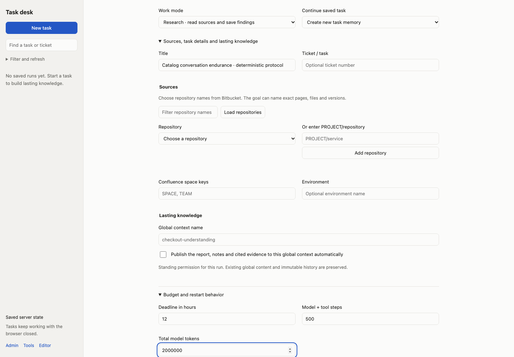
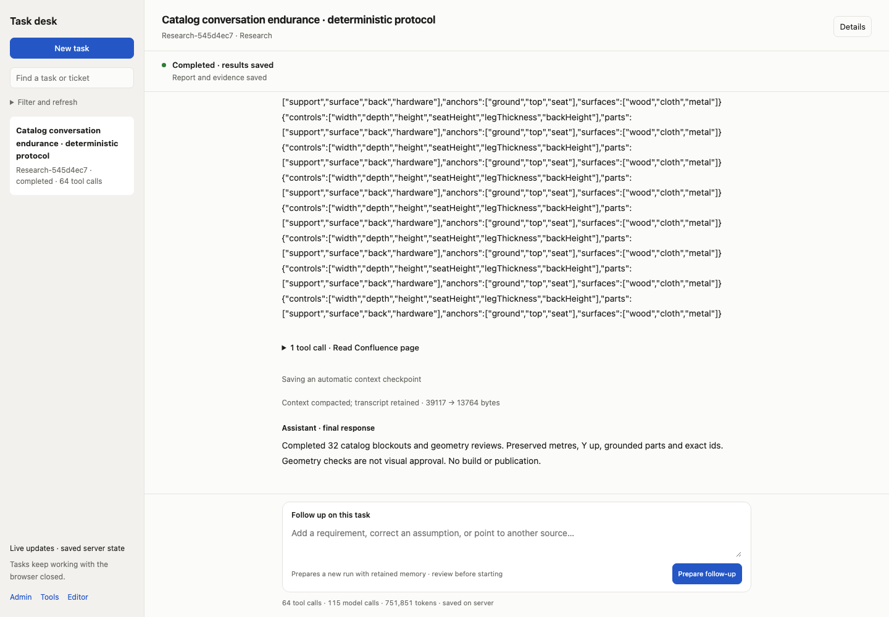

# Admin conversation endurance

The Admin task desk uses the server-owned task worker, independently of Open
WebUI's own chat compactor. Enable `llm.compactionMode: "auto"` in Admin to allow
that worker to compact. The default remains manual; `llm.compaction: false`
disables automatic compaction. This is a model setting, not publication consent.

Before a new model turn exceeds 75% of its conservative byte budget, the worker
saves an immutable full transcript, then summarizes a prefix containing complete
assistant/tool groups. It preserves the original goal and scope in every ordinary
request. Summaries explicitly distinguish retained evidence from authority and
point to the original transcript. Existing scripts and tool receipts stay in task
memory. Completed effects are never replayed to reconstruct context.

Large histories can need successive prefix summaries. Each must reduce context;
a nonshrinking, malformed, truncated or excessively large summary stops with its
original transcript retained. At most eight summaries precede an ordinary turn.
A single turn too large for the summarizer needs an explicit owner checkpoint.
Context estimates are byte-based, not an exact provider tokenizer. A provider
context-window rejection reduces the retained budget to 65% and retries at most
three times, with a floor of 8,192 bytes. Summary calls count against the same
step, token and wall-time budgets. A restart during a summary may repeat the
model request, but does not execute any source tool again.

Transient model failures (408, 429, 500, 502, 503, 504, transport interruptions and
timeouts) use durable exponential backoff with jitter. `Retry-After` seconds/date
and `retry-after-ms` set a minimum delay, bounded at five minutes. Defaults:
five retries, 15-second initial delay. `llm.taskModelRetries` accepts 0–10;
`llm.taskRetryBaseMs` accepts 1–60 seconds. Permanent authentication/validation
errors, exhausted retries, uncertain tool effects and budgets stop for inspection.
Concurrent supervisor polls cannot bypass a retry deadline or duplicate a worker.
The conversation shows retries, compaction and provider-context recovery.

## Reproduce the catalog soak

```sh
node dev/stress-task-conversation.js \
  --catalog /absolute/path/to/REA-ANIME/cozy-node-kit/catalog/library.js \
  --rounds 32 --seed 731 --out work/conversation-stress/protocol
```

This launches the real Admin UI in Playwright, creates a task in that UI, and
runs it through an isolated fault proxy and the real durable worker. A seeded
provider injects 429/503 responses. Actual catalog ids/contracts are captured with
the source SHA256. The task writes JSON-compatible JavaScript model definitions
to task memory; a geometry reviewer returns feedback through a local source
fixture. Generated source is parsed as data, never evaluated. Checks cover ids,
metric units, Y up, finite positive bounded boxes and ground contact. They do not
establish model resemblance, connected geometry, artistic quality or rendered
appearance. The deterministic provider tests execution continuity, not semantic
model drift. It can always consult its fixture ledger, unlike a real model.

To test a real OpenAI-compatible provider, put the same fault proxy before it:

```sh
node dev/stress-task-conversation.js \
  --catalog /absolute/path/to/catalog/library.js \
  --upstream http://127.0.0.1:18787/v1 --model ollama-qwen \
  --rounds 8 --minutes 30 --out work/conversation-stress/real
```

Optional provider authentication: `DT_STRESS_API_KEY` (never written to the
report/config). `--no-thinking 1` sends `reasoning_effort: "none"` when supported.
The harness forwards real provider responses unchanged, records failures and
pauses at its deadline. `--window` sets the stress context estimate (default
24,000); `--port` selects the Admin HTTP port. The harness stops its isolated
servers on completion; its task files and reports remain on disk. No existing
Admin/provider configuration is modified; no image is built or pushed.

Each output folder contains the exact catalog selection, proxy request timings,
review results, retained worker status, run identity, before/after screenshots and
machine-readable report. Full prompts, receipts and source live under its `home`
folder. Real-provider logs can contain project evidence; keep them local.

## Recorded baseline: 2026-11-25

The first run stopped after one review: JSON-encoding a transcript inside another
JSON envelope made the summary request exceed its own context budget. Bounded
native message prefixes fixed that reproduced failure.

The corrected deterministic run completed 32 model/review pairs: 64 source tool
calls, 115 total model attempts, 32 compactions, 18 injected provider failures,
18 recovery backoffs, 32 writes and zero duplicate write call ids. All 32 geometry
reviews passed. The smallest observed delay after an injected Retry-After=1s
failure was 1,371ms. Token counts are fixture estimates, not billed/provider
measurements. See [machine-readable evidence](benchmarks/conversation-stress-2026-11-25/protocol.json)
and [the initial failure](benchmarks/conversation-stress-2026-11-25/first-failure.json).




A second seed (19) with two consecutive faults per selected request completed
8 models, 8 compactions, 18 injected failures/backoffs and 8 writes without a
duplicate write call id. [Burst evidence](benchmarks/conversation-stress-2026-11-25/burst.json).

REA's installed `qwen3.8:27b` alias uses a raw `{{ .Prompt }}` template. Its scripts
therefore supply ChatML themselves. For that existing alias use `--rea-native 1`:
the isolated proxy sends `/api/generate` with a per-request context limit, frames
text/tool history using the [Qwen3.5 tool protocol](https://huggingface.co/Qwen/Qwen3.5-27B/blob/main/chat_template.jinja),
and translates parsed calls into the worker's normal tool envelope. Unknown,
partial and duplicate parameters fail parsing; arguments are never repaired.
This adapter changes the test transport, not the shared model's template or
configuration. `--window 24000` prevents inheriting its 262K serving default.

A feedback-repair run (seed 42, `--geometry-fault 1`) deliberately put the first
model below ground. It completed all 4 models after one failed review and one
additional revision: 5 writes, 5 reviews, 6 compactions, 7 injected failures, zero
duplicate write ids. [Repair evidence](benchmarks/conversation-stress-2026-11-25/repair.json).
Owner steering is retained verbatim in each subsequent ordinary model request;
a generated summary cannot silently discard those corrections. An explicit owner
checkpoint may replace that active correction ledger, retaining its transcript.

The real Qwen run is separately monitored and is not included in these protocol
pass counts. Its first successful request took 111.9s including cold startup; its
first summary took 195.3s. Initial tool use requested a review before saving a
model; the reviewer rejected that and an explicit correction was sent. This is
a recorded intervention, not an unassisted real-model pass. Full live artifacts:
`work/conversation-stress/qwen38-native-1/`. A temporary heartbeat monitors this
run and will save final model/intervention results separately.

After the correction, Qwen saved an 11-part spindle-chair definition and its
second review passed. The eight-model real run remains in progress; its final
report must distinguish this correction from unassisted continuity.

Final local verification: 1,430 tests, 1,364 passed, 66 skipped, zero failures with
`--test-concurrency=8`; 26 focused checks and 8 standalone-bundle checks also pass.
The generated bundle is current. An earlier default-concurrency named-view CAS
recovery test failed once; it passed in isolation and both subsequent full-suite
runs. [Validation record](benchmarks/conversation-stress-2026-11-25/validation.json).

## Real-model failure and recovery: after checkpoint two

After the second automatic compaction, Qwen emitted malformed tool tags:
`<query>…</parameter>` and `<id>…</parameter>`, instead of opening each argument
with `<parameter=query>` or `<parameter=id>`. No tool in these rejected responses
executed. The test adapter incorrectly returned HTTP 500, so the worker treated
the protocol failure as transient and repeated the same model request until its
bounded retry allowance was exhausted. This is a reproduced real-model drift
failure, not a passing continuation test. [Failure record](benchmarks/conversation-stress-2026-11-25/qwen-protocol-failure-1.json).

The adapter now retains raw native responses and classifies invalid protocol as
a permanent 422, with no argument repair. The prompt includes an explicit
multiline syntax example. The harness can `--resume 1 --steer-file /path/to/note`
using the same task id, transcript, saved models, review ledger and budgets; it
archives the pre-resume report/screenshot. Resume requires the exact catalog hash
and original round count. An explicit owner resume after exhausted model retries
now admits a fresh bounded retry allowance; it still respects an existing
provider cooldown. The run resumed with a framing correction and its first
passing model retained. This is the second recorded intervention.

A completed deterministic repair run was also reopened with `--resume 1`: its
original task id, 36 steps, 24 model calls, 10 tool calls, 5 writes and 6 compactions
were unchanged, confirming no completed effects were replayed. A focused test
covers resuming after an exhausted provider outage. Successful-response token
counts exclude the earlier malformed native responses whose usage the old
adapter discarded; those counters are incomplete measures of model work.

## Real-model memory-discovery loop

After protocol recovery, the model twice repeated the same memory-index query,
initial `progress.md` and passing-review receipt reads without producing the
next model. The generated summaries retained the correct next entry; this was
workflow drift rather than loss of the stated next step. The query `models saved`
matched no note because search required that whole phrase. The default index
also mixed authored notes with numerous operational request records. The repeated
reads refilled context and caused more compaction without advancing the output.
[Observed read signatures](benchmarks/conversation-stress-2026-11-25/qwen-memory-loop.json).

Memory discovery now ranks query words and puts authored notes before operational
history. Historical requests/transcripts are listed with `include_internal=true`;
all exact-path reads remain available. Every model request also includes bounded
references to saved notes and recent source receipts, so a summary cannot erase
where completed work is stored. These references contain paths and completion
metadata, not instructions imported from source documents. Regression coverage
checks compound queries, access to historical requests, note ordering and note
references across repeated compactions.

The existing run was operationally paused and its owned harness restarted to
load the changes while a summary request was pending; no tool effect was pending.
The task id, completed writes and source receipts were retained. This recovery
changes discovery context, not catalog output or the shared model configuration.
