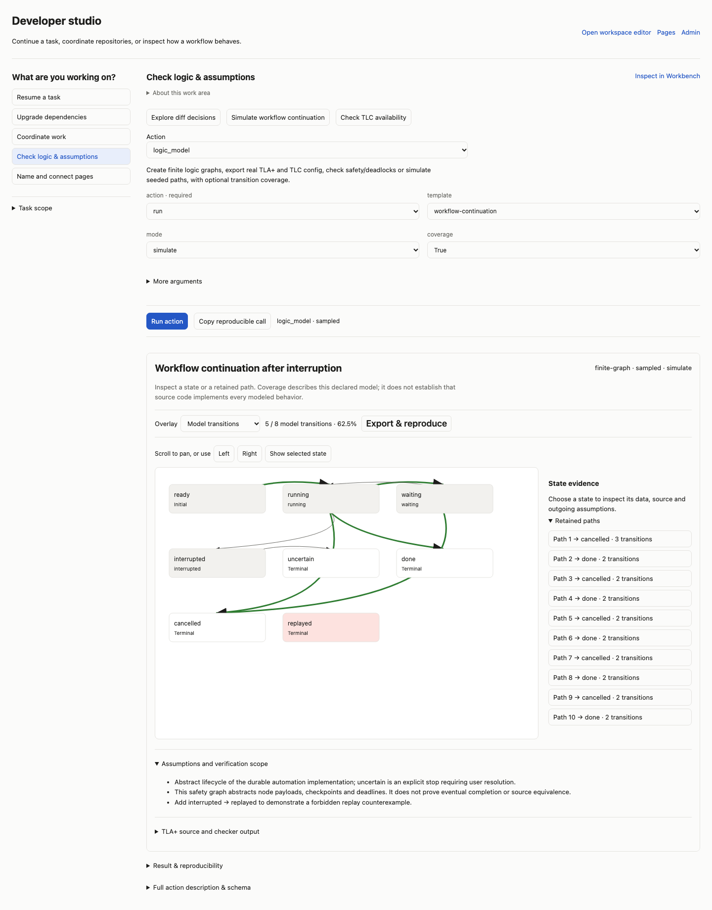
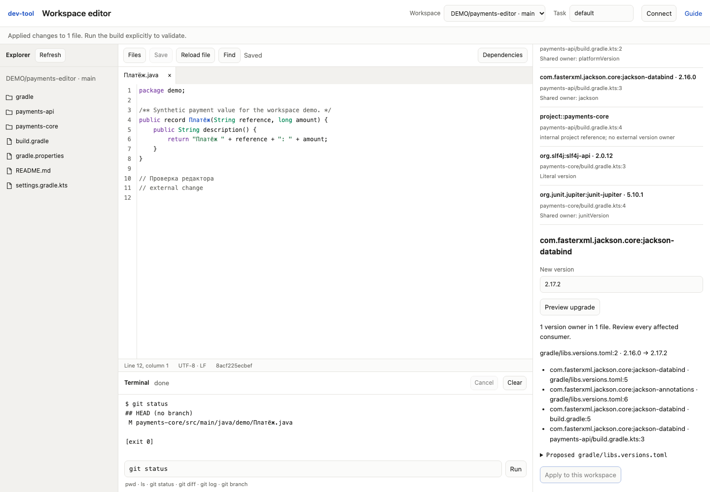
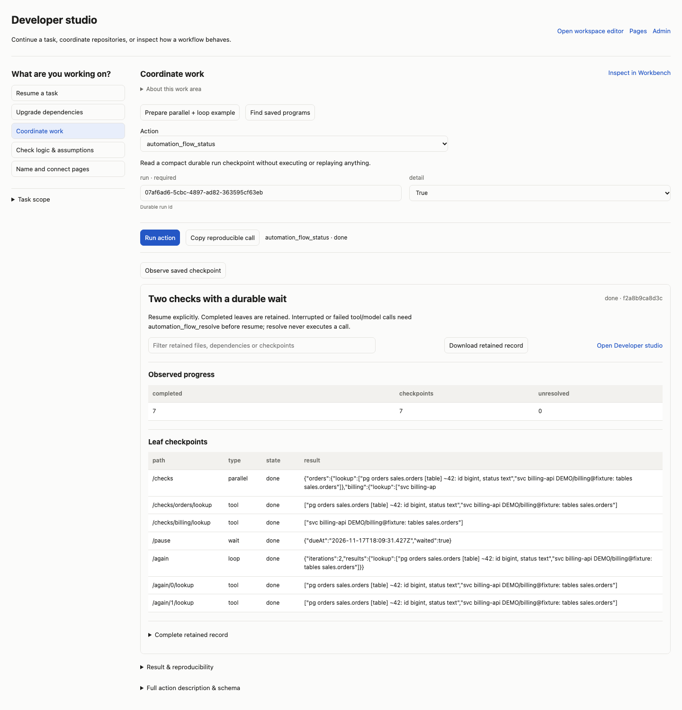
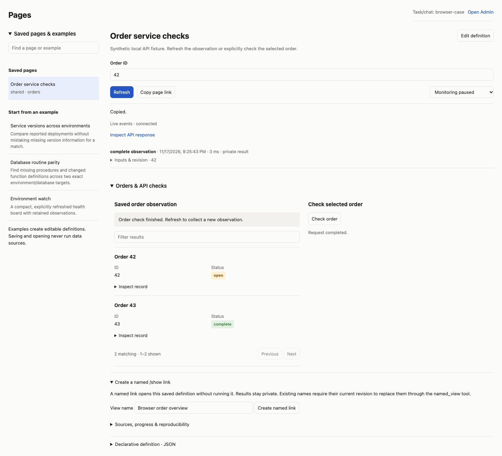

# Developer studio

Open **Admin → Developer studio** or `/studio`. Choose a work area, prepare an
action, review its arguments and click **Run action**. Preparation sends no tool
request. Every execution uses the same tool registry, access checks, tracing and
cancellation as MCP and chat. **Copy reproducible call** preserves the exact tool
and arguments; results retain their original evidence and revision.

## Pick the question first

| Work area | Start here | What you keep |
| --- | --- | --- |
| Resume a task | Create a stable ticket/task, or find and explicitly attach one | Notes, scripts, files, progress and related repository/workspace identities across chats |
| Upgrade dependencies | Index selected repositories, search a coordinate, inspect its version owner | Immutable all-build-file inventory at each Git SHA; reviewed guarded upgrade plan |
| Coordinate work | Prepare the parallel/loop example, save, then start that exact revision | Durable checkpoints, original wait deadlines, explicit reconciliation after uncertain effects |
| Check logic & assumptions | Explore diff decisions or simulate workflow recovery | Interactive states, retained paths, assumptions, optional coverage and portable TLA+/TLC exports |
| Name and connect pages | Name a saved definition or inspect scoped events | Readable revision-pinned links; explicit backend API actions and event-aware components |

Advanced arguments and raw records are collapsed. An inline retained result is
interactive evidence: opening it executes no API, script or model request.
On a narrow screen, use the **Work area** select. Graphs and wide tables scroll
inside their own panels.

## Resume work in another chat

Create a continuation with a stable `task_id` such as `PAY-42`. Save findings with
`continuation_write`, update progress with a revision-checked
`continuation_checkpoint`, and keep repositories/workspaces in its index. In a
new chat, search with `continuation_find`, attach the chosen returned id and read
`continuation_briefing`. The attachment survives restart; it never selects a task
automatically for an unrelated chat.

Use `continuation_flow` for a program that must travel with that task. Ordinary
`automation_flow_*` programs remain chat/story scoped. Both the bridge and target
tool grants apply. Shared global project knowledge still uses its separate
administrator publication flow; private notes stay private.

Full contracts and restart examples: [Durable workflows and continuations](workflow-continuation.md).

## Edit and coordinate repository changes

Open **Workspace editor**, choose an owned workspace and expand its file tree.
The vendored CodeMirror editor provides tabs, syntax highlighting, search, undo
and UTF-8 source editing. Conflicting saves preserve the draft and report the
changed revision. The terminal runs approved inspection commands such as
`git status` and `git diff`; builds require explicit configuration and an
authenticated runner. This is a bounded command interface, not an arbitrary host shell.

`gradle_inventory` indexes all supported build files in each selected repository
using one tree read and one batch content read, then retains an immutable SHA
generation. Search coordinates across cached repositories, inspect Groovy/Kotlin
builds, properties and version catalogs, and review shared-owner consumers before
applying a `gradle_bump` plan. Applying checks the workspace repository, SHA and
every source-file hash first. Unknown dynamic version owners remain explicit
gaps; static inspection does not run Gradle dependency resolution. Tools do not
commit or push the change.

[Editor, terminal and Gradle details](editor-gradle.md).

## Coordinate bounded work

Save an explicit JSON program with tool, loop, parallel, wait and optional model
nodes. Start the exact reviewed revision, then inspect checkpoints or cancel.
Completed leaves are retained after restart. A call interrupted during an
external effect becomes uncertain: inspect its receipt, explicitly resolve it,
then resume. The runtime cannot infer exactly-once behavior from a failed HTTP
transport. Explicit model nodes require `allow_model:true` for each start/resume;
there is no background planning or summarization call.

## Give pages names and connect live results

`named_view` gives a saved definition a readable path such as
`/show/payments-release-board`; revision-pinned links retain the former definition.
Definitions are shared by default and administrators publish them. Execution
results remain private unless their owner explicitly publishes a capability link.
Opening a definition does not refresh its sources.

Collection widgets, nested collapsible panels and explicit API action buttons
compose from declarative primitives. API requests go through the backend and its
existing request allowlist/authentication/grants. The event transport uses HTTP
publication and SSE replay with principal/story/channel isolation. Events update
status and notices; they never execute actions. Click a button to run a request
and inspect its job, progress, error or response.

[Names, event channels and permissions](named-views-events.md) · [Page definitions](ui-pages.md).

## Model logic and inspect evidence

The finite JSON model editor supports named states/transitions, forbidden states,
assumptions and optional supplied source observations. Run exhaustive finite
graph checking or seeded simulation, select a state/path, switch coverage off or
on, and export `LogicModel.tla` and its TLC configuration. Install the optional
SHA256-pinned checker explicitly with `node dev/setup-tlc.js` to use `engine:tlc`.

Both requested examples are included: actual diff-decision observations and
workflow recovery. Model transition coverage and source observations remain
separate. These are safety abstractions, with no claim of source equivalence or
liveness. [Showcase cases and reproduction](../demo/studio/README.md) ·
[Model schema, bounds and TLC setup](logic-models.md).

## Verification scope

The showcase uses disposable local Git repositories, local HTTP adapters and
labeled synthetic service/database data. Workflow demonstrations make one
explicit request to a local mock model, with no production model request.
Desktop/mobile browser checks exercise the actual HTTP tools and retained
visualizations. Real TLC runs check and simulate the exports with coverage on
and off, including an injected unsafe transition. Production Qwen/GPUStack and
Open WebUI were not exercised by these fixture checks.

The [verification record](benchmarks/developer-studio-verification.json) retains
the source digest, complete suite/coverage results, browser checks, review scope
and deployment limits. Start the interactive local fixture with
`node demo/studio/serve.js`; its printed token is only for that disposable demo.
