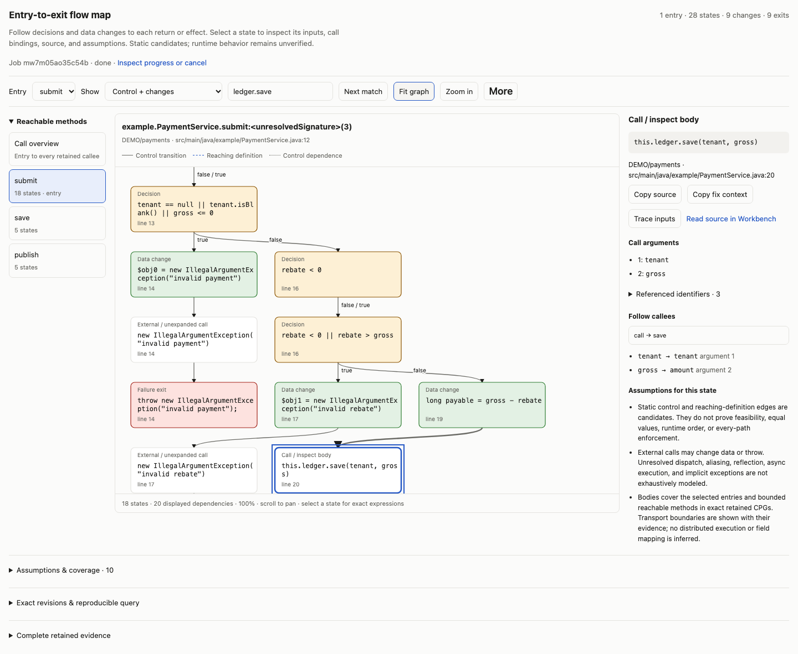
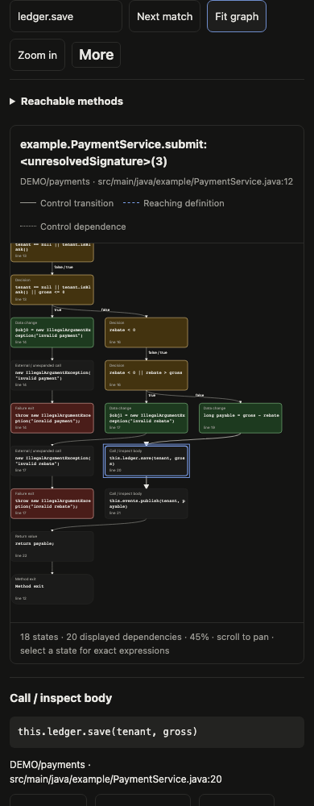

# Entry-to-exit state maps

Use the map to find where a value changes, which predicate controls the next step, and which expression reaches a return or effect. It queries existing retained Joern CPGs. It does not parse implicitly, modify source, publish knowledge, or establish runtime behavior.

In **Admin → Joern & service ports**, select a retained analysis, choose **Map entries to exits**, and search/select the entry symbol. The target picker is hidden because the map discovers reachable bodies and their exits. Review the structured arguments, then choose **Run investigation**. Without an explicit entry, only uniquely bound HTTP ingress, Kafka consumers, or scheduled passport ports become entries. A method with no callers is not automatically an entry. Overloaded selections require a more precise signature.

In chat or the CLI, use the existing semantic tool:

```json
{
  "operation": "flowmap",
  "analysis": "<exact-retained-analysis-id>",
  "from": {"kind": "method", "name": "submit", "file": "src/main/java/example/PaymentService.java"},
  "maxMethods": 20,
  "maxStates": 180,
  "maxHops": 8,
  "waitMs": 1000
}
```

Observe the same job with `semantic_query {"operation":"flowmap","job":"<returned-job>","waitMs":1000}`. Cancel through the existing owned `job_cancel` tool or Admin Jobs. Missing retained analyses report recovery guidance; an unavailable worker never produces fabricated edges from source line order.

## Reading and using the graph

**Call overview** shows the selected entries and every retained callee with positional argument bindings. In the rebate fixture, it makes the discrepancy visible: `gross → amount` at the ledger versus `payable → amount` at the event publisher. Select a method to inspect its state graph. The method list preserves access to all retained bodies without expanding every body into a long chat message.

**Control + changes** keeps method inputs, predicates, assignment and compound-assignment expressions, field writes, increments/decrements, calls, returns, and explicit throws. Intermediate expression nodes are contracted into CFG transitions. The retained transition records include the number of contracted expressions. Loops remain cycles; graph layout uses strongly connected components rather than source-line ordering.

**Control + data dependencies** adds reaching-definition and control-dependence edges. **Data dependencies** shows the local dependency layer alone. Edges remain distinct:

| Relation | Meaning | What it does not establish |
| --- | --- | --- |
| `control` / CFG | Supported transition between retained control states | Feasible execution or exhaustive exception routing |
| `data` / REACHING_DEF | Conservative local reaching-definition dependency, projected to containing states | Equal values, precise object aliasing, or field equality |
| `control-dependency` / CDG | A state is control-dependent on another expression | A universal business invariant |
| `call` | Candidate callee dispatch and positional argument-to-parameter bindings | Runtime dispatch or a context-sensitive return/exception proof |
| `unresolved-exception` | Raw CPG continuation after an explicit throw | Normal continuation after that throw |

The underlying relations follow the [Joern CPG schema](https://cpg.joern.io/). True/false labels require an actual CFG successor plus matching condition/branch evidence, or an immediate short-circuit operand and successor. Other polarities stay unknown. An explicit throw can have a Joern CFG fall-through; the map retains it as unresolved exception evidence and excludes it from normal control paths. It does not invent catch-handler routing.

Select a state for its full expression, source location, changed target, call arguments, callee bindings, boundary provenance and assumptions. **Trace inputs** highlights recorded upstream data/call dependencies; it is not an observed runtime trace. **Read source in Workbench** prepares `code_read` at the retained source index key; review and run the draft. **Copy fix context** includes exact analyses, the selected state, its dependencies and proof limits for a model or another developer.

Passport ports attach to the exact recorded call where possible. A method-only port stays method-scoped with an explicit assumption; it is not silently attached to a similarly named call. Manual boundary declarations and field mappings retain their provenance. Cross-service transport execution is not synthesized. Use a composite Java analysis for a pinned internal-library closure, or select compatible retained library analyses with exact bindings.

## Sharing evidence and fixing a bug

The chat result starts collapsed. Open it for the map or use **Open full view** for more room. Graphs support mouse and keyboard selection, find/next, zoom and fit; scroll inside the canvas to pan. The method list and source inspector work at narrow widths.

The **More** menu exports full retained JSON, the currently displayed SVG with its styles, and a Mermaid graph of all retained method states and dependencies. The SVG is a snapshot of the selected method/overview and layer; JSON and Mermaid include all retained bodies. Copy the pinned query to repeat the analysis. Current passport corrections may differ on a later replay; the saved JSON retains the original overlay identity and port evidence.

Models receive a compact byte-bounded preview by default. Local `s0`/`m0` aliases reduce repeated native identities; exact CPG IDs, source locators and full edges remain in the saved view or `format:"full"`. `previewTruncated` and `omitted` describe preview omissions independently from `truncated`, which describes bounded analysis coverage. Do not treat a missing preview edge as absence of dependency.

For the rebate bug, first run a sensitive failing entry-to-exit regression. A zero-rebate smoke test misses the wrong ledger amount. Check API return, stored amount and event amount with a nonzero rebate. Make the fix in a private workspace, retain its new semantic snapshot, and check the graph plus the same regression. [Branch comparison](joern-branch-comparison.md) remains available for targeted before/after value paths.

## Limits and verification

One map accepts one retained source snapshot per repository. Map different branches independently. Default budgets are 20 methods, 180 states and eight call-depth expansions; maxima are 40 methods, 400 states and 30 expansions. Each named CPG query caps edges at 500, AST scans at 8,000 nodes per method, records at 950, and output at 3 MiB. Ingestion, worker memory, wall-clock deadlines and scoped query caching remain in force. Method/state/edge/output/time limits produce explicit gaps and truncation. Narrow the entry or increase the relevant bound; there is no cursor pretending to cover the rest of an incomplete map.

`complete:false`, `behaviorVerified:false`, and unknown runtime/feasibility are intentional. Dynamic dispatch, reflection, aliasing, external library semantics, implicit exceptions, async execution and distributed field mappings remain limitations. Graphs guide a fix and its regression; they do not replace executable assertions at the exits.

Run deterministic regressions with:

```sh
node --test test/semantic-flow-map.test.js test/workbench-links.test.js test/admin-semantic.test.js test/inline-views.test.js
```

With a real compatible worker configured through `DT_SEMANTIC_LIVE_URL` and `DT_SEMANTIC_LIVE_TOKEN`:

```sh
DT_SEMANTIC_MAP_HOME=work/flow-map/live node --test test/semantic-flow-map.live.test.js
node dev/check-flow-map-browser.js work/flow-map/live work/flow-map/browser
```

The live test creates a disposable Git fixture, verifies the incorrect and corrected argument/field expressions, independent Java behavior before/after the fix, unchanged original analysis, branch polarity, failure exits, loop cycles, compound writes, JavaScript, compact/full evidence and bounded coverage. The browser check uses actual retained results and Open WebUI's native embed HTTP contract; it does not claim a running production Open WebUI installation. See the [portable verification report](benchmarks/flow-map-verification.json).




