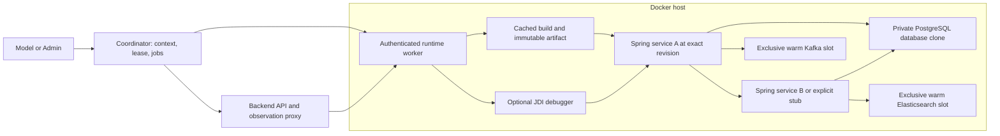
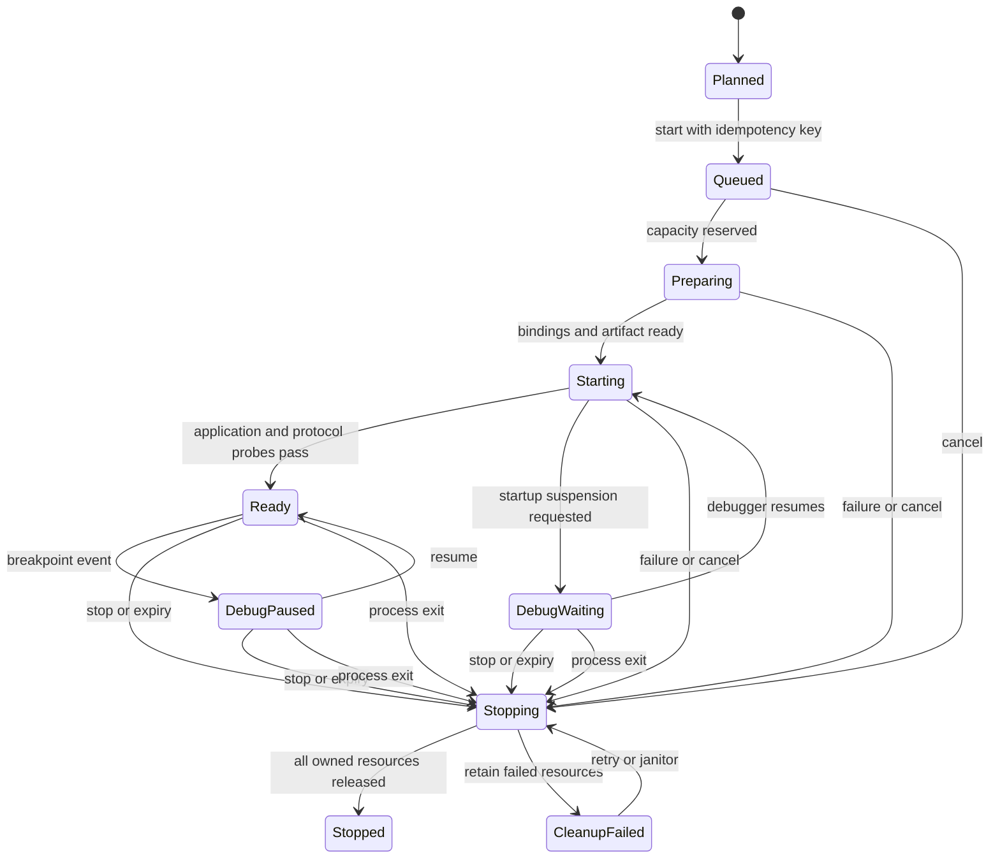

# Fast, model-operated service environments

Historical research/design, 19 November 2026, audited against `63b2454`.
The subsequent [service environment implementation](service-environments.md)
provides persistent definitions/leases, worker supervision, application bindings,
exclusive explicit prewarming, API/query evidence, Admin/inline surfaces and JDI
debugging. The baseline inventory and broader proposals below remain dated
research; automatic pool replenishment, shared namespaces, broader migration
adapters and performance targets are not established by that implementation.

## Recommendation

Add a durable **environment lease** joining an exact source revision, dependency
bindings, running application processes and investigation evidence. Start with
Docker on the existing runner: reuse immutable PostgreSQL templates, keep a
small pool of clean prestarted Kafka/Elasticsearch capacity, and launch Spring
applications in separate JVM containers using cached build artifacts. No image
build per source edit is required.

Allocate only dependencies required by the selected entry-to-exit path. An HTTP
endpoint using PostgreSQL should not pay for an Elasticsearch JVM or Kafka
broker. Passports, application configuration and Joern paths suggest bindings;
a versioned service profile resolves ambiguous names and unsupported resources.
Unknown dependencies stay visible and prevent claiming a complete reproduction.
Include connections opened by startup beans and background consumers/schedulers,
even when the selected request path does not reach them. If the local profile
disables background work, record that assumption in the reproduction definition.

Start with **exclusive, single-use warm slots** for Kafka/Elasticsearch. A slot
is leased to one investigation, then destroyed and replenished asynchronously.
This retains real topic/index names, avoids incomplete state-reset logic and
removes cold startup from the allocation path while spare capacity exists.
PostgreSQL remains a shared scratch cluster with private databases and roles.
Later, offer shared brokers/clusters for services whose full naming surface is
configurable and whose isolation has been tested.

## What already exists, and what is missing

| Capability | Existing implementation | Change needed |
| --- | --- | --- |
| Branch checkout and edits | [`workspace.js`](../lib/workspace.js), `workspace_open/read/write/patch` | Freeze resolved commit plus dirty-file fingerprint for each build; hold workspace retention while leased |
| JVM builds, caches, cancellation | [`runner.js`](../lib/runner.js), [`testrun.js`](../lib/testrun.js), JDK runner in [`docker-compose.yml`](../docker-compose.yml) | Durable service supervision independent of a tool request; artifact staging and launch adapters |
| Prefilled PostgreSQL | [`testdb-templates.js`](../lib/testdb-templates.js), `testdb_template_build`, `testdb_clone`, renew/reset/release/GC | Bind clones to service lifecycle; migration identity and multiple datasource mappings |
| Native PG/ES/Kafka dependencies | [`reproduction-runtime.js`](../lib/reproduction-runtime.js), `fixture_runtime_*` | Warm capacity, parallel preparation and worker-aware endpoints; preserve independent effect checks |
| Native fixtures used by actual tests | [`fixture-runtime-bridge.js`](../lib/fixture-runtime-bridge.js), `test_run.fixture_runtime` | Current bridge accepts local execution only; add a worker-backed adapter rather than pretending a remote loopback address is local |
| Executable scenarios | [`scenario-runtime.js`](../lib/scenario-runtime.js), [`scenario-package.js`](../lib/scenario-package.js) | General Spring service/session adapter; current isolated service adapter is Node, JVM path runs project tests |
| API calls, scripts and collections | [`api-client.js`](../lib/api-client.js), [`scripts.js`](../lib/scripts.js), [`collections.js`](../lib/collections.js) | Select owned runtime bindings for HTTP/PG/ES/Kafka steps without creating permanent catalog environments |
| Scope, jobs and telemetry | [`access.js`](../lib/access.js), [`jobs.js`](../lib/jobs.js), [`execution.js`](../lib/execution.js), [`telemetry.js`](../lib/telemetry.js) | Environment ownership, resume permission, lifecycle events and per-stage resource/latency metrics |
| Java debugging | No JDWP/JDI breakpoint tooling found | Optional debugger agent and bounded structured operations |

The current native adapter starts PG, then ES, then Kafka, and seeds ES documents
and Kafka records individually. It requires already available images, starts an
owned bridge, publishes loopback ports and retains ownership/expiry evidence.
It does not launch arbitrary Spring services itself. Its recorded cold startup
was **149,245 ms**, with a preceding **177,158 ms** sample on the shared 8 GB
Docker VM. These are historical observations, not new measurements or guarantees;
see [native fixture runtime](native-fixture-runtime.md) and
[retained evidence](evidence/native-fixture-readiness.json).

There is also a deployment boundary: `dt` has no Docker socket in the standard
Compose configuration; the authenticated **runner** has it. The native adapter
executes Docker locally and its test bridge explicitly rejects runner targets.
The new implementation must put Docker ownership and protocol probes on a
runtime worker. Installing a Docker CLI in `dt` alone will not fix this.

`runner.exec` currently kills its child when the response disconnects and keeps
process handles in memory. `workspace_terminal` supports bounded commands, not a
durable service daemon. Neither should be used with `nohup` as the supervisor.

## Runtime and networking

Prefer sibling application containers on the lease's user-defined bridge.
Services use names such as `postgres:5432`, `kafka:9092`, `search:9200` and
`billing:8080`, scoped to that environment. Docker user-defined bridges provide
name resolution between attached containers; their IPs need not be recorded in
passports. See [Docker bridge networking](https://docs.docker.com/engine/network/drivers/bridge/).

Every binding needs its **audience**, not one universal host string:

| Caller | Binding |
| --- | --- |
| Service inside the environment | Bridge DNS and container port |
| Protocol observer on the worker | Join the bridge or use an explicitly reachable published endpoint |
| JVM intentionally launched on the Docker host | Published host ports; use the configured host address if the caller is in another container |
| Remote coordinator | Authenticated worker operation/proxy, not the worker's `127.0.0.1` |
| Browser/Open WebUI | Stable backend API URL; requests and credentials stay on the backend |
| Developer IDE | Explicit loopback publication or forwarded JDWP endpoint |

On Docker Desktop, `host.docker.internal` addresses the host from a container;
on Linux the existing runner already supplies the `host-gateway` mapping. A
service bound only to host loopback is not automatically reachable through that
mapping. Prefer the bridge topology; host-JVM mode must probe each direction.
See [Docker Desktop networking](https://docs.docker.com/desktop/features/networking/networking-how-tos/)
and [port publication](https://docs.docker.com/engine/network/port-publishing/).

Kafka needs special handling: bootstrap connectivity alone is insufficient.
The broker returns its advertised listener addresses to clients. Configure a
bridge listener for container clients and a separate host listener when host
clients are needed; actually produce and consume from each audience before
declaring readiness. Do not advertise `localhost` to sibling containers. See
[Kafka broker configuration](https://kafka.apache.org/41/configuration/broker-configs/).

Do not bind-mount a runner-container path into a sibling container assuming it
is a Docker-host path. Docker resolves bind sources on the **daemon host**.
Stage immutable application artifacts into an owned named volume using a
fixed worker helper, or transfer them through the Engine archive API. A remote
worker needs content transfer by digest. See
[Docker bind mounts](https://docs.docker.com/engine/storage/bind-mounts/).

Local HTTP service lookup should be a lease overlay, separate from dev/UAT
Consul. Disable live registration/config imports for the local profile, map
dependent service base URLs, or supply a private Consul instance when the
application actually requires discovery. Spring Cloud has a separate discovery
disable setting; configuration loading must also be accounted for. A cached
passport does not prove that every runtime endpoint has been overridden. See
[Spring Cloud configuration](https://docs.spring.io/spring-cloud/docs/current/reference/htmlsingle/spring-cloud.html).

For the shared scratch PG cluster, give each lease a reachable worker-side
binding or fixed bridge gateway and its private database/role. Do not attach
every application to the entire dt control network just to resolve `testdb`.
The application, observer and coordinator can use different addresses for the
same database; record and probe the correspondence.

## Fast preparation without sacrificing fresh state

### PostgreSQL

Use the existing content-addressed template and private-role lease contract.
Template identity includes fixture SQL, migration/seed policy, server
compatibility, extensions and locale. Preserve verified bases across branches
when those inputs are identical. New schema/data inputs create a new base;
updating an index or template must not invalidate running environments.

On the currently configured PostgreSQL 16 baseline, `CREATE DATABASE ... TEMPLATE`
copies database storage; it is not an O(1) database branch. The default `WAL_LOG`
strategy and `FILE_COPY` have different I/O/checkpoint costs. Benchmark both
where supported before changing the implementation. Templates cannot have active
connections while copied. Keep them frozen as today. See
[PostgreSQL 16 CREATE DATABASE](https://www.postgresql.org/docs/16/sql-createdatabase.html).

Use small, coherent captured datasets first. For larger fixtures, optionally
prepare unused clean clones in the background, record their exact template
identity and assign them atomically; create/rotate the private application role
at allocation. Keep clone count and storage bounded. This moves copying off the
critical path at the cost of spare disk; it does not remove copying.

Current scratch lifecycle work is serialized under one PostgreSQL advisory
lock, including template construction. Keep that safe default initially, expose
queue time, and prepare templates outside interactive traffic. Concurrent copy
work needs narrower reservations/fencing and a measured I/O budget before
loosening the lock. Template construction/deep verification scans data and
aggregates row hashes; large-fixture work should use bounded hashing and remain
off the hot allocation path. Ordinary clones already avoid deep rehashing.

Distinguish snapshot-schema replay from **branch migration** runs. Apply branch
migrations to a fresh compatible base before starting the service, with a
separate migration role where required; do not disable Flyway/Liquibase and
then claim to have tested a schema change. Record the applied migration set.
The existing template contract rejects some fidelity cases, including RLS,
security-definer ownership and foreign tables; use a dedicated compatible
adapter when those are required. Reset means stop/reconnect application clients
and replace the clone, including effects from asynchronous writes.

### Kafka

Provision declared input/output/retry/dead-letter topics in batches, including
partition counts and applicable configs. Poll metadata/leader readiness and
await consumer assignment before publishing an action. Admin topic operations
can partially succeed and metadata can lag completion; compensate using the
owned-resource manifest. See [Kafka Admin API](https://downloads.apache.org/kafka/4.1.2/javadoc/org/apache/kafka/clients/admin/KafkaAdminClient.html).

Shared-broker mode must map **topics, groups, transactional IDs, Streams
application IDs/internal topics and schema-registry subjects**, not just topic
prefixes. A new group alone does not isolate writes. Hardcoded names, regex
subscriptions, unmanaged auto-created resources and cluster-wide mutations
require exclusive capacity. Give each iteration new names rather than deleting
and immediately recreating the same topic. Stop all clients before releasing
resources; preserve fixture source offsets separately from replay offsets.

The current adapter uses Redpanda. Keep that explicit as one compatibility
profile, and offer matching Apache Kafka versions for broker-specific,
transactional or Streams regressions. Protocol compatibility is not identical
broker behavior; [Redpanda documents exceptions](https://docs.redpanda.com/streaming/current/develop/kafka-clients/).
Avro/protobuf and schema registries remain explicit additional dependencies.

### Elasticsearch

Bulk-load small fixtures and check every bulk item, then wait for one visibility
barrier. Avoid one refresh/wait per document; a disabled refresh interval also
requires an explicit final refresh. See [Elastic refresh behavior](https://www.elastic.co/docs/reference/elasticsearch/rest-apis/refresh-parameter).

For larger seeds, evaluate immutable base indices plus `_clone` on the same
cluster. The source must be read-only and green; clones may hard-link segments,
but copy them when unsupported, and aliases/other metadata require explicit
restoration. Wait for recovery and make the destination writable before use.
This optimization requires retained base capacity, so it belongs to a later
reusable-slot adapter, not the initial single-use pool. See
[Elasticsearch index cloning](https://www.elastic.co/docs/api/doc/elasticsearch/v8/operation/operation-indices-clone).

Shared-cluster mode needs per-lease indices **and aliases**, templates, pipelines,
ILM policies and any application-owned scripts. Hardcoded aliases or operations
over broad wildcards require an exclusive slot. Cross-cluster large-seed replay
can use supported [snapshot/restore](https://www.elastic.co/docs/deploy-manage/tools/snapshot-and-restore)
with version checks and deliberate metadata selection; copying a live data
directory is not the proposed restore interface.

### Application build and startup

Build using the project's own Maven/Gradle wrapper and annotation processors,
including Lombok. Reuse dependency artifacts and compatible build outputs. Key
application artifacts by source/dirty digest, build files, resolved dependencies,
toolchain and build parameters; branch names alone are insufficient. Preserve
debug line/local-variable metadata and match source/jar revisions when debugging.

Use a compatible preloaded JDK image and start the packaged Boot jar, or an
explicit compiled classpath adapter for projects without a bootable jar. Set
UTF-8 locale before JVM startup and bounded heap/CPU/process limits. Separate
build-time credentials from application bindings. A source edit creates a new
artifact and explicit restart; a running JVM is not silently reclassified as the
latest workspace version. Reuse the real build for final verification rather
than relying solely on incremental compilation.

Parallel build and dependency allocation can overlap once capacity is reserved.
PG/Kafka/ES preparation should run concurrently within host admission limits,
with compensation after any failure. Preserve stage timings so concurrency
does not hide a resource bottleneck. Independent Gradle build containers should
use private writable caches and a compatible preseeded read-only dependency
cache; blindly sharing a writable Gradle home across containers is unsupported
when their processes cannot communicate. See [Gradle dependency caching](https://docs.gradle.org/current/userguide/dependency_caching.html).

## Lifecycle, persistence and observability

This is a proposed environment lifecycle, not a new shipped state machine.
Record outcome separately from cleanup status, so a failed application whose
resources were removed remains a failed run. Maintain service and dependency
substates rather than overloading one status with every detail.

The worker owns processes/containers after an HTTP/WebSocket call ends. A
disconnect stops observation, not the environment; cancellation is explicit.
Persist owner, context/task link, worker, lease generation, exact source and
artifact digests, dependency IDs, expiry, observed readiness, events and cleanup
errors. Workers reconcile the journal with labeled resources after restart.
An expired/inconsistent slot is quarantined until stopped and verified; a stale
worker generation cannot release or return someone else's capacity. The janitor
uses an explicit owned-resource maintenance path, not a guessed chat identity.

Keep a reproducible, credential-free definition in context files; retain private
runtime records and secret bindings in the scoped backend. A new chat can
explicitly resume an authorized context/lease without losing resources or
automatically joining another user's environment. Published definitions remain
separate from private execution results. Record evidence before cleanup, and
retain it after containers disappear.

Reuse current jobs and WebSocket events for accepted/queued/stage/log/ready/error/
stopped updates, with sequence cursors and a status-poll fallback. Measure queue,
template/cache hit, allocation, seed, compile, JVM readiness, action, observation
and cleanup durations, plus RSS/CPU/disk and pool occupancy. Propagate trace
context through worker commands and supported application instrumentation;
otherwise label correlation as run/time based. Model calls are unnecessary for
the deterministic provisioning path.

Internal URL access can remain permissive as requested. For reproducible
scratch runs, explicitly select local dependencies/stubs and expose any live
dependency as such; never silently fall back to dev/UAT when local startup fails.
The current bridge permits outbound traffic, so it is not an egress sandbox.
If strict local-only execution is selected, enforcement belongs on the worker
network/proxy, not merely in environment-variable naming.

## Model tools and the human workbench

Proposed thin registry surface; keep detailed schemas behind discovery:

| Proposed tool | Purpose |
| --- | --- |
| `service_env_plan` | Source revision, required bindings, reusable bases, gaps, resource estimate and next operation; cached discovery first |
| `service_env_start` | Idempotent job allocating an environment and launching one or several service workspaces |
| `service_env_status` | Scoped list/detail, stage/progress, exact revisions, expiry, binding names and evidence links |
| `service_env_logs` | Bounded, filterable log tail with cursors; full artifacts stay outside model context |
| `service_env_control` | Explicit stop, renew, restart or fresh-state reset with expected generation |
| `service_debug` | Attach, breakpoint CRUD, wait event, bounded stacks/locals, step, resume and detach |

Extend existing HTTP/SQL/ES/Kafka and collection tools with an **owned runtime
target**, resolving bindings server-side. Reuse existing query semantics and
visualizations; do not require models to copy passwords or edit `config.json`
for every short-lived database. Existing tools do not yet accept this new target.

A concise result should state environment ID, phase, changed service revision,
dependencies ready/total, elapsed time and the next useful call. Full logs,
config diffs and resource manifests belong in retained results and collapsed
details. `Ready` means the application has passed probes; distinguish it from
`dependencies-ready`, `waiting-for-debugger`, `consumer-not-assigned` and
`started-but-unhealthy`.

Proposed workbench story: task/context tree → **Run service locally** → review
detected dependencies and editable bindings → Start/Cancel → Open API client,
Logs, Databases, Events, Debug, Restart, Reset, Stop and Renew. Display source
SHA, dirty digest, actual runtime version, resource usage, TTL and live/stub/local
badges. Save the definition and action collection under a human-readable name.
This is an implementation requirement, not a new UI delivered by this research.

## Breakpoints and entry-to-exit evidence

Enable optional JDWP when launching a service. For a container JVM,
`-agentlib:jdwp=transport=dt_socket,server=y,suspend=n,address=*:5005` listens
inside that container; keep host publication loopback-only or forward it through
the worker. Host-JVM mode can bind directly to loopback. Startup debugging uses
`suspend=y` and a distinct waiting state, not a false healthcheck failure.
Spring Boot Maven launches a forked application, so its debug arguments belong
in `spring-boot.run.jvmArguments`, not just the Maven JVM. See
[Spring Boot run](https://docs.spring.io/spring-boot/3.5/maven-plugin/run.html)
and [JPDA connection options](https://docs.oracle.com/en/java/javase/21/docs/specs/jpda/conninv.html).

Use a small JDI helper with structured JSON commands/events rather than parsing
an interactive terminal indefinitely. Method or file/line breakpoints should
report unresolved/generated-source locations, exact loaded class/jar identity,
thread, stack and bounded locals. Default to event-thread suspension, bound the
pause duration, and resume/detach on teardown. Pausing can change HTTP deadlines,
Kafka rebalances and lock timing; report this perturbation. Arbitrary expression
evaluation is unnecessary for the first version. JDK `jdb` can serve a manual
smoke check; its [official commands](https://docs.oracle.com/en/java/javase/21/docs/specs/man/jdb.html)
cover attachment, breakpoints and stepping.

Joern/passports propose path locations and assumptions; runtime observations
establish what actually executed. Compare the same named action/fixture against
two pinned revisions in **separate environments**. Record HTTP response, committed
SQL changes/procedure results, produced Kafka events, ES effects and actual
breakpoint/trace hits. A reached exit or a green healthcheck alone does not prove
that all conditional paths were exercised. Prefer outside-in actions and real
dependency observations over generated mocks for this workflow.

## Alternatives and implementation sequence

| Approach | Fit here | Decision |
| --- | --- | --- |
| Cold Compose per investigation | Simple isolated reference; startup/build/seed costs remain | Keep as reproducible fallback and benchmark baseline |
| Warm exclusive slots + PG template leases | Preserves application names and existing ownership checks; costs spare RAM/disk | First implementation |
| Shared Kafka/ES with per-lease namespaces and permissions | Efficient for many concurrent runs; full naming/config isolation required | Add only for compatible service profiles |
| Testcontainers reusable mode | Useful local project option, but experimental and documented as unsuitable for CI | Do not use as the durable multi-chat lease manager; see [official guidance](https://java.testcontainers.org/features/reuse/) |
| Kubernetes namespaces or VM/storage snapshot branching | Potential later adapters when placement, storage or fidelity require them | Defer until worker and benchmark contracts justify the added platform |

1. **Service lifecycle vertical slice:** exact workspace artifact → existing PG
   template clone → Spring start/readiness → backend API → logs/SQL → stop.
   Implement worker ownership/endpoints and durable restart recovery first.
2. **Fast dependencies and multiple services:** clean warm slots, bounded parallel
   preparation, Kafka metadata/consumer readiness, ES bulk seeding, local URL
   overrides/private discovery, collections and separate before/after leases.
3. **Investigation surface:** runtime target pickers, retained named definitions,
   context resume, model discovery examples, Admin/inline progress and results.
4. **Debug and optimization:** JDI operations, internal-library breakpoint case,
   pooled unused PG clones, then compatible shared namespaces/ES clone adapters
   if measurements show the need.

## Experiments and release gates

No new startup benchmark was possible during this research: the local Docker
server probe timed out at a five-second deadline. No remote deployment was
changed. The numbers above come from checked-in historical evidence.

Benchmark on the intended Docker host, recording OS/architecture, image digests,
PG/broker/ES/JDK versions, host capacity/load and fixture bytes. Report cold image
pull separately from cached-image cold startup, warm allocation, cache-hit build,
edited-file rebuild and reset. Run sequential and 2/4-concurrent cases; report
p50/p95 and errors across repeated samples. Measure PG bases at small, 100 MB
and 1 GB sizes so template copies and lock queueing cannot hide behind tiny
fixtures. Include bulk ES and Kafka replay volume, not just empty startup.

Initial **acceptance targets to validate**, not promised performance: warm small
dependency allocation p95 ≤10 s; cached-artifact application-ready p95 ≤30 s
excluding compilation; immediate job acknowledgement with stage feedback; idle
environment stop/cleanup p95 ≤10 s. Publish failures and cold fallback timings
even when a warm pool misses. Size the pool from observed memory and peak active
leases; the current 8 GB test VM evidence does not establish four-full-stack
capacity.

Required real integration cases before release:

- REST → procedure/table regression across two branches; prove old failure and
  fixed result against identical independently cloned fixture state.
- Kafka → service A → service B → PG/ES, including retry/dead-letter handling;
  prove consumer readiness, actual outputs and no cross-run contamination.
- Internal-library handler inheritance with exact library source/jar and a
  real breakpoint hit, then resume without leaking a suspended process.
- Two users/tasks using the same service/topic/index names; reject cross-owner
  observation/control and stale-generation stop/reset, while preserving explicit
  authorized resume after a chat disconnect.
- Startup failure, port conflict, unavailable internal dependency artifact,
  unknown datasource, broker metadata delay, process exit, cancellation during
  provisioning, coordinator/worker restart, expiry and retryable cleanup failure.
- Prove each network audience from the actual Compose deployment and a remote
  worker; include Kafka metadata addresses, browser proxy, artifact transfer and
  matching database/consumer observations, not just direct host curl.
- Hash/revision-sensitive artifact reuse, branch migrations, Lombok generation,
  UTF-8 filenames, multi-datasource bindings, clean reset and retained evidence
  after stop. Run the existing fixture observers/ownership tests unchanged.

The first demo should let a small model discover the lifecycle from an ordinary
bug prompt, reproduce an HTTP-to-database failure, change source, restart with
fresh state and demonstrate the fix using saved actions. Grade actual effects,
call count, output size, time and cleanup independently; successful tool
invocation alone is insufficient.
