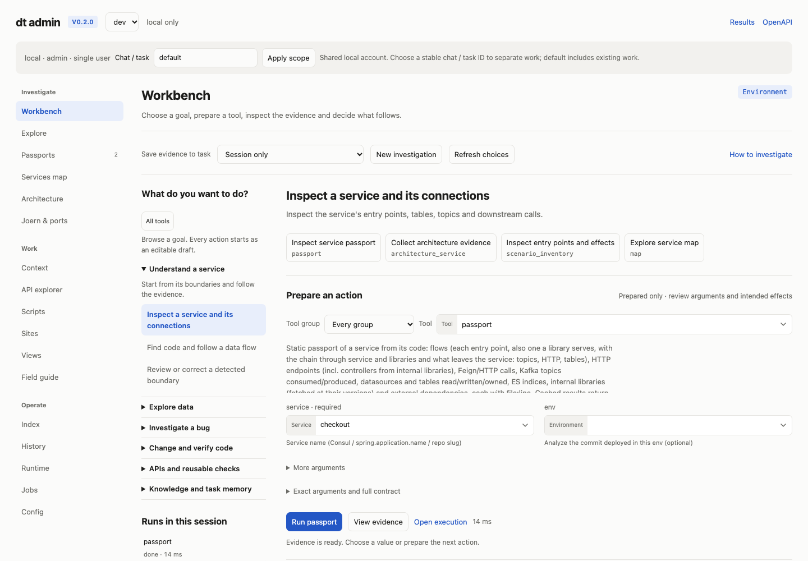
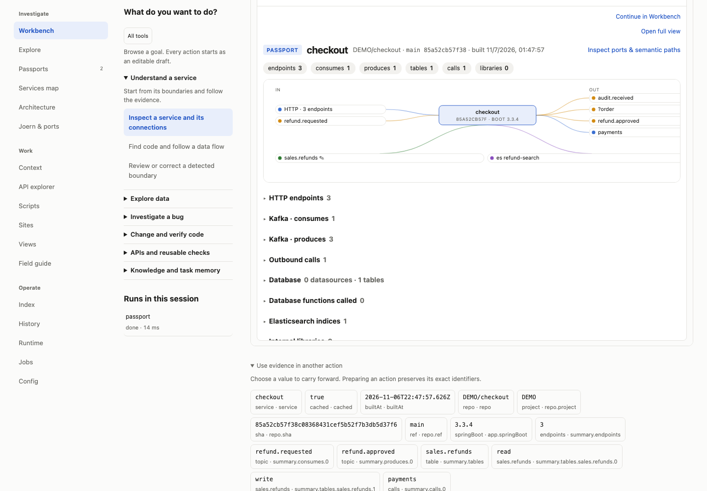

# Click-through investigation workbench

Open `/admin` to start in **Workbench**. The left navigator switches between
**Contexts**, **Services** and ticket/task groups, with nested files and related
workspaces. Use the [object workbench walkthrough](workbench-explorer.md) for
branch navigation, source editing, saved queries/scripts and live service actions.
For goal discovery, expand **Browse goals and all tools**. Pick a goal, review the
prepared tool, choose known names, and click **Run**. Preparing a tool, selecting
a value, asking for help and opening a saved link never execute a suggested call.
The specialist Admin tabs remain available for deeper editing and configuration.

## First investigation, using the mouse

1. Choose **Inspect a service and its connections**. Open the **Service** picker
   with its arrow and choose a cached service. If the catalog is absent, choose
   **Prepare cached index**, then **Run catalog_sync**. This preparation uses
   retained source metadata; refreshing live systems is a separate selection.
2. Optionally choose **New investigation** to save subsequent invocation records
   to a private task folder. Its files are available in **Context** and file tools.
3. Click **Run passport**. Leaving its optional environment unset opens the
   cached passport. Selecting a deployed environment explicitly can start a new
   source analysis. Inspect the native result and the actual source revision.
4. Under the evidence, choose a table value and **Inspect table**. The object
   picker also browses exact `database:schema.object` identities. Follow with
   **Find readers and writers**.
5. Choose **Prepare a SQL query**, browse a table, then choose **Preview 20 rows**
   or **Count rows**. The template quotes identifiers and selects the table's
   database. Review the query before running it against the selected environment.

Existing identifiers and these prepared queries can be selected without typing.
New notes, unknown identifiers, custom queries and new object-property names
still accept text. The UI does not invent missing names to make a flow appear
complete.

## Find and edit any enabled tool

Expand another intent group or use **All tools**, the group selector and the
tool picker. Blank pickers browse known values; typing filters them. **Load more
choices** continues a page. Catalog pages display their retained generation.
An unavailable source, missing index or failed lookup is shown beside the choices
with a retry or preparation path; the existing input remains editable.

The same schema forms are used in Context, Runtime and the Field guide. They
support nested objects, arrays with Add/Remove controls, alternative shapes,
typed enums, booleans and nullable values. **More arguments** contains secondary
fields. **Exact arguments and full contract** exposes the actual schema and JSON;
after editing JSON, use **Apply JSON to form** before running. Form validation
uses the registry's shared schema validator, and the server validates again.

SQL fields offer keyword/identifier completions and insertion controls. Code
fields offer syntax and an enabled-tool selector that inserts the real sandbox
`tools.call(name, arguments)` API. A template is a starting point: review its
required arguments before running it. File-store pickers can descend through
folders and return to their parent. Remote store browsing uses ordinary
authorized file-list calls and can contact the configured store.

## Progress, recovery and evidence

Runs are owned jobs with local progress, a Cancel button and **Open execution**
for logs, child work and cleanup details. Cancellation can take time to settle.
A tool may itself return a background job; **Observe background job** prepares
its poll call and **Cancel background job** requests cancellation of that job.
An invocation finishing successfully does not prove application behavior passed.

The run history retains earlier evidence during the current session, including
when another action fails. A save error is shown separately from tool success;
do not repeat an effectful action just to save its result. If submission or
polling loses its response, inspect Runtime before retrying.

Choose a short identifier in a result to carry it into a prepared follow-up.
Only the tool's declared arguments are populated; unrelated job identifiers do
not silently become a new tool's job. Inspect ambiguous values before running.
Previews are bounded; **Open full result** and the saved invocation record retain
the available full evidence. Existing result retention/size limits still apply.

**Copy run link** reopens the owned run without replaying it. **Download recipe**
exports the selected tool, exact redacted arguments, source and result link as
JSON. It is a portable call description, not an assertion that replay is safe or
that an independent expected outcome has been defined. Set expectations and
restore needed credentials before preparing a repeat.

Sandboxed inline results, including those shown in Open WebUI, offer **Continue
in Workbench** beside **Open full view**. Authenticate with the owning account
to inspect the result in its task scope. A public read-only result capability
does not grant access to another user's task workspace or execute an action.

## Optional model help

Configure `llm.baseUrl`, `llm.model` and, when needed, `llm.key` in the normal
configuration. **Suggest next action** and **Interpret this result** send a bounded,
redacted question, selected arguments and available evidence to that model.
The UI explains when no model is configured or the credential lacks access.
Suggestions contain editable arguments, missing facts, validation issues and
uncertainties. Click **Prepare** to inspect one, then separately choose **Run**.
The optional automatic interpretation checkbox starts unchecked. **Cancel model
help** aborts that request while preserving the draft and tool evidence.

Model output is untrusted text. It cannot run tools, publish shared knowledge,
choose an unavailable tool or turn a successful invocation into proof of a fix.
Invalid responses and model/network errors leave manual follow-ups available.

## Scope and limits

The Workbench uses existing tool grants, environment grants, private tasks and
job ownership. Switching tasks clears displayed evidence and pending selectors;
stale responses cannot repopulate the new scope. Switching environment does not
cancel an already accepted job: inspect it in Runtime in its original environment.
The tool registry is authoritative; configured plugins and custom tools appear
with their actual schemas. Unsupported or deeply nested contracts retain exact
JSON as an escape hatch. A mouse workflow is offered for indexed values and
prepared operations; arbitrary domain-specific code still needs authored input.

## Verification

`test/workbench.test.js` checks helper HTTP authentication, grants, retained
catalog pages, ownership, validation before effects, redaction, evidence capture,
failure separation, cancellation and a local synthetic model provider.
`dev/check-workbench-browser.js` exercises the mouse-driven service/data path,
recursive forms, code completion, model suggestions/interpretation, cancellation,
failure recovery, saved links, inline continuation and task changes in Chromium.
These are fixtures; they do not claim fresh Joern parsing, production database
queries or quality measurements against a real model.

Run the disposable browser fixture and checks:

```sh
DT_DEMO_WORKBENCH=1 node demo/ui-ux.js 4064 work/workbench/fixture.json
# In another terminal:
node dev/check-workbench-browser.js work/workbench/fixture.json work/workbench/browser
# Add --screenshots for the desktop/mobile evidence batch.
```

The model helper and catalog in this fixture are explicitly synthetic. No real
credentials or configured production endpoints are used.





[Mobile discovery](screenshots/workbench-mobile.png) ·
[Mobile evidence](screenshots/workbench-evidence-mobile.png)

The independent finish review identified seven issues, all addressed in the
final pass: stale SQL table selection, unreachable picker pagination/retry,
actionable stale choices, missing focus/scroll destinations, model controls
preceding evidence, advanced defaults crowding the main form, and unexplained
task-folder lookup failures. The native passport preview also exposed a CORS
failure in opaque-origin frames. Passport results now retain the effective owned
snapshot, which the existing passport page can read without task headers or
loosening its sandbox. Editing still goes through authenticated Admin controls.
Browser assertions cover actual snapshot content, keyboard pagination and stale
SQL selection; screenshots wait for the rendered frame to paint.

## UX review and resulting changes

| User task | Current gap | Working interaction |
| --- | --- | --- |
| Choose a starting point | Index is the default; hints are a tool-name excerpt | Workbench opens with a browsable intent tree and concrete preparation buttons |
| Select an identifier | Exact names must often be copied into text fields | Searchable, prefixed pickers browse cached services, repositories, tables, topics, files and owned work |
| Supply arguments | Nested objects/arrays require JSON | Shared recursive forms expose property, item and alternative controls; exact JSON remains available |
| Write a query or short script | Syntax and identifiers must be remembered | Insert buttons and contextual completions offer syntax, indexed identifiers and concrete tool-call templates |
| Run and recover | Initiating screens show little progress | A private job provides local progress, execution link and cancellation; previous evidence survives a failed attempt |
| Decide what follows | Results must be translated back into tool arguments | Clickable evidence values, prepared follow-ups and workflow stages carry selected facts into the next form |
| Get model help | Suggestions require a saved context and interpretation has no direct control | Explicit Suggest next action / Interpret result buttons send bounded redacted evidence to the configured model |
| Resume or share | Selected state is fragmented | Owned run links reopen evidence without replay; task capture and downloadable recipes preserve the selected work |

## Surface contract

Operate mode. Preserve the restrained palette, system type, specialist pages and
native sandboxed inline views. Use a compact intent rail beside a working area;
stack them on small screens. Put progress next to Run, keep actionable errors
visible, and disclose exact contracts and raw records. Indexed browsing must work
with an empty search string and a mouse. Typing remains available for new names,
free-form notes and custom code; an absent index is an explicit empty state.

The workbench uses the same authorized registry, validation, source environment,
private task scope, execution engine and result renderers as ordinary tools.
Selecting a candidate or opening evidence never executes it. A successful tool
invocation is separate from its application verdict and evidence-save outcome.
Models suggest editable actions and explain uncertainty; they do not execute or
publish. Shared knowledge publication remains an admin operation.

## Acceptance cases

- Without typing: choose a service, inspect its passport, select a table from
  indexed choices, inspect usages and prepare a read-only query.
- Browse every enabled tool by group, add/remove nested arguments and array
  entries, and inspect the resulting exact JSON.
- Reuse an actual result value as a named argument; preserve an ambiguous or
  missing identifier instead of inventing it.
- Run, inspect progress, cancel owned work, recover from a failure and reopen the
  preceding successful evidence.
- Use explicit model help with editable validated suggestions, including an
  unavailable model, invalid model response and server error.
- Switch task/environment without rendering an older response into the new
  scope. Reopen an owned run link without rerunning it.
- Verify desktop/mobile layouts, keyboard operation, native inline rendering,
  grants and cross-user isolation with disposable fixtures.
