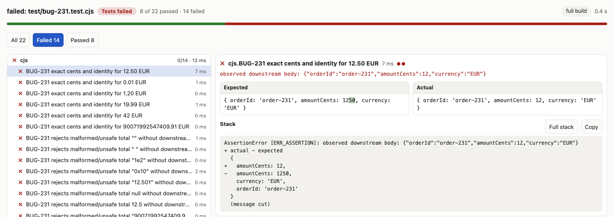
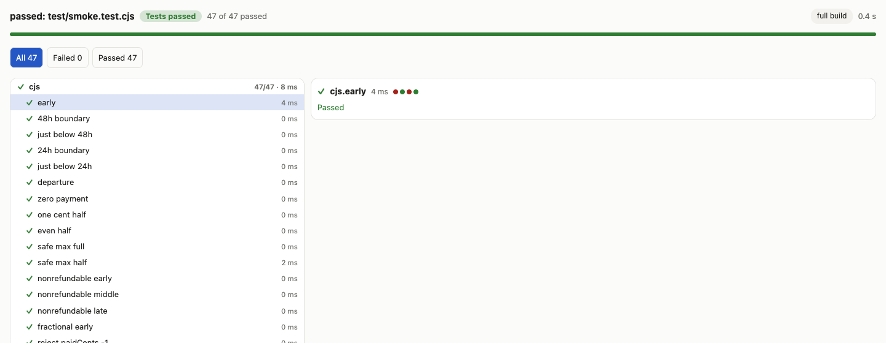

# Novice task review: a lost tester and developer

Reviewed 2026-11-05 against published commit `9e6de38`. Two fresh independent
agents started from under-specified colleague messages, public documentation
and Admin. They did not read the earlier review, implementation, solutions or
acceptance graders. This is a task-based novice-role exercise, not a study of
human novices or a measurement of an autonomous production model.

Both completed useful local work. The tester scored the experience **8/10**;
the developer scored it **9/10**. Their actual tool calls and application tests
support those task outcomes. Both found the same two P2 problems in the Node
workflow. Those findings remain open; this review does not change application
behavior or claim those problems are repaired.

[Tester’s independent report](reviews/task-review-2026-11-05/tester/review.md) ·
[Developer’s independent report](reviews/task-review-2026-11-05/developer/review.md) ·
[Machine-readable summary](../benchmarks/handbook-task-review.json) ·
[Frozen task cards and input hashes](reviews/task-review-2026-11-05/plan.json)

## What they were given

| Role | Initial colleague message | Authorized outcome |
| --- | --- | --- |
| Tester, BUG-231 | “Customer entered 12.50 EUR but reservation history showed 0.12. Might be display or rounding. Can you test it and leave a useful bug report and regression checks? I don’t know the right component. Repo: NOVICE/checkout-boundary.” | Discover the contract; reproduce and leave regression evidence and a handoff. Tests-only source changes; no application repair. |
| Developer, TASK-318 | “Booking cancellation quote currently throws. We need to show what the customer gets back before they cancel. Early refundable bookings should return everything, closer departures about half, late ones nothing; don’t change the booking. Repo: NOVICE/booking-policy.” | Resolve expectations from available evidence, demonstrate the original failure and deliver a tested local patch. |

The task owner copied the original tracked C02 and C07 incident projects into
fresh cached Git repositories, added a Node package test command, and indexed
them. Original incident notes, contracts and source were available through the
product; no solution or prewritten regression was supplied. The vague initial
messages did not contain all requirements. Reviewers had to discover the
repository evidence and state what it still left uncertain.

They used separate stories, owned disposable workspaces and context folders.
All task source reads/writes and tests went through dev-tool APIs. Browser
walkthroughs covered scope selection, the relevant handbook chapter, native
results and patch review. There was no direct fixture-file editing or shell
test bypass. The baseline stayed unchanged throughout the review.

## What was actually achieved

| Evidence | Tester | Developer |
| --- | --- | --- |
| Contract discovery | Incident and API contract establish exact decimal strings, integer cents, identity preservation and no downstream request on malformed totals | Incident establishes confirmed/refundable rules, 48/24-hour thresholds, half rounded down, valid amounts/minutes and no mutation |
| Exact source | NOVICE/checkout-boundary at `9407344605f9e9ff5e49d1076d77b6bcb69526dd` | NOVICE/booking-policy at `ebdcfddc1d57b417a343d07ae7526bad9e619d98` |
| Original test state | One skipped placeholder, explicitly rejected as proof | Skipped placeholder replaced with independent regression checks |
| Final original-source run | 22 executed: 8 passed, 14 assertion failures, zero errors/skips | 47 executed: 31 passed, 16 failed, zero errors/skips |
| Repair evidence | Application source deliberately unchanged; a real in-process call sends 12 cents where 1250 are required | Same selector and identical test bytes after repair: 47 passed, zero failures/errors/skips |
| Test sensitivity | Exact amounts/types/identity, safe-integer boundary, malformed totals with no call, direct receiver checks | Exact time/rounding boundaries, invalid inputs, writable-object preservation and frozen input; an earlier weaker iteration was superseded |
| Delivery | Tests-only patch, bug report, exact run/target evidence and saved task context | Two-file patch, unchanged test SHA256, before/after evidence and saved completed task context |
| Product API calls | 25, including one rejected unsupported preparation call | 30, including five rejected calls; three were reviewer argument mistakes |
| Reviewer score | 8/10 | 9/10 |

The developer’s final test SHA256 is
`ff6c4546226609eb9fabcd33726f867e585d567551f0bf5bc70b600b24440a30`.
The final patch SHA256 is
`0a4185ba46a91196965e46ba8e46426ba2b155610f4f5d91a7bba19a85ee10cd`.
The earlier 46-check iteration is retained in the transcript but is superseded
by the 47-check original/repaired pair. Original negative checks passing
because a stub always throws do not prove its validation was correct.

Both used the reviewed `local` Node target, not a deployed environment.
`mode=build` selected the final test execution, but there was no separate Node
compile/build command. Both retained exact identities, selectors, counts,
limitations and next actions in private task memory and verified the saved
handoff. Their contexts and workspaces were separate. No runtime dependency
lease or remote application mutation was needed; workspaces were intentionally
retained for review.

## Open findings and repair priorities

| ID | Priority | Observed problem | Practical repair and regression check |
| --- | --- | --- | --- |
| NTR-01 | P2, both reviewers | The handbook sends users to `test_context` before tests. A known `.cjs` source file gets “no class” and passport/library-fetch advice, despite working Node execution. | Detect Node/file targets and supply appropriate context, or state the JVM preparation boundary with an exact source/package/test-file fallback. Verify that a Node file never prompts an irrelevant library fetch. |
| NTR-02 | P2, both reviewers | `workspace_patch` returns `tests:[]` after actual Node tests. Both a failing tests-only patch and a repaired red/green patch lose their visible proof. | Include Node selector/test hashes, applicable run IDs/counts and source state in patch proof; retain red-only evidence too. Test both scenarios and show an explicit gap if attachment is unavailable. |
| NTR-03 | P2 tester / P3 developer | Native result views expose failure details well, but omit a compact source/target/deployment-provenance row. | Show exact source, reviewed target, deployment verification and execution link beside the summary. Confirm a shared result cannot be mistaken for a deployed test. |
| NTR-04 | P3, tester | An all-skipped result correctly says so, but points to generic source `parts` that are empty. | Give an all-skipped/no-tests next action: replace/enable the placeholder or choose an executed selector before diagnosing application code. |
| NTR-05 | P3, developer | The Node result says “full build” when the command is only `node --test`. | Label the actual operation and expose any separately executed build step. |
| NTR-06 | P3 contract clarity, developer | Reopening a context with summary/status leaves old values; the reviewer recovered with `context_update`. | Explain creation-only fields and return an update next action when such fields are ignored. The tester regarded this as documented operator learning, so it is not classified here as data loss. |

Neither reviewer established a P1 documentation/UI defect. This is a bounded
result, not a guarantee that no P1 exists. The developer also observed an
unclear root-directory read error and a Runtime disclosure collapsing during
refresh; these were not isolated sufficiently to classify as broken behavior.

After the reviewers finished, the task owner checked the two shared findings
against source. `test_context` resolves class/flow targets and emits the
reported library advice. Patch proof selection currently recognizes changed
JVM test paths, explaining why these Node test files are omitted. This source
check is separate from the independent reviews, which did not inspect the
implementation. The proposed Node patch-proof repair should also check the
corresponding `workspace_push` proof-selection path; that path was not executed
in this review.

## Honest stopping points

The tester localized a defect in actual local checkout/reservations modules;
that does not establish the behavior of a deployed history screen. Decimal
spelling edge cases, currency-specific precision, error shape/status and
incident deployment/order/trace/time remained open. Ambiguous spellings were
excluded from assertions.

The developer obtained the business thresholds from the incident, but the
booking object’s `status` field and boolean `refundable` convention were
inferred and explicitly flagged for caller confirmation. The tested patch is
a reviewable local candidate, not a claim that an unspecified integration
contract has been fully agreed.

No fresh Joern parse, live PG/ES/Kafka environment, real HTTP/persistence/history
pipeline, Open WebUI transport or production-model evaluation was performed.
Synthetic infrastructure and presentation samples were not used as behavior
proof. Completed jobs with zero registered resources do not independently
attest every child process was registered and reaped.

## Portable evidence and screenshots

| Tester | Developer |
| --- | --- |
| [Bug handoff](reviews/task-review-2026-11-05/tester/bug-report.md) | [Developer handoff](reviews/task-review-2026-11-05/developer/handoff.md) |
| [Tests-only patch](reviews/task-review-2026-11-05/tester/bug-231-tests.patch) | [Final application/test patch](reviews/task-review-2026-11-05/developer/task-318.patch) |
| [Concise evidence](reviews/task-review-2026-11-05/tester/evidence.json) · [All requests/results](reviews/task-review-2026-11-05/tester/calls.json) | [Concise evidence](reviews/task-review-2026-11-05/developer/task-evidence.json) · [All requests/results](reviews/task-review-2026-11-05/developer/evidence.json) |
|  |  |

Machine paths/hostnames and temporary view origins are normalized in the
published text/JSON. Patches retain their original bytes. Result-panel images
are fresh captures of retained actual runs, cropped above the machine-specific
runner command; UI content was not modified. Temporary result keys identify
historical artifacts, not live links. Full reviewer reports include their
Admin/guide screenshots and separate harness mistakes from product findings.
