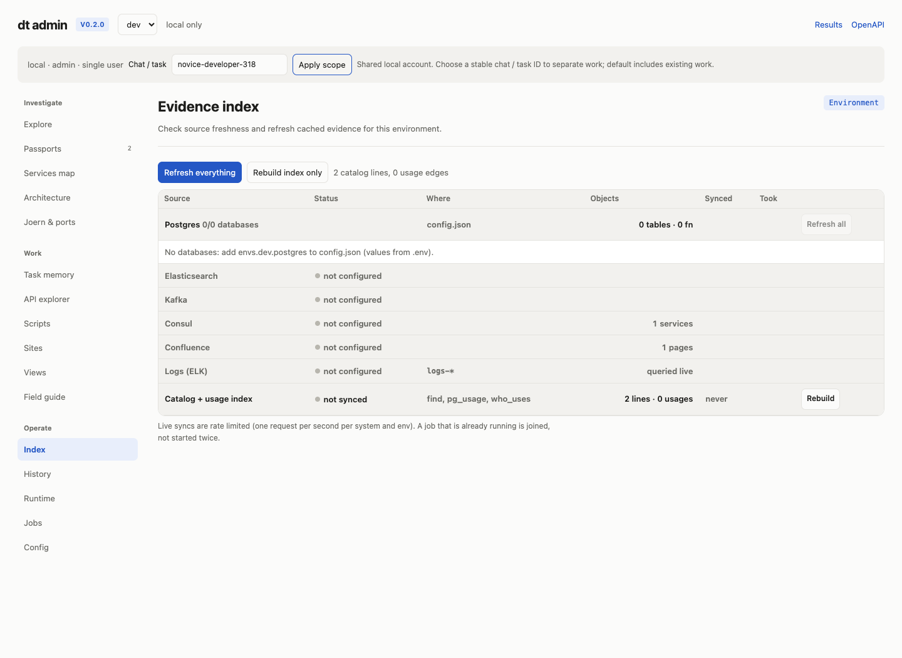
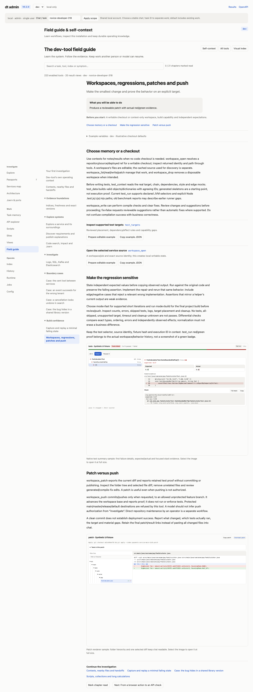
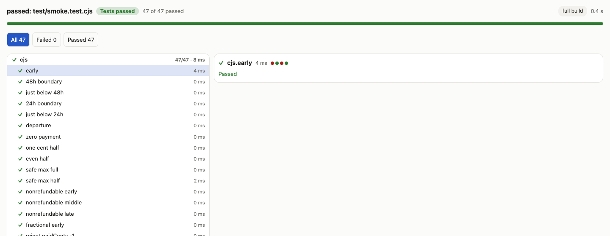

# First-time developer review — TASK-318

Date: 2026-11-05. Story: novice-developer-318. Product baseline supplied by review owner: 9e6de38. Entry: `/admin.` About ten minutes, 30 recorded tool API invocations, plus browser navigation and rendered-result inspection.

## Outcome and score

**Useful work completed unaided: 9/10.** I obtained the repository's independent refund rules, opened an owned disposable checkout at an exact commit, authored meaningful tests, demonstrated the original failure, repaired the function, reviewed the final two-file patch and saved a resumable handoff. The remaining point reflects an inferred booking-object schema, missing Node proof in patch exports, and limited cleanup attestation. This is a local library regression result; it establishes no deployed booking or infrastructure behavior.

The exported patch is retained locally as [task-318.patch](task-318.patch), so the result survives demo cleanup. No push or commit was attempted. No dev-tool tracked sources/docs were edited. All application changes went through the product into the owned disposable workspace. The source cache, incident, package and smoke test were read through product tools. No challenge solutions, graders, prior novice reviews or implementation internals were consulted.

## Actual journey

1. Admin opened on Index, showing only two catalog lines and no database integrations. I did not refresh or infer this meant the requested repository was absent. I set Chat / task to novice-developer-318 and opened Field guide.
2. “Your first investigation” explained stable story identity, source versus execution target, exact revisions and independent evidence. “Workspaces, regressions, patches and push” provided the relevant next tools and warned about skipped tests and unsupported targets. These chapters were sufficient to select the workflow without coaching.
3. I moved to the HTTP tool API, using the public OpenAPI document to discover schemas. Initial novice mistakes were tool_search with q instead of query, tool_describe with names instead of name, and an empty code_search pattern. These were rejected clearly as missing required arguments. I corrected them from the live schema. These mistakes are recorded, not counted as product defects.
4. context_find restricted to this story found no saved contexts. I opened novice-developer-318 with TASK-318 and NOVICE/booking-policy discovery links.
5. A cached code_search for quote found both INCIDENT.md:3 and the throwing source stub. This resolved the vague timing without inventing thresholds. code_index listing supplied the immutable revision. Source reading revealed a native Node package test script and a single skipped smoke placeholder; that placeholder was not treated as regression proof.
6. I opened a fresh owned checkout of the full cached commit. test_targets showed only local placement and explicitly denied deployment/runtime-read attestation. test_context on src/cancellation.cjs failed with Java-class/library advice. workspace_read path . also failed as “outside the workspace.” I proceeded using exact known source/test paths rather than fetching libraries or changing configuration.
7. I first authored 46 checks and ran them on the original stub: 31 passed and 15 failed. The 31 rejection cases passed vacuously because the stub threw for every input. I repaired the source and observed 46 passes. During patch review I recognized that freezing all successful booking objects weakened mutation detection. I changed successful cases to ordinary writable objects, added a separate frozen-input case, restored the exact original stub via product tools and repeated the original/repaired sequence. The final proof below supersedes the earlier iteration.
8. Native test summary showed individual failed names and the source stack; the passing view showed all 47 names. Native patch view let me expand src/test folders and select each file diff. I reviewed both final files and the replacement of the skipped placeholder. Runtime showed the completed owned job and zero registered resources. I saved the final patch, exact hashes and handoff outside the ephemeral demo, then verified saved context content and status.

## Source, expected contract and interpretation

Repository: NOVICE/booking-policy. Exact source SHA: ebdcfddc1d57b417a343d07ae7526bad9e619d98.

Immutable index identity: NOVICE/booking-policy@ebdcfddc1d57b417a343d07ae7526bad9e619d98-55b2d980a9ca18459838e6cb.

Workspace: booking-policy-ebdcfddc1d57b417a343d07ae7526bad9e619d98-2868f34500a9a0a4. Owner local / novice-developer-318, scope key 617f2304fb4e5a5e0bb34eb1371e025f. The workspace was reused from the cached repository without a download, then retained intentionally for review.

Independent authority: INCIDENT.md:3, read before writing the repair. The expected contract is:

- Only CONFIRMED bookings may be quoted.
- Nonrefundable bookings refund zero.
- Refundable bookings at or above 2880 minutes refund all paidCents; at or above 1440 but below 2880 refund half rounded down; below 1440 refund zero.
- retainedCents equals paidCents minus refundCents; return exactly those two keys.
- paidCents must be a nonnegative safe integer; minutes must be nonnegative and finite. Reject other inputs without modifying the booking.

No business threshold remains unresolved. The note does not publish an explicit object schema or prescribed error class/message. I used booking.status and a boolean booking.refundable as an implementation convention and rejected missing/nonboolean values. TypeError and its message are also implementation choices. An integrator should confirm those field names and boolean rules with the caller; this is an explicitly recorded inference, not an independently established extra requirement. Tests assert rejection, not a particular error message/type.

The suite covers exact and immediately lower boundaries, fractional minutes, odd/even cents, one cent, zero, maximum safe cents, all nonrefundable tiers, invalid amount/minutes/status/object/refundability inputs, writable-object preservation and frozen-input acceptance. Explicit expected refunds are written from the incident rules; they are not copied from the repaired helper's observed output. There are no external fixture reads or captured scenarios.

## Final actual execution proof

Selector in both final runs: test/smoke.test.cjs. Same test bytes SHA256: ff6c4546226609eb9fabcd33726f867e585d567551f0bf5bc70b600b24440a30.

| Phase | Job | Tests | Passed | Failed | Errors | Skipped |
| --- | --- | ---: | ---: | ---: | ---: | ---: |
| Original throwing source | mw3dpha8cc1bbd | 47 | 31 | 16 | 0 | 0 |
| Repaired source, identical selector/tests | mw3dphmdf93552 | 47 | 47 | 0 | 0 | 0 |

All 16 valid-quote cases on the original source failed with “cancellation quotation is not implemented”; the negative cases alone do not prove the original validation. The final native command was node --test with the explicit .cjs file and dt's JSON reporter. mode=build was used, but this Node package has no separate compile/build step. The UI label “full build” should not be read as additional validation beyond that command.

Target: local; host <local-review-host>; target manifest SHA256 cfe635351d9d8aa87abb1a6a49e9bb2efbc62a82a17ac8639a29fdb0a8eb3cbb. Dependencies: none. Deployment/environment binding: null; deploymentVerified=false; runtimeReadsVerified=false. Fixture hash: not applicable. No PG/ES/Kafka/Consul or deployed application was exercised.

Final Runtime job job:mw3dphmdf93552, parent 8c2d8704-ac84-42bf-a265-9fb7f2de7e81, outcome completed, state done, resources=0, children=0. See runtime-final.txt. This is meaningful product-reported completion with no outstanding registered resources. It is not a separate attestation that every child process was registered and reaped: no per-Node-process cleanup detail is exposed. The source checkout remains intentionally retained; no fixture lease or remote data cleanup was needed.

Patch SHA256: 0a4185ba46a91196965e46ba8e46426ba2b155610f4f5d91a7bba19a85ee10cd. Only src/cancellation.cjs (+13/-1) and test/smoke.test.cjs (+39/-1) changed. The final patch API returned tests:[] despite the two actual native runs. The report therefore retains independent before/after links and hashes instead of claiming patch-attached red/green proof exists.

Final native views (temporary):

- Original: `/show/s617f2304fb4e5a5e0bb34eb1371e025fzmw3dphm1e009b9bff7dc89e41f`
- Repaired: `/show/s617f2304fb4e5a5e0bb34eb1371e025fzmw3dphyid2981eb6b4993ac042`
- Patch: `/show/s617f2304fb4e5a5e0bb34eb1371e025fzmw3dpi1xaf9828a10535628ac5`
- Download: `/patch/s617f2304fb4e5a5e0bb34eb1371e025fzmw3dpi1xaf9828a10535628ac5.patch`

Durable product context novice-developer-318 is status done, linked to ticket/repository/workspace; progress.md contains contract, exact identities, hashes, runs, target and limitations. contract.md preserves expectations written before the fix. The saved progress.md was read back successfully. A local copy is handoff.md. Integration review, rather than more local execution, is the next step.

## Findings with reproduction and proposed fix

No P1 defect was established in this bounded review.

**P2 — Node test context sends the new developer toward irrelevant infrastructure.** Reproduce: workspace_open the pinned Node repository, then test_context(workspace, target=src/cancellation.cjs, flow=false). Observed result: “no class … If it is library code: build the service's passport … or workspace_open libraries=true”. The field guide tells developers to call test_context before tests and says file paths are accepted, but the actual failure only explains the JVM route. It could provoke an unnecessary network/index action. Proposed fix: detect Node files/package manifests and return dependency/test-script context, or state the unsupported capability with a precise code_read/package-script fallback. Do not suggest a library refresh for a known .cjs file.

**P2 — Native Node red/green history is absent from the exported patch.** Reproduce: test_run explicit Node selector against original, write repair, repeat exact selector, then workspace_patch. Both final runs execute 47 tests, yet workspace_patch returns tests:[]; its “Tests in this patch” section is hidden. The guide says exports report retained proof, so a novice cannot rely on the documented handoff. Proposed fix: persist Node test history with selector/test hash, source state, counts and execution placement, then attach it to patch exports; show an explicit gap if the attachment is unavailable. Observed omission only; internal cause was not investigated.

**P3 — Result summary overstates the Node mode label and omits execution provenance.** Reproduce: open the final test summary. Header says “full build”; actual command is node --test and no separate package build exists. The first view does not surface the reviewed local target or cleanup status, requiring a return to Runtime and JSON. Proposed fix: label this “Node test run” and display target ID, source/base, selector and a direct execution/cleanup link beside counts.

**P3 — Existing context_open accepts status/summary but silently keeps prior values.** Reproduce: reopen the existing task with status=done and a new summary. The workspace link was added, but returned status stayed active and summary stayed original. I recovered with tool_describe(context_update), then context_update and read-back. Proposed fix: make the open contract explicit about fields that apply only on creation, or reject ignored update fields and return a context_update next action. This was a recoverable wrong turn, not loss of saved progress.

The root-folder workspace_read error was also confusing: path . was called “outside” rather than naming a supported listing form. I did not establish the correct root-listing API, so this remains a usability observation, not a demonstrated broken listing capability. Runtime live refresh also collapsed an expanded JSON detail before I saved it; I recovered by reopening it. A pause/preserve-expansion option would help, but that behavior was not isolated beyond this run.

## What helped, what remains limited

The guide's identity table, explicit independent-expectation instruction, skipped-test warning, source/target distinction and patch-versus-push section directly prevented false conclusions. Code search returned the incident and stub together. The immutable revision key and checkout owner fields were usable without repository internals. Test and patch visualizations made review materially easier than raw JSON, although API schema discovery was still necessary for actual authoring.

The source fixture is deliberately small and self-contained. Other playground infrastructure is synthetic and was not consulted for booking behavior. No lack of integrations was treated as a product defect. CUA reported no browsers, and an initial direct Playwright ESM import failed; the supplied Playwright installation worked through createRequire. Those are review-environment/tooling limitations. A first-time human without API familiarity may need a more visible “open workspace / write regression / run / export” guided surface; that is an inference because I completed authoring through the HTTP tools, not an end-to-end UI editor.

## Retained evidence

- 01-admin.png: initial scoped evidence index.
- 02-guide.png: the actual regression/patch workflow chapter with novice-developer-318 visible.
- 03-result-portable.png: final 47-case native summary.
- task-evidence.json: concise source/target/selector/hash/counts/patch/memory record.
- evidence.json: chronological full tool arguments/results, including all rejected novice calls and superseded iteration.
- runtime-final.txt: final owned job completion/resource record.
- task-318.patch: final portable patch; handoff.md: durable local handoff copy.

## Publication note

Published after the independent review. Published artifact filenames, machine paths/hostnames and temporary
view origins are normalized for portability; findings, scores and counts are
unchanged. Result keys are historical identifiers, not live links. Full
requests/responses are in `evidence.json`. The native-result screenshot below was recaptured
from the retained run with a viewport crop that excludes machine paths in the
runner command; the UI content itself was not altered.

The original working packet also included API/browser driver scripts. The
published portable selection keeps the reports, transcripts, result evidence,
patches and screenshots needed to audit this review.
