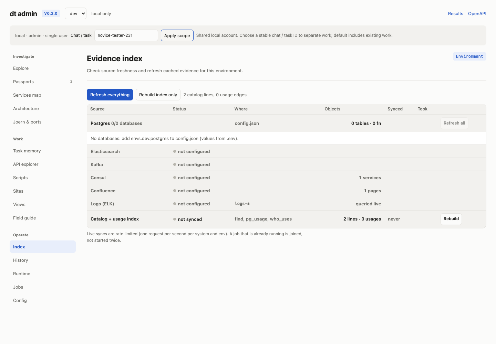
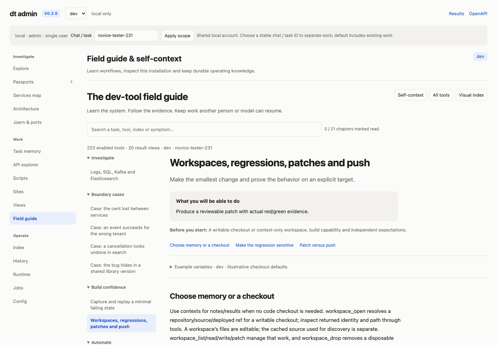
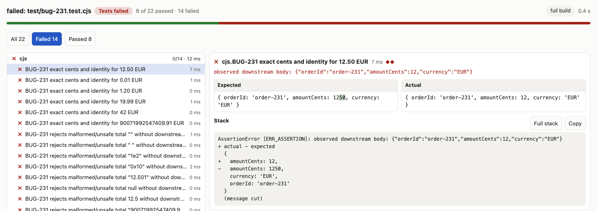

# Independent novice tester review — BUG-231

Verdict: **useful local tester task completed unaided; 8/10**. The field guide and public tool contracts let me discover the missing expected behavior, pin the correct repository, create private memory and an owned checkout, execute real regression tests, and preserve a tests-only patch and scoped handoff. The two-point deduction reflects one misleading Node preparation path and two gaps in proof presentation/export. Missing deployed infrastructure is a separate limitation, not a documentation failure or an invented pass. No P1 documentation/UI defect was observed.

## Scope and method

Started 2026-11-05 about 09:58 UTC at ``/admin`,` with only the colleague's vague symptom and repo link. Review baseline `9e6de38` was supplied by the task owner; app reports v0.2.0. Story `novice-tester-231` was applied in Admin and supplied in every HTTP tool request (`x-dt-story`); principal `local`. Public README, handbook and tool reference were the only product documentation read. No previous novice review, grader, solution, challenge-result or verification document was opened. No implementation source of dev-tool was read. Source of the reviewed checkout repository was read only through product tools.

Browser walkthrough: Admin → set Chat/task → Apply scope → Field guide → Workspaces, regressions, patches and push → actual native failed test result. I also opened the standalone handbook. The native test page selected the first real failure and showed the independently expected 1250 and observed 12 side by side. Three screenshots are retained below. Tool work used the localhost HTTP API, not direct reads/writes of playground repositories. Scripts in this folder only drive that API/browser or author review artifacts. Tests were executed by `test_run`, never by a shell test command. No production source, global configuration, external infrastructure, other story or repository push was changed.

## Task result and proof

[Bug report](bug-report.md) contains the reviewable application handoff. The symptom is locally reproduced: input `{id:"order-231",total:"12.50",currency:"EUR"}` results in a real checkout-to-reservations module call with `amountCents:12`; independent requirements say 1250. Checkout source at `checkout/src/checkout.cjs:3-5` converts to Number and truncates without converting major units to cents. Reservations accepts 12 because its API contract is integer cents. This supports a boundary conversion defect; it does not prove a history rendering or production deployment claim.

The missing behavior was discovered from `INCIDENT.md:3` and `contract.json:5-7`, rather than inferred from current output: total is an exact decimal **string** with at most two fractional digits; downstream amount is a nonnegative safe integer cents value; preserve order/currency; malformed totals must cause zero downstream requests. Neither a rounding rule for excessive precision nor a broader decimal grammar was invented.

Source: `NOVICE/checkout-boundary`, full SHA `9407344605f9e9ff5e49d1076d77b6bcb69526dd`, revisionKey `NOVICE/checkout-boundary@9407344605f9e9ff5e49d1076d77b6bcb69526dd-421c67ce69189ab8f58ee9b5`. Source catalog env `dev` is not deployment identity. Owned workspace `checkout-boundary-9407344605f9e9ff5e49d1076d77b6bcb69526dd-fd0b6e99b3f34fd1`, scoped to this story. `workspace_open` reused the exact cached commit without downloading.

| Run | Selector | Actual result |
| --- | --- | --- |
| `mw3dljo0441e06` | `test/smoke.test.cjs` | 1 test, 0 passed, 0 failed, 1 skipped; `all-tests-skipped` |
| `mw3dmehcb01d8b` | `test/bug-231.test.cjs` | 22 tests, 8 passed, 14 assertion failures, 0 errors/skips |
| `mw3dn2wgad5ad6` | same explicit file | 22 tests, 8 passed, 14 assertion failures, 0 errors/skips; negative assertions improved to retain calls + rejection |

The 22 checks comprise 7 valid EUR totals (zero, one cent, ordinary fractions/whole amount and maximum safe cents); 11 malformed/type/overflow totals requiring rejection with no downstream call; and 4 direct reservations-contract checks. The final suite asserts exact values/types through deep equality, one downstream call for valid inputs, identity preservation, returned reservation shape, and `{calls:0,rejected:true}` for invalid totals. Six valid amounts and eight invalid cases fail; zero, three clearly invalid totals and all four direct reservation checks pass. Later assertions after a failing assertion in a test do not execute; 22 test cases are not 22 fully passing behaviors.

Every run used target `local`, mode `build`, native Node node:test. Target manifest SHA256 `cfe635351d9d8aa87abb1a6a49e9bb2efbc62a82a17ac8639a29fdb0a8eb3cbb`, local placement, no dependencies, `workspace-and-scratch` effects. `deploymentVerified:false`, `runtimeReadsVerified:false`, deployment/environment null. Latest native result (temporary result `/show/sf586114d1ebd0be05182b494d46e98d4zmw3dn37t834e081c6222245c7e`). There is no green repair proof; source repair was excluded from the task.

Only `test/bug-231.test.cjs` was added. Patch view (temporary result `/show/sf586114d1ebd0be05182b494d46e98d4zmw3dof4yd436f7bec631be0089`) and [local tests-only patch](bug-231-tests.patch) are retained. The workspace is intentionally kept for a reviewer. No runtime lease was started, so none needs cleanup.

## Observed documentation/UI findings

### P2 — Node tester preparation leads into an irrelevant class/library dead end

Reproduce: follow Workspaces → “Before writing tests, test_context reads the real target…” for this Node repository. Invoke `test_context` with the owned workspace and target `checkout/src/checkout.cjs`. The exact response is `no class "checkout/src/checkout.cjs" in workspace ... If it is library code: build the service's passport (it indexes its libraries), or workspace_open libraries=true`. The guide immediately advertises explicit Node test execution, but does not qualify this preparation step as JVM/class-specific.

Evidence: `calls.json` invocation 10; source file is real and was successfully read by code_read; native test_run of explicit `.test.cjs` files succeeded in executing tests. The error is observed; broader language support is not inferred.

Impact: a novice may index libraries, fetch/parse a passport, or abandon a supported Node tester task unnecessarily. Practical fix: label test_context language support in the workflow/tool contract; detect Node/file targets and return an explicit unsupported preparation path with code_read/code_search and existing package/test-file alternatives. Avoid suggesting library fetch for an unsupported Node file. Screenshot `02-guide.png` anchors the workflow.

### P2 — Tests-only patch export drops visible executed test proof

Reproduce: run the explicit Node selector, observe 22 executed tests and retained result URL; call `workspace_patch` on the same workspace. Both exports returned the correct tests-only diff but `tests:[]`. The handbook says workspace_patch reports retained test proof; the tool contract describes recorded test proof as part of export.

Evidence: `calls.json` invocations 12/16 (runs), 15/17 (patches); final patch contains only the new 32-line regression file. The omission is observed. I did not inspect implementation to determine whether this affects other languages or only tests-only changes.

Impact: a reviewer receiving the patch export can lose the original red baseline evidence. Practical fix: attach applicable run IDs/counts/selector/source and test hashes to Node/test-only patch exports, including red-only runs, or explicitly state why proof is excluded and link the retained run history. I worked around it by storing separate execution-evidence.json and native result links in durable memory.

### P2 — Native result makes the failure clear but omits compact source/target provenance

Reproduce: open the latest native result. It shows the file, counts, first failed assertion and full runner command. It has no visible full source SHA, reviewed target ID/manifest, or deployment-attestation status. The API response has those target fields; the screenshot does not.

Evidence: `03-result-portable.png`, `result-browser.txt`, test_run response in `calls.json`. This is an observed result-page omission, not a claim that the metadata is absent from the system.

Impact: a shared screenshot looks persuasive while a reader cannot readily tell local modules from a deployed application check. Practical fix: add a compact provenance row with source SHA, target local, and “deployment unverified,” with a details disclosure for manifest/dependencies. Keep the useful expected/actual first-failure treatment.

### P3 — All-skipped run supplies an unsuitable generic next action

Reproduce: run the existing smoke selector. Outcome/counts correctly say `all-tests-skipped`, but next says `fix the test or the code at parts (test_run files=[{path, edits}] writes and runs in one call)` while `parts:[]`.

Evidence: `calls.json` invocation 11. The outcome itself is correctly classified; no pass was claimed.

Impact: a first-time tester is directed toward nonexistent source excerpts and possibly application edits, although the immediate problem is a skipped placeholder. Practical fix: special-case all-skipped/no-tests with an instruction to inspect/enable or replace the placeholder and choose an explicit executed selector, before evaluating application behavior.

## What worked

The first-investigation chapter explains task/env/repository/target identities in plain language. Scope is visible in Admin and again in Field guide (`novice-tester-231`). `context_find` explicitly returned indexedContexts=0 and a clear create-context next action, avoiding fruitless searches. code_index versions supplied an immutable revisionKey; workspace_open reused the exact cached commit. The guide warns that all-skipped, invocation success, synthetic screenshots and declarations are not proof. The actual native result surfaced all 14 failures, selected the correct first assertion, and made the units mismatch immediately understandable.

## Dead ends and reviewer-side limitations

The first automated browser locator used role button for Field guide; its actual accessible role differed. It timed out, and using the visible text locator opened the page. This was a browser-harness mistake, not evidence that a human cannot navigate. An initial Playwright ESM import failed in the tool runtime; using CommonJS resolved it. A standalone screenshot captured a loading state because I did not wait; that screenshot was deleted and replaced with the real native test failure. These are separated from product findings.

`context_open` reusing an existing context preserved the old summary while attaching links; the documented `context_update` was then used to update summary/status with the read revision. This is operator learning, not a reported product defect. One API response could succeed while not meaning the task passed; I inspected each result/error/count rather than HTTP status alone.

## Requirement questions and environment gaps

The colleague's card omitted units, input type, precision and invalid-input effects; the repository's original incident/contract resolved those. Still open: allowed spellings such as `.50`, `12.`, leading plus/zeroes and negative zero; currency-specific precision; error shape/status and UI response. Those spellings were excluded from assertions rather than guessed.

To establish customer/environment impact, obtain the deployed checkout/reservations/history source versions, a safe explicit target, incident order/request/trace and time window, and independently observed HTTP/persistence/history effects. This playground has no configured Postgres/ES/Kafka/log integrations in self-context. Synthetic catalogs/semantic fixtures, an echo API and rendered samples are not reservation behavior; none was used as such. The task succeeds as a local source/test handoff, with deployed behavior explicitly unproven.

## Resume and artifacts

Private context `novice-tester-231` is marked done for this tester handoff and links the exact repository/workspace/task. `progress.md`, `bug-report.md`, and `execution-evidence.json` were saved through context_write and confirmed in context_get. To resume, select the same principal/story, context_get this ID, then read progress.md and bug-report.md. The next authorized developer can inspect the tests-only patch, repair checkout if requested, rerun the same selector, and then seek independently observed deployment effects. No other reviewer's context was read or altered.

Artifacts: `evidence.json` is the concise machine-readable source/task/run summary; `calls.json` records exact localhost tool requests/responses; `regression-request.json` preserves the final test source and selector; `bug-231-tests.patch` is the exported patch; `bug-report.md` is the application handoff; `browser.txt` and `result-browser.txt` retain browser observations. `01-admin.png`, `02-guide.png`, `03-result-portable.png` are the three screenshots. No external publication occurred. Review completed in roughly nine minutes and under forty meaningful product invocations.

## Publication note

Published after the independent review. Published artifact filenames, machine paths/hostnames and temporary
view origins are normalized for portability; findings, scores and counts are
unchanged. Result keys are historical identifiers, not live links. Full
requests/responses are in `calls.json`. The native-result screenshot below was recaptured
from the retained run with a viewport crop that excludes machine paths in the
runner command; the UI content itself was not altered.

The original working packet also included API/browser driver scripts. The
published portable selection keeps the reports, transcripts, result evidence,
patches and screenshots needed to audit this review.
