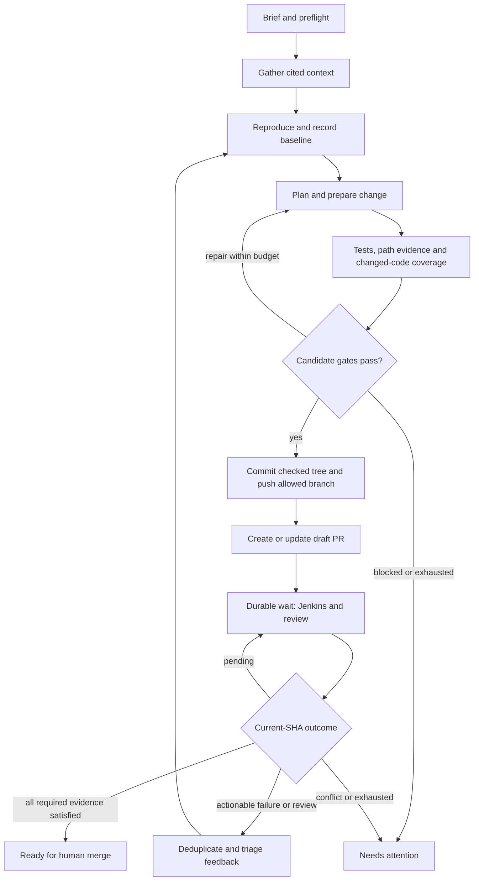

# Task harness through the UI

Planning brief, 20 November 2026. Source audit: dev-tool `5f812d4` and Happen
[`bed93df`](https://github.com/meoyawn/happen/tree/bed93df0e8061fd07c6b191c11fd13009b5c1176).
This describes proposed behavior, not capabilities already delivered.

Implementation now has a [task desk and autonomous supervisor](task-harness.md).
That guide distinguishes delivered behavior, file-store persistence, verification
and remaining PTY/distributed-runtime work from this broader target design.

## Direction and outcome

Build a **task desk backed by a durable task supervisor**. A developer supplies
a ticket or problem, expected behavior, repositories and an environment, then
leaves a bounded worker to investigate, prepare a fix, test, publish to an
allowed branch, and respond to CI and review. The same desk supports doing each
step manually, inspecting its evidence, or taking control when the model is close
but needs correction. Browser tabs observe the work; the server owns its life.

The first complete journey ends at **ready for human merge**, with a PR, current
revision checks, review decisions and reproducible evidence. It must also handle
the less happy endings: ambiguous requirements, unavailable dependencies,
exhausted budgets, uncertain pushes, missing coverage and conflicting feedback.
These produce actionable states rather than an indefinitely spinning agent.

Use the current web application, tool registry, runner and storage foundations.
Keep Admin for connection setup, policy and operational diagnosis; make the task
desk the everyday entry point. Preserve task-first discovery and the current
inline views, editor, API client, mapping debugger and named result pages.

## What exists and what must change

| Area | Reuse | Missing for an unattended harness |
| --- | --- | --- |
| Task identity | [continuations](workflow-continuation.md), `lib/continuation.js` | Task runs, attempts and a supervisor linked to that stable identity; no automatic cross-user or cross-chat attachment |
| Memory | Context files, revision checks, [published project context](project-context.md) | A task-facing evidence index, explicit checkpoint actions and context inspection within the desk |
| Code | `lib/workspace.js`, `lib/workspace-editor.js`, existing CodeMirror editor | Exclusive writer ownership, guarded human takeover, separate commit/push operations and candidate-bound gates |
| Loops | `lib/automation-flow.js`: bounded tools, loops, parallel branches, waits and checkpoints | A real model/tool execution loop. Existing model leaves deliberately return text and never execute model-selected tools |
| Recovery | Durable workflow checkpoints and uncertainty resolution | Opt-in unattended startup recovery and a persistent wakeup scheduler. Existing workflows require explicit resume |
| Terminal | `workspace_terminal` fixed inspection/build commands | Real interactive PTY, task-owned sessions, reconnectable output and explicit command/process ownership |
| Background work | Execution/job ownership, cancellation and runner process trees | Detached task admission, resumable observation and resource inventory across browser lifetimes |
| Testing | Outside-in test planning, native Maven/Gradle, [changed-code coverage](workspace-change-coverage.md) | A mandatory configurable gate tied to the exact candidate, with coverage capability discovery per stack |
| CI/reviews | [Jenkins and Bitbucket tools](ci-review-loop.md), exact-SHA evidence, submission receipts | Durable subscriptions, complete feedback traversal, feedback triage, PR updates/replies and iteration policy |
| UI transport | WebSocket tool execution, `lib/ui-events.js` and HTTP fallback | Durable event replay. The current bounded in-memory event bus is a notification layer, not a recovery journal |

Two existing contracts need particular care:

- `workspace_push` currently commits and pushes together, may replay the commit
  onto a moved remote branch, and reports tests without enforcing green. An
  unattended path must validate the candidate **after** any replay, then commit
  and push that checked tree. Keep existing direct-tool behavior compatible.
- Operational call/job records are bounded projections with retention. They
  cannot become the authoritative task journal simply by adding more log fields.

This expands the scope of earlier Happen-inspired operational work: dev-tool now
needs an agent turn loop as well as its existing tool server.

## Inspiration and component choices

Happen provides useful interaction patterns: an attention/working inbox,
restored sessions, inline activity, steering, a context inspector, Git actions
with partial-success feedback, and terminals independent of the selected view.
Use those patterns within dev-tool's existing web UI.
Source: [Happen desktop guide at the reviewed commit](https://github.com/meoyawn/happen/blob/bed93df0e8061fd07c6b191c11fd13009b5c1176/packages/desktop/README.md).

For unattended wakeups, follow its separation of server-owned subscriptions,
durable inbox admission, deduplication and recovery. Happen's event extension is
separate from core MCP; dev-tool should work with ordinary webhooks and polling,
with an MCP event adapter optional.
Source: [Happen MCP/events guide](https://github.com/meoyawn/happen/blob/bed93df0e8061fd07c6b191c11fd13009b5c1176/packages/mcp/README.md).

| Component | Proposed choice and decision boundary |
| --- | --- |
| Source editor | Reuse the vendored CodeMirror editor, its revision checks and file tree. Add task, diff, coverage and review annotations around it |
| Terminal | Evaluate [xterm.js](https://xtermjs.org/) with a runner-side [node-pty](https://github.com/microsoft/node-pty#readme) service. The browser renders the terminal; the runner owns the process. Keep native PTY dependencies out of the core server bundle |
| Agent executor | Keep a small adapter boundary. Spike [`@earendil-works/pi-agent-core`](https://github.com/badlogic/pi-mono/tree/main/packages/agent) against the configured Qwen/GPUStack endpoint and dt's cancellation/tool contracts. Adopt it only if those contracts survive; a native bounded executor over the existing gateway is the fallback |
| Durable control plane | Extend the existing SQLite owner-worker pattern with dedicated task tables and transactions. Do not put recovery-critical data into clipped call/job records |
| Graphs and results | Reuse the vendored graph SDK and existing typed inline/show views; task activity links to actual retained evidence |

The agent-core candidate supplies tool execution and streamed events, but dt must
still own policy, task durability, model accounting and concurrency. Its default
parallel execution must not permit simultaneous workspace writers. Adoption needs
a pinned version, license review and compatibility tests; no dependency has been
selected or benchmarked by this planning exercise. Happen is design inspiration,
not a proposed Flutter rewrite or unreviewed source import.

## The task desk

Proposed entry: `/tasks`, with stable task/run links. Opening a task from a new
chat explicitly attaches that owned continuation; it does not silently select a
different task. A ticket number is a display/search key, not an authorization key.

```text
Task inbox / tree       Task header: phase · branch · environment · budget
                       Start / Pause / Resume / Stop / Steer / Take control
Needs attention        -------------------------------------------------
Working / Waiting      Brief | Evidence | Changes | Checks | Review
Ready / Archived       Main working surface              Activity/inspector
  ticket               editor, results, graph, checklist  selected item
    repositories       -------------------------------------------------
    contexts           Terminals | Background jobs | Runtime logs
    scripts/results    collapsed drawer; failures and questions surface above
```

The main surface occupies the width; the inspector and bottom drawer open when
needed. Tool internals and successful transient output stay collapsed. A failed
check opens its first actionable error. Do not display every log, filter and
export button at once; secondary actions live in an overflow menu.

### Start a task without a CLI

1. **Describe:** paste a ticket/link or problem. Separate observed behavior,
   expected behavior, acceptance examples and unresolved questions. Optional
   model suggestions are explicit, editable proposals.
2. **Choose scope:** searchable indexed repository/ref, service, environment,
   Confluence space/page, context and test-target selectors. Explain index
   freshness and fall back to bounded source search when absent. Support a
   context-only investigation without a Git repository; code publication then
   becomes unavailable with a visible reason.
3. **Choose execution:** runner, workspace reuse/new checkout, model, test
   recipes, coverage adapter and disposable dependency environment. Show actual
   placement and available bindings, not just a source environment name.
4. **Choose autonomy:** investigate only; edit and test; or publish to a task
   branch and iterate on a draft PR. Display permitted effects, stop conditions,
   budgets and the selected repository policy in plain language.
5. **Preflight and start:** verify credentials/capabilities, branch rules, model
   reachability, runners and required test/coverage support. Show blockers with
   setup buttons. Admit a durable run before acknowledging Start.

### Work and inspect

| Surface | What the person sees and can do |
| --- | --- |
| Brief | Acceptance checklist, scope, current plan, assumptions, next action and pinned policy. Edit the brief or answer a blocking question; amendments are revisioned |
| Evidence | Searchable task memory: cited docs, code at SHAs, environment observations, graphs, screenshots, queries and scripts. Preview/edit notes, archive files, refresh a source, rerun a saved recipe or attach evidence to an acceptance item |
| Changes | Nested file tree, lazy diff and editor; source/coverage/review anchors. See generated and ignored files separately. Switch a branch only after pausing/reconciling active work; dirty files require a visible preserve/new-workspace choice |
| Checks | Baseline and candidate runs, actual commands/targets, progress, JUnit failures and changed-line/branch coverage. Rerun a selected check; inspect missing instrumentation instead of showing a misleading percentage |
| Review | PR/build timeline for the exact head SHA, comments with source anchors, proposed responses and their supporting changes. See outdated feedback, missing pages, required checks and approval gaps |
| Activity | Ordered model/tool/command events, duration, bytes/tokens, retries and causal links. Expand editable tool arguments, rerun permitted reads, or prepare a new explicit action; never silently replay a mutation |
| Context inspector | Actual outgoing system/tool/message context, source revisions, result truncation, provider/model and measured versus estimated usage. Copy a redacted briefing; explicitly checkpoint or compact |
| Bottom drawer | Real terminals, tests, services, jobs and logs with owner, state, elapsed time, last output and individual cancel controls. Open related API client/mapping debugger/service-environment panels with this task scope |

Every command has admitted/running/settled feedback. Waiting shows **what** is
awaited, the watched SHA, last observation, next check and deadline. A model
request queued behind provider capacity is visibly queued, not a frozen spinner.
Manual corrections invalidate affected proof and tell the user what must rerun.

On narrow screens, task navigation and inspector become drawers; checks and
review remain usable without a graph. Preserve focus, labelled controls, keyboard
operation, screen-reader status and non-color status indicators. Normal use
needs no JSON editing, but every action has an advanced structured view.

### Steering and control semantics

- **Steer:** append an attributed instruction for the next safe execution
  boundary; show when it was received and applied. Critical scope changes pause
  before further effects. Do not pretend a note already changed an in-flight call.
- **Pause:** stop scheduling new work, drain the current owned operation and
  checkpoint. Remote Jenkins builds remain remote work; show that distinction.
- **Interrupt:** cancel the active model/tool/command where supported, drain
  children and mark ambiguous external effects for reconciliation.
- **Take control:** pause the model writer, transfer the workspace/terminal
  input lease to the person and invalidate stale proof after edits. Resume only
  after reconciling the new tree and queued feedback.
- **Stop:** cancel the run and wake subscriptions, then expose owned-resource
  cleanup/retention choices. Closing a tab or archiving its inbox entry does not
  implicitly stop the task or kill a terminal.

## Execution loop and explicit state



The graph is a phase projection, not the entire runtime state. Keep separate,
explicit machines for task lifecycle, attempt phase, model turn, effect receipt,
wait subscription, command/process, worker lease and cleanup. Export their
definitions through the existing state-machine tooling and simulate races with
the existing TLA+/trace facilities where useful.

| Machine | Required distinctions |
| --- | --- |
| Task run | draft, preflight, queued, running, waiting, pausing, paused, needs-attention, ready-for-merge, completed, cancelling, cancelled, failed |
| Attempt | gathering, reproducing, editing, checking, publishing, observing; a new feedback cycle creates a new attempt with exact inputs |
| Effect | planned, admitted, running, succeeded, failed-with-known-outcome, uncertain, reconciled; uncertain blocks dependent writes |
| Wait | registered, waiting, due, event-admitted, consumed, expired, cancelled; duplicate/outdated events are recorded without a second wake |
| Terminal/job | starting, running, cancelling, draining, exited, failed, interrupted, cleaned; output retention is separate from a live process |

Transitions enforce invariants in code, not through system-prompt instructions.
One task run has one active controller; one workspace has one writer. Read-only
research may run in bounded parallel branches. Multi-repository tasks use an
explicit workspace/dependency graph and separate per-repository publication
receipts; they cannot claim an atomic cross-repository push.

## Durable ownership, waits and recovery

Keep the stable continuation as task identity and memory. Add dedicated durable
records for these proposed objects:

| Record | Essential contents |
| --- | --- |
| Task specification | Owner, ticket, goal/acceptance, exact repository/context references, environment, reviewed policy revision and capability grants |
| Run and attempt | Original budgets/deadlines, parent task, phase, candidate/base fingerprints, control commands, outcome and reason |
| Turn/context manifest | Serialized outgoing context references, tool schema/profile revision, provider parameters, usage and tool-call/result identities |
| Effect receipt | Stable request id and argument digest, expected tree/remote SHA, admission and reconciliation evidence; commit and push are separate effects |
| Gate result | Candidate tree, tests/build inputs, test target/environment fingerprint, coverage report and policy revision |
| Subscription/inbox | CI/review source, target SHA, cursor, dedup key, absolute due time, last result and pending wake |
| Worker/resource lease | Owner, heartbeat, fencing generation, runner/process identity, expiration and cleanup state |

Reuse the SQLite owner-worker pattern, with a dedicated schema/transaction API;
the current operational store only handles calls/jobs/executions. Do not extend
its bounded metadata projection into a transcript store. Large output belongs
in bounded, hashed artifact files with retained references. Keep one authority
for each record and migrate/version it explicitly.

Durable admission, inbox deduplication and wake scheduling must commit together.
Publish an outbox event only after commit. The UI subscribes by durable cursor;
after a gap it fetches a current snapshot, then resumes events. Existing WebSocket
and HTTP transports carry the projection. A browser disconnect detaches the
observer, not the admitted task execution.

On restart, recover only runs admitted with unattended-resume permission. Acquire
a new fenced lease, revalidate current access and reconcile unfinished effects
before more writes. Expired, paused, revoked or uncertain work cannot silently
resume. Existing `automation_flow_*` retains its explicit-resume contract.
Background calls restore the task's authenticated principal and scope, never an
ambient administrator identity, and recheck current grants on each invocation.
Unattended admission requires the transactional durable store to be healthy;
an operational-store fallback cannot silently weaken this requirement.

Use verified Jenkins/Bitbucket webhooks when available and a bounded shared
poller otherwise. Persist events before acknowledgement. Coalesce unchanged
observations and wake the model only for relevant new information; no model
calls for heartbeats, empty polls, reconnects or rendering. Polling observes
rate/concurrency budgets, backs off on errors and releases active execution
slots while a task waits hours or days. Expose degraded polling and evidence gaps.

| Interruption | Required recovery |
| --- | --- |
| Browser closes | Work continues; reopen the same task/run and replay activity |
| Worker dies during a read | Record interruption; retry under an explicit read-retry policy |
| Commit succeeds, push fails | Retain the local commit; retry that candidate, never blindly create another commit |
| Push/PR/build response is lost | Reconcile remote branch/PR/queue using receipt and SHA; unknown is neither failure nor permission to resubmit |
| Branch moves | Stop publishing, reconcile/replay deliberately, invalidate affected gates and check the resulting tree before push |
| Duplicate or old build/review event arrives | Admit/deduplicate the event; old-SHA evidence cannot make the current candidate green |
| Server/runner restarts while a command runs | Reattach only if the runner proves the same live owned process; otherwise mark interrupted. A saved transcript does not resurrect a shell |
| Access or policy is revoked | Suspend further execution and report what remains active remotely |

Back up task records, receipt/inbox tables, contexts and referenced artifacts as
one recoverable set. Retention cannot evict unfinished work or unresolved effect
receipts. Surface disk pressure before admission; do not delete evidence to make
a task appear complete. A first release may have one server with several runners;
multi-server scheduling needs a shared lease/store design rather than a shared
SQLite file on an arbitrary network mount.

## Context gathering and model behavior

Gather **relevant bounded context**, not an entire environment dump:

1. Read the task briefing and published project knowledge at pinned revisions.
2. Search cached catalogs/passports and exact-ref code indices. Use fast bounded
   source search if an index is absent; optional Joern enrichment must not stall
   the whole task. Resolve internal-library build versions and show fallbacks.
3. Retrieve selected Confluence requirements and code/library evidence with
   citations. Resolve contradictions or missing acceptance criteria explicitly.
4. Inspect live environment/API/PG/Kafka/ES observations only as needed, with
   timestamps, selected environment, source identity and redacted values.
5. Save a searchable evidence index, progress, hypotheses, useful scripts/queries
   and reproduction steps into the stable task memory throughout the attempt.

Retain original evidence outside the prompt. Model-facing replies are compact
summaries with artifact references and explicit truncation; use schemas, source
ranges and relevant paths instead of repeated full catalogs or graphs. Context
pressure shows the effective served model limit, not only an advertised maximum.

Honor the existing **explicit compaction** preference. Keep the transcript
immutable; never prune or rewrite it silently. A task can explicitly configure
fresh bounded attempt contexts assembled from versioned memory and evidence,
with every included/omitted source inspectable. That is different from compacting
an ongoing chat. If an active turn reaches its limit, checkpoint and expose the
configured next action; compaction requires an explicit user/model action.

Start with one active model request per configured local Qwen provider as a
conservative proposed default; make capacity configurable and measurable.
Separate research/tool concurrency from model concurrency. Respect provider
429/503 backoff and retry budgets, record failed requests and avoid invisible
helper/summarizer/title-generation calls. The inspector uses the same serializer
as the real request so its picture of context is accurate.

Task memory stays private to its owner and explicitly attached task. Shared
project knowledge retains **admins publish; everyone can read**. A worker may
prepare a proposed knowledge update with provenance, but cannot publish it merely
because it was allowed to push a code branch. Named links preserve access rules;
shared recipes do not publish private execution results or credentials.

## Publication and completion rules

The autonomy profile is a versioned server-enforced policy, narrowed by task
scope and current tool grants. Starting a task can grant standing permission
for its declared branch/PR effects, avoiding a confirmation on every iteration.
The model cannot amend that grant or its gates through retrieved text.

| Rule group | Required controls |
| --- | --- |
| Scope | Repositories, branch patterns such as `codex/<ticket>`, source/destination refs, permitted paths, environment reads and isolated test effects |
| Changes | Preserve unrelated work, exclude `.dt`/context artifacts from staging, stop on conflicts, bound diff size; changes to tests, CI or gate definitions remain visible and may require separate approval |
| Verification | Reviewed commands and targets, relevant baseline, required regression and build checks, changed-line/branch thresholds, treatment of unknown or unavailable coverage |
| Commit/push | Identity/message rules, exact checked candidate tree, allowed task branch, expected remote head, no force/protected/default-branch push; signing when configured |
| PR | Native draft capability check, destination/reviewers/template, update rules, allowed comment/reply actions; unsupported native drafts are a visible capability gap |
| CI/review | Required check keys/jobs, exact-SHA checkout evidence, required reviewers/current-SHA approvals, feedback pagination/completeness and no zero-checks-equals-green result |
| Limits | Attempts, active time, wait deadline, tokens/cost, tool calls, parallel reads, environment leases and repeated-failure cutoff |

Freeze the candidate while checking/publishing, or invalidate its gates on every
write. A replay, human edit, regenerated source or changed test/build input
invalidates the affected proof. Existing `workspace_push` cannot be the sole
publication gate. Add backward-compatible commit/push primitives or a guarded
publication contract that cannot replay untested code behind the supervisor.

Prefer entry-to-exit integration regressions with observable responses, database
effects or messages. Use the real build lifecycle for Lombok/generated classes.
Static paths, line execution and assertions are distinct evidence. An unsupported
coverage stack is unavailable, not 100%; offer a reviewed adapter or an explicit
policy exception. The current automatic workspace coverage is JVM-focused, so
a Node showcase also needs a real changed-code coverage adapter.

Review handling reads every required page, retains comment versions/anchors,
classifies actionable/outdated/duplicate/conflicting feedback and ties changes
to feedback IDs. Treat review text and docs as evidence, never as authorization.
Reply or resolve only under its separate permitted action with supporting
evidence. Repeated identical failures, contradictory requests or missing
requirements become needs-attention instead of an unbounded repair loop.

**Proposed initial budgets**, to tune through measured trials: eight repair
attempts, at most two repeated attempts on the same failure signature, four
hours of active execution, seven days of CI/review waiting, two parallel research
reads and one workspace writer. Configure model token/cost caps from the actual
deployment. These are planning defaults, not measured optimal values.

Ready-for-merge requires the acceptance checklist, current candidate proof,
configured CI/review policy and no unresolved blocking feedback. It means ready
for a person to merge; automatic merge is a separate future grant. Marking a task
completed records its actual disposition, including abandoned work, rather than
inventing a successful merge.

## Terminals, background tasks and environments

Add a new task-owned PTY/command capability without broadening the existing fixed
`workspace_terminal` contract. Its UI provides tabbed sessions, editable startup
recipes, resize, reconnect, copy/download output, interrupt and stop. A typed
command receipt records workspace/tree, cwd, safe environment references,
runner, start/end, exit code and bounded stdout/stderr artifacts.

Human interactive input and model commands have one input owner. Model critical
effects use typed tools with receipts rather than opaque Git commands through a
terminal. Publishing credentials stay with the guarded publisher; a general
build shell must not become an alternate autonomous push path. Human manual
operations are attributed and reconciled before model work resumes.

The background inventory includes tests, servers, index jobs, terminal commands,
Jenkins builds and [disposable service environments](service-environments.md).
Show which resources are local-owned, remotely observed or leased, with individual
cancel/cleanup controls. A stopped poller does not claim it stopped Jenkins.
Environment bindings can be previewed and applied to local application config
through the existing runner/environment tools. Idle retention/TTL rules avoid
keeping all containers alive throughout a multi-day review wait.

Task-level cancellation drains owned child work before reporting settled state.
Test descendants, shell children and orphan cleanup; do not rely only on killing
the shell PID. Retained outputs survive cleanup. Runner disconnection and process
exit are different states with explicit recovery actions.

## Tool and API surface

All new behavior must remain available through the normal authenticated tool
registry as well as buttons. Proposed contracts, to finalize in the first slice:

- `task_run_start/status/list/control`: admitted run receipt, durable cursor,
  current phase, reason, budgets and control-command acknowledgement.
- `task_run_context/evidence`: actual context manifest and task-scoped retained
  artifacts; reuse continuation/context reads and revisioned writes underneath.
- `task_wait_register/status/cancel`: durable source/SHA subscription with due
  time, dedup cursor and visible delivery state.
- `task_terminal_open/read/input/resize/close` and `task_command_run/cancel`:
  task/resource ownership, input lease, output cursor and process receipt.
- Checked workspace commit/push contracts plus PR metadata/reply/resolve actions:
  stable request IDs, exact revisions, capability checks and reconciliation.

These are proposed names, not tools to call today. Keep summaries short with
obvious next actions and artifact links. UI forms derive syntax help and indexed
choices from concrete schemas; core task flows get purpose-built controls.
WebSocket events deliver progress/results after durable admission, with a
snapshot/replay API and HTTP fallback. A new transport must not create a second
execution path with weaker policy or ambiguous automatic mutation retries.

Instrument task/run/attempt/turn/tool/effect/wait IDs through existing telemetry.
The task inspector and Admin observability show provider queue time, first-token
latency, durations, tool volume, retries, tokens, failures, idle waits and active
resource cost. Correlate these with upstream traces where supplied. Keep full
private prompts/artifacts separate from redacted operational logs.

## Delivery slices and acceptance

| Slice | Deliverable | Must demonstrate before proceeding |
| --- | --- | --- |
| 1. Contracts and UX | Clickable task-desk stories using real-shaped data; explicit state/policy/effect contracts; PTY and agent-core compatibility spikes | First run, absent capability, waiting, failed checks, lost push response and human takeover are understandable without a CLI. Record component/version decisions |
| 2. Complete manual task desk | Task creation, continuation/memory tree, editor/diff, real terminal, jobs, test/coverage evidence and CI/review panels | A person completes the entire investigate → edit → test → allowed branch/PR → inspect feedback journey through buttons; reopening keeps the same work |
| 3. Supervised agent | Bounded tool-executing worker, actual context inspector, deterministic gates, controls and isolated resources | Real model reproduces and fixes a fixture bug, runs relevant checks/coverage and reaches a draft PR under its task policy; edits/takeover invalidate stale proof |
| 4. Unattended iteration | Durable leases, inbox/outbox, startup reconciliation, CI/review subscriptions and feedback loop | Close browser and restart dt while waiting; one new failure/comment wakes one attempt, old-SHA evidence is rejected, uncertain effects never duplicate silently |
| 5. Hardening and showcase | Multi-repository coordination, provider load trials, recovery/permission tests, reproducible demo and handbook | Two users/tasks stay isolated; budgets/cancellation work; a small model finishes the documented journey without private API shortcuts |

The first advertised unattended release includes slices 1–4, not just an agent
button. Keep the feature gated during development and retain existing MCP,
Open WebUI inline views and direct-tool workflows. A full Happen integration,
distributed queue service, automatic merge and a new frontend framework are not
prerequisites for this release.

## Verification and demonstration

Build a deterministic local fixture with a Git remote, fake Confluence,
Bitbucket/Jenkins REST and a service with an observable mapping bug. Include a
real Java/Lombok fixture for the current JVM coverage path, then a small Node
fixture with measured coverage once its adapter exists. Use isolated real
PG/Kafka/ES dependencies for integration showcases where required; label skipped
native/container checks explicitly.

The demonstration starts from a partially explained ticket, finds requirements
and internal-library code, reproduces wrong API/database mapping, prepares an
outside-in regression and patch, shows changed-line/branch coverage, commits and
pushes an allowed branch, then creates a draft PR. Jenkins fails on an edge case;
the worker fixes it. A review asks for another case; the worker ties its response
and new checks to that comment. Restart while waiting, reopen the task, and end
at current-SHA ready-for-merge with named evidence links and a rerunnable recipe.

Required verification layers:

- **State/contract tests:** transition guards, budgets, ownership, CAS, candidate
  staleness, grant revocation and current-SHA gating; simulate concurrent edits,
  cancellation and out-of-order events.
- **Crash/effect tests:** stop before/after commit, push, PR/build admission,
  inbox acknowledgement and wake consumption; dropped responses and duplicate
  deliveries must reconcile rather than repeat side effects blindly.
- **Process tests:** real PTY input/output/reconnect, one input owner, descendant
  cancellation, runner loss and truthful restart behavior.
- **Browser journeys:** mouse-only onboarding and the full loop, manual steering,
  missing coverage/configuration, reconnect/replay, narrow layouts and access
  denial. Verify inline Open WebUI snapshots and full task links from results.
- **Model trials:** real configured small Qwen/GPUStack runs, including missing
  indices, unavailable library versions, large outputs, malformed tool arguments
  and overload. Measure tool discovery, recovery, context size, unnecessary model
  calls and completed acceptance cases. Report failures and repetitions, not a
  single successful transcript as general proof.
- **Regression/operations:** existing tool/UI contracts, build/dist checks,
  storage migrations/backup recovery, event fan-out, bounded memory/output,
  provider concurrency and zero model requests during unchanged wait polling.

Ship evidence must show: no required CLI step after setup, no cross-task data or
workspace leakage, no duplicate publication after lost acknowledgements, no old
coverage/check/approval accepted for a new candidate, no orphaned owned command
after cancellation, and no task loss after a supported restart. Capture before/
after UI stories and screenshots under the repository's existing demo/handbook
conventions, with reasons for layout and disclosure choices.

## Confirmed autonomy default

The user selected task-branch pushes and draft PRs for unattended work. Make that
the default profile: publish only within the run's declared branch scope after
its gates pass, and create/update a native draft PR without asking again each
iteration. Merging remains manual. Retain a per-push approval profile for tasks
that need it. The run records its standing grant and policy revision explicitly.
