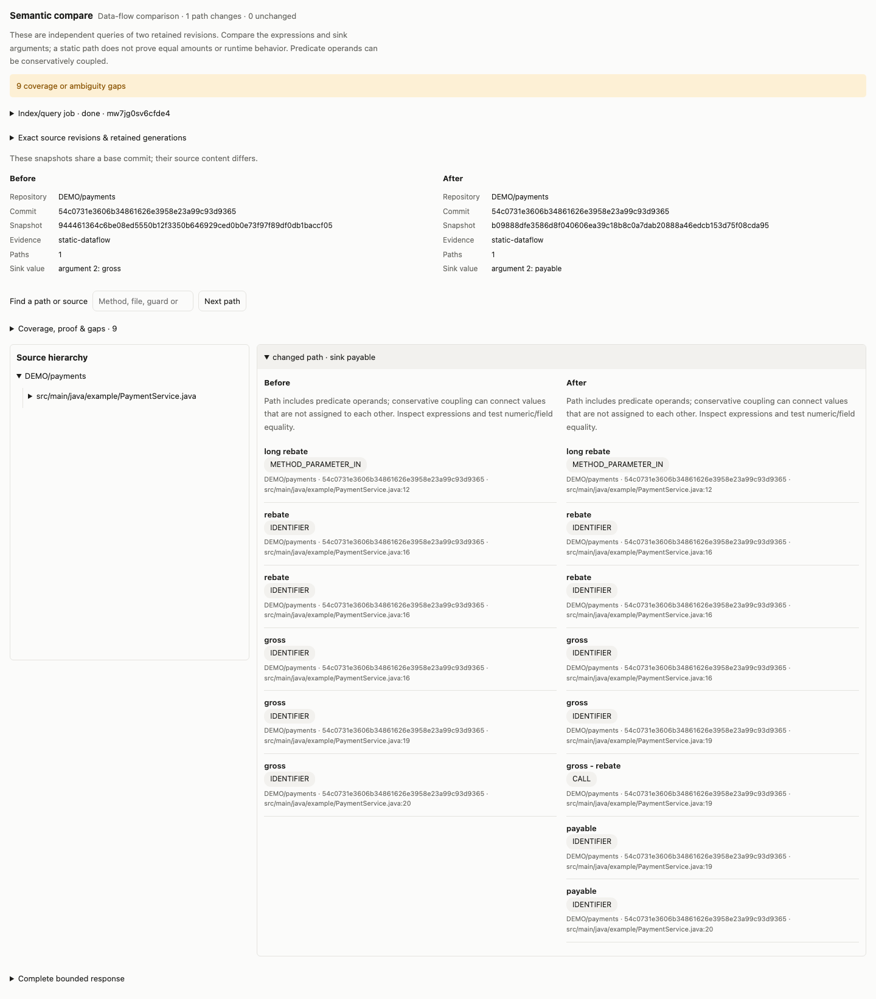

# Compare branch data flows and verify a feature

Use two retained analyses of the same repository and frontend. A structural comparison reports changed signatures, calls, guards and ports. A data-flow comparison runs the same selected value query independently in each retained CPG. It does not connect the branches into one graph.

## Pin the sources

Build each ref separately. Keep the returned `revisionKey`, then index it with `language:"java"` (or `"js"` for JS/TS). A Java service with a Node smoke test can otherwise have both frontend analyses; they are not a before/after pair.

```json
{"tool":"code_index","arguments":{"project":"SHOP","repo":"payments","ref":"main"}}
{"tool":"code_index","arguments":{"project":"SHOP","repo":"payments","ref":"feature/rebates"}}
{"tool":"semantic_index","arguments":{"revisionKey":"<before-revision-key>","language":"java"}}
{"tool":"semantic_index","arguments":{"revisionKey":"<after-revision-key>","language":"java"}}
{"tool":"semantic_index","arguments":{"repo":"SHOP/payments","language":"java","versions":true}}
```

Observe returned jobs using the same tool and `job`. Queries never silently start a parse. If a service passport pins the deployed revision, use its repository and an explicit ref/revision key to analyze another branch; do not mix the deployed dependency closure into a different branch without verifying its bindings.

## Compare one entry value to an exit

The `analyses` array is ordered **before, after**. Use names/signatures/files that resolve independently in each revision. Do not put a revision-specific canonical ID, SHA or analysis ID inside the endpoint selector. `parameter` accepts an exact method parameter name or a one-based index; `argument` selects a one-based call argument. Narrow overloads and repeated call sites with signature/file/line, and inspect ambiguity.

```json
{
  "tool":"semantic_query",
  "arguments":{
    "operation":"compare",
    "mode":"dataflow",
    "analyses":["<before-analysis-id>","<after-analysis-id>"],
    "from":{"kind":"method","name":"submit","parameter":"rebate"},
    "to":{"kind":"call","name":"save","argument":2},
    "maxPaths":8,
    "maxHops":30,
    "waitMs":1000
  }
}
```

Compare each relevant exit: storage, event publication and an API response can disagree even when their caller chains look the same. `comparison.before/after.selectedValues` states the selected source call and argument expression, such as `gross` versus `payable`. These are source expressions, not measured runtime amounts. Unique changed paths are shown side by side; multiple unmatched candidates remain separate additions/removals rather than guessed pairs. Matching ignores generation-local node IDs and shifted line numbers. It does not normalize away changed expressions.

Table/port exits retain their local CPG segments and separately declared field mappings. The comparison includes those segment expressions and mappings; missing mappings remain inconclusive evidence, not an empty clean diff. A composed lineage remains different from a single Joern path and from runtime proof.

`inconclusive` means one side failed, was ambiguous, had no resolvable endpoint or exhausted a bound. It cannot establish a clean removal. `no-supported-path` means only that this bounded query found no supported path. Even an unchanged result cannot prove behavioral equivalence.

## Read the predicate caveat

The real Joern exercise found a conservative path from `rebate` through the predicate `rebate > gross` to the `gross` argument of `ledger.save`. The application still saved the wrong amount. Static path membership therefore did **not** prove that the ledger received `gross - rebate`.

Paths mark predicate operands with `inCondition` and carry a caveat. Inspect the expressions and the selected sink value. Keep numeric/field equality, rejected-input no-effects, tenant identity and effect counts as independent entry-to-exit assertions. `comparison.behaviorVerified` remains false; the model's explanation and a green smoke test cannot change that verdict.

## Fix in a workspace and retain the comparison

Edit a private workspace, run an appropriate regression and export its patch. To check the edited source, call `semantic_index` with `repo:"work/<workspace-id>"` and the frontend. The analysis keeps the logical service repository, base SHA and a distinct source digest. Two edits at the same base SHA retain separate CPG generations and canonical symbol identities. Dirty workspace snapshots do not replace the committed repository default. Select the returned analysis ID explicitly when comparing the feature to the fix.

The Admin Semantic page and the inline Open WebUI result show exact before/after snapshots, sink values, source hierarchy, changed expressions, proof limits and expandable gaps. **Open full view** removes the chat height limit; it reads the saved result without rerunning Joern.



## Keep model responses short

Semantic tools default to `format:"compact"`, with a 16 KiB JSON preview budget. Set `max_output_bytes` between 4 and 64 KiB. Repeated locators, frontend metadata and generation-local node IDs are removed from path previews; exact analyses, source locations, proof status and selected argument values remain available. If further detail does not fit, `previewTruncated` and `omitted` state what was left out. This is separate from the query's own `truncated` coverage flag.

The inline view always retains the original response. `format:"full"` returns original tool JSON; narrow the query or use its same-result cursor when more evidence is needed. A preview omission is not a missing graph path.

## Reproduce the exercise

The fixture generator creates an actual Git repository with `main` and `feature/rebates`. The feature contains a deliberate ledger/event mismatch. Its public Node smoke test compiles and executes Java, but covers zero rebate and passes before the fix. A second public entry-to-exit test checks a nonzero rebate and reports all three exit amounts. This gives the model concrete red/green feedback. A separate evaluator compiles independent Java checks for other nonzero/zero/full rebates, tenant identity, large integer amounts, exactly one effect at each exit and invalid-input no-effects. Editing a public test cannot satisfy that oracle. The adapters are in-process fixtures, not a real database or broker.

```sh
# Use an existing owned Joern worker and, for model runs, a loopback model endpoint
# or SSH tunnel. Tokens stay in environment variables, outside reports.
export DT_SEMANTIC_LIVE_URL=http://127.0.0.1:44110
export DT_SEMANTIC_LIVE_TOKEN=YOUR_WORKER_TOKEN

# Real Joern, both branches, edited/reverted snapshots and original evidence retention.
node --test test/semantic-branches.live.test.js

# Real local model; creates an isolated config and synthetic service repository.
node dev/eval-branch-flows.js --home work/branch-model \
  --endpoint http://127.0.0.1:41435 --semanticUrl http://127.0.0.1:44110 \
  --model qwen3.5:4b --profile evidence --format compact --task bug --verification regression \
  --output work/branch-model-bug.json

# Implement the feature from main instead of fixing the incomplete feature branch.
node dev/eval-branch-flows.js --home work/branch-model \
  --endpoint http://127.0.0.1:41435 --semanticUrl http://127.0.0.1:44110 \
  --model qwen3.5:4b --profile evidence --format compact --task feature --verification regression \
  --output work/branch-model-feature.json
```

`--profile direct` exposes the broader investigation tools and requires the model to obtain its evidence. `--profile evidence` explicitly prefetches the two real Joern exit comparisons and exposes four tools for further queries, source reading, editing and tests. Prefetches are attributed to the harness, not credited as model discovery. Models receive requirements and source evidence; expected answers and independent test implementation remain outside the readable service repository. Reports include exact advertised model digest/quantization, schema/source hashes, usage, response bytes, ownership-safe tool events, patch, budgets and independent outcomes. Model identity is provider-reported.

`--verification regression` additionally prefetches the public failing regression and requires the model to rerun it successfully. The hidden cases stay private. The default `smoke` mode reproduces the earlier failure experiment; it does not supply a sensitive regression. Use a fresh home when switching from an older fixture that lacks the new public test.

The exercise also exposed a model copying line-numbered display text into Java. `workspace_read` now returns plain, copyable source by default; `line_numbers:true` opts into numbered display. Exact line ranges remain in metadata. `workspace_write` rejects an obvious numbered Java source dump before changing the file. Small changes can use exact `edits` instead of rewriting an entire file. Missing-file errors include complete relative recovery paths, and empty regex-looking literal searches explain the `regex:true` option without silently changing search semantics.

Observed runs and limits are recorded in the [evaluation evidence](benchmarks/joern-branch-evaluation.json). These few synthetic tasks do not establish production reliability. Broad-tool 4B runs repeated unproductive searches; source-search ambiguity and missing-file recovery were fixed from that feedback. The guided mode tests interpretation and implementation, not unguided tool discovery. Review the model's explanation separately from the independently verified patch.

Observed on the provider-reported `qwen3.5:4b` / 4.2B / Q4_K_M model:

| Exercise | Observed result |
| --- | --- |
| Broad-tool investigation | Repeated unproductive queries; exhausted the turn budget. |
| Guided repair of the incomplete branch | Correct patch; all 13 independent Java cases passed. Some explanations overstated the smoke-test evidence. |
| Guided feature development with only a smoke test | Claimed the ledger was updated, but the patch still saved `gross`; independent checks failed. |
| Guided feature development with a public entry-to-exit regression | Initial patch still missed the ledger. The public failure reported the three exit amounts; the model repaired it, reran both public tests successfully and passed all 13 independent cases. |

The final regression-assisted trial used 12 model turns and 11 model tool calls, plus three explicitly attributed harness prefetches. The 4 KiB example preview was 3,796 bytes versus 13,335 bytes for the original response; it explicitly omitted path detail and retained the selected values and proof limits, with complete paths in the full view. These are individual observed trials and byte measurements, not a controlled model-quality benchmark.
