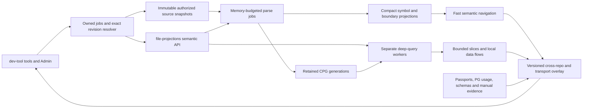

# Joern integration: retained revisions, fast queries and distributed flows

Status: proposed architecture, inspected 2026-11-04. No Joern backend is enabled by this document. Resource sizes and latency gates below are starting targets, not measured Joern performance.

Implementation: the opt-in backend now ships as a vendored Node worker and standalone Joern scripts, with retained revisions, compact SQLite navigation, editable passport/port overlays and inline views. See [operation and verification](semantic-code.md) for the implemented contract; this document retains the broader design rationale and acceptance roadmap.

Use `file-projections` as the reusable analysis service, extend its Joern farm, and keep dev-tool responsible for repository/version resolution, passports, environment identities, ownership and tool presentation. Keep native text search immediately available. Use compact semantic projections for navigation and retained CPGs for deeper queries. Add distributed boundaries as explicit evidence, rather than parsing the entire service estate into one graph.

## What exists and what needs work

Inspected `file-projections` at [`fbce4a5da60a0431c233d18b524bdbd99246574c`](https://github.com/merv-gh/file-projections/tree/fbce4a5da60a0431c233d18b524bdbd99246574c), currently also the `v0.18.0` source. Its Go source tests passed locally (`go test ./... -timeout 90s`). The separate farm compiles under `go test ./...`, but has no tests. These checks did not execute Joern or establish production throughput.

| Existing component | Reuse | Required change |
| --- | --- | --- |
| [Farm API and workers](https://github.com/merv-gh/file-projections/tree/fbce4a5da60a0431c233d18b524bdbd99246574c/joern-farm) | Async source submission, parse workers, logs, retained binary CPG and remote scripts | Durable jobs, commit/content keys, language dispatch, authentication/scope checks, scheduling, cancellation and bounded IO |
| [`src/joern.go`](https://github.com/merv-gh/file-projections/blob/fbce4a5da60a0431c233d18b524bdbd99246574c/src/joern.go) | Frontend invocation, manifests, farm client, embedded scripts | Content/configuration identities, immutable generations, atomic publication and request deadlines |
| [`src/language.go`](https://github.com/merv-gh/file-projections/blob/fbce4a5da60a0431c233d18b524bdbd99246574c/src/language.go) | Language registry and scanners | Explicit `jssrc2cpg` dispatch and tested JS/TS semantic capabilities |
| Cross-repo types, Gradle discovery, DB mappings and trace lenses | Candidate discovery, readable slices, DI candidates and source locations | Exact dependency revisions, signatures, environment-qualified database identities and typed evidence |
| Assumption/unroll helpers and projection renderer | Present guards and source-linked slices compactly | Structured predicates, branch polarity, coverage and proof status |

Concrete limitations in that revision:

- Farm parsing always chooses Java: `javasrc2cpg` or `joern-parse --language javasrc`. The JS/TS lexical unroller does not establish JS/TS Joern data-flow coverage.
- Farm jobs live in an in-memory map. Submitted metadata contains name/branch/export, without immutable source, dependency or analysis identities.
- Queries use `joern-worker-1` directly, bypass the parse queue, start a fresh interpreter and ignore the execution error if an output file exists. Query CPU/heap and cancellation are not managed independently.
- The worker hardcodes a 4 GiB parser heap even though configuration exposes `JOERN_HEAP`; Compose uses a mutable `:master` image. Source uploads are buffered by the client, and `ParseMultipartForm(500 << 20)` is an in-memory threshold, not a total request-size cap.
- Binary CPG retention already exists with `export:false`. The optional CSV export deliberately removes data/control-dependence and dominance edges in `NeededEdges`; it cannot be our data-flow store.
- Local CPG names hash the source-root path; changed roots are rebuilt into that same path. The manifest supports unchanged-source reuse, not complete per-file incremental CPG relinking. `cpg-remove-file.sc` explicitly documents the missing re-add/linker work.
- `entry-to-exit.sc` computes method reachability and emits endpoint pairs; it does not emit every feasible interprocedural data path or its required guards. Its representative `chain` helper is not emitted. Several scripts collect complete traversals into `.l` before writing output.
- The application and farm are separate Go `package main` modules. They are usable as processes; the current repository is not an importable analysis library.

For Joern, evaluate the inspected latest release [`v4.0.673`](https://github.com/joernio/joern/releases/tag/v4.0.673), then pin the tested release, image digest, CPG schema and query bundle together. Current upstream requires JDK 21 and uses flatgraph; some documentation still describes older runtimes. Java uses `javasrc2cpg`; JS/TS uses [`jssrc2cpg`](https://github.com/joernio/joern/blob/v4.0.673/joern-cli/frontends/jssrc2cpg/README.md), including a platform-specific AST generator. Verify both frontends in the actual image during admission.

## Architecture and responsibility



dev-tool remains the authority for fetching source and resolving exact artifact/module versions through `lib/bbindex.js` and `lib/passport/index.js`. The analysis service receives authorized snapshot handles or streamed archives; it does not independently choose a latest library branch. Parsing must run outside Node's `lib/isolate.js` heap and outside the request process.

Keep the initial integration over a versioned HTTP/NDJSON API and a pinned worker image. This lets the Node app and Go service deploy independently. Later extract `analysis`, `cpgcache`, `query` and `projection` Go packages behind the same protocol if other consumers need a library; do not make that refactor a prerequisite for the first integration.

## Immutable identities and cache lifecycle

Separate source parsing from environment overlays:

| Identity | Inputs |
| --- | --- |
| `sourceId` | Canonical repo, full commit SHA, actual source digest, module/root selection; dirty sources use a scoped workspace digest |
| `parseKey` | Source IDs, frontend/release/schema/image/AST-generator versions, language, parser options, JDK/type classpath hashes, relevant build/tsconfig/lockfile hashes |
| `analysisKey` | Parse key, required passes, analysis limits, custom semantics and extractor/query-bundle versions |
| `overlayKey` | Selected analysis generations, exact dependency bindings, passport digests, environment/catalog/schema revisions and manual-adjustment revision |
| `queryKey` | Resolved analysis/overlay IDs, named query and version, normalized arguments, query budgets and visibility scope |

Type-resolution dependencies belong in `parseKey` when they influence the frontend. Boundary-only metadata belongs in `overlayKey`: editing a Kafka mapping or a map adjustment must not reparse Java. Hash canonical serialized manifests, not display names or host paths.

Use `cache/semantic/<namespace>/<analysisKey>/<generation>/` with a manifest, checksums, `cpg.bin`, compact query database and diagnostics. Namespace follows the authorized corpus; private workspaces and story artifacts never enter a globally visible cache. Share immutable artifacts only when access policy permits and enforce authorization on every lookup, including cached results.

Publish by staging a complete generation, validating it, then atomically changing a small alias with compare-and-swap. A late job must not move a branch alias backward after a newer requested build wins. Resolve branch/tag to SHA once before scheduling; every response returns that SHA, source digest and generation. A missing pinned SHA remains missing; an explicitly allowed latest-branch approximation is labeled and excluded from exact-version claims.

`reparse=true` creates a new generation even for the same analysis key. It preserves the last good generation until validation succeeds. Readers hold a lease on the generation they opened. Failure, OOM, restart and cancellation do not mutate it. Job attempts and artifacts have separate lifetimes: deleting a job record must not delete a referenced snapshot.

Initially, unchanged inputs reuse artifacts and changed parse inputs receive a full frontend build. Reuse unaffected repository CPGs and recompute only affected overlays. Do not promise incremental per-file Joern reparsing: removing nodes without re-running cross-file type/call/data-flow linking can leave incorrect results. Evaluate copy-on-write incremental builds only against a full-build equivalence oracle. Preserve all pinned versions; later add explicit, reference-aware retention with dry-run and active-reader leases.

Joern numeric node IDs are generation-local. Expose canonical repository/revision/signature identities using `lib/semantic-identity.js`, plus a separate `{analysisId,generation,nodeId}` locator. Include overload signatures and relative source spans for anonymous functions/calls. A line number or simple class name alone is not a cross-version identity.

## Parsing and resource scheduling

Each job has durable stages: `queued → resolving → uploading → parsing → enriching → projecting → validating → publishing → ready`, with `failed`, `interrupted`, `cancelling`, `draining` and `cancelled` outcomes. Stage progress is explicit; a percentage is an estimate unless based on completed work units.

Use direct language frontends, then explicitly create and verify the passes required by each capability. Parsing is not equivalent to a data-flow-ready graph: record available overlays, skipped/failed passes, unresolved types and analysis limits in the manifest. Joern's [default-overlay implementation](https://github.com/joernio/joern/blob/v4.0.673/joern-cli/src/main/scala/io/joern/joerncli/DefaultOverlays.scala) applies base overlays and OSS data flow separately. Never silently turn an enrichment failure into a complete result.

For Java, resolve type jars from the exact dependency closure and record their checksums. Make Lombok/delombok behavior an explicit capability/configuration decision; disabled generated members become coverage gaps. For JS/TS, preserve tsconfig aliases, package exports, workspace/lockfile bindings, source locations, TS/TSX and async/callback behavior in the fixture matrix. Report dynamic imports, reflection, generated code and unresolved dispatch honestly. Mixed-language repositories get language-specific parses tied to one source manifest.

Proposed first worker profiles on a 64 GiB analysis host: one parse slot with a 32 GiB container cap and about 20–24 GiB Java heap, plus a separately admitted query slot with a 16 GiB cap. Reserve the remainder for native AST generation, OS and services. Measure RSS before increasing concurrency; a memory admission controller sums reservations across parse and query jobs. Large repositories may need a larger profile or bounded module-level parses with explicit linking gaps. No single size is asserted sufficient for every repository.

Run jobs in independently stoppable containers/process groups with source mounted read-only and only their staging/output directories writable. Avoid inherited global heap flags; [Joern documents](https://docs.joern.io/installation/) that importing source can create another JVM. Separate resolution network access from CPU parsing. Do not give analysis workers the host Docker socket or service credentials.

Add durable attempt leases, heartbeat/restart recovery, idempotency keys, deadlines, fair per-owner admission, bounded logs and typed `resource_exhausted` failures. Retry transient infrastructure errors within a budget; an OOM needs a deliberate larger profile or changed scope, not an endless identical retry. A cancelled queued job never starts; cancelling a running job stops the actual container/JVM, waits for cleanup and forbids publication. Client disconnect alone must not lose the job handle. If several authorized callers share a build, cancelling one subscription must not cancel the others.

Stream archives and NDJSON with compressed/uncompressed byte, file-count and per-record limits. Reject traversal/symlink escapes and unexpected files. Preserve parser-relevant configuration without uploading secrets or build outputs. Stream query records and keep large artifacts out of Node's heap; no whole-estate JSON export or unbounded `.l` traversal on the request path.

## Fast navigation and deeper analysis

Publish a compact, indexed SQLite projection per generation: interned strings, integer node/edge IDs, symbol signatures, relative source locations, forward/reverse call adjacency, external ports, parameter/return summaries and coverage. Use indexes on symbol, kind, file, callers/callees and boundary identity; use FTS for symbol/document discovery where appropriate. Keep large CFG/DDG bodies in the CPG and fetch bounded slices on demand.

The fast path answers symbol search, callers/callees, boundary lists, neighborhoods and candidate reachability without starting a JVM. Deeper field-sensitive slices and `reachableByFlows` run in the separate query pool. Start by publishing useful boundary/parameter summaries, not every source/sink pair. Cache completed slices against immutable identities and limits. Keep a memory-budgeted LRU of warm CPG query sessions; serialize or isolate interpreter access rather than assuming its mutable workspace is concurrent or read-only. Never mutate the published binary while importing/enriching it.

Keep distinct query kinds: symbol search, call reachability, control-flow paths and data-flow paths. A call chain is not proof that a particular value reaches its sink. Natural-language requests resolve to these typed operations with source citations; embedding similarity can later improve discovery, but is not the semantic edge engine. Native trigram/ripgrep search remains available while parsing is queued, missing or failed, with the fallback and missing semantic coverage shown.

For expensive requests return a job quickly and progressively expose available summaries. Cursors bind to a fixed generation/overlay, with node/path/time/byte budgets and `truncated`, `gaps` and continuation information. Avoid repeated automatic reparses when a bounded query finds no path.

## Passport entry/exit ports and cross-repo composition

Attach passport evidence to exact CPG methods and call sites by source snapshot, relative file, range and resolved signature. Enrich passports with a semantic reference and typed ports rather than embedding a giant graph. Match ambiguity remains a list of candidates. Preserve current passport/code-index compatibility.

| Port | Evidence needed and direction |
| --- | --- |
| HTTP ingress | Server method + route + service/environment/base-path identity; request fields → handler parameters |
| HTTP egress | Client target/config + verb/route + serialization; caller argument → request body, response → caller result |
| Kafka consume/produce | Cluster/env + resolved topic + payload/schema/version + key/header/field mapping; producer → topic → consumer |
| DB read/write | Env + database + schema/table/column, SQL/ORM mapping and operation; table column → read value, written value → table column |
| Scheduled/background ingress | Scheduler registration/callback + configuration; schedule → handler control edge, with separate table-read data edges |
| Internal library | Exact artifact/module/source revision and method signature, dispatch/DI evidence and argument/return mapping |

Extend `lib/passport/edges.js`: its current normalizer handles HTTP/Kafka/ES at service level, not the required method/field-level DB ports. Reuse PG usage, `lib/fieldtrace.js`, SQL-function/trigger/view dependencies and `lib/flows.js` findings as separately attributed evidence. A scheduled table reader is not triggered by an insert merely because it reads that table. Reads, writes, polling, CDC and DB triggers require different edge kinds.

For HTTP, matching a route string alone is insufficient: keep configured hosts/base URLs, service/environment and proxy prefixes. A React UI links to its API calls through actual code/config evidence; it acquires no Kafka edge from a broad service overview. Kafka topics in two clusters and tables in two databases never merge by name. Foreign keys establish a schema relation, not executable value flow. Manual links stay in a separate, versioned overlay with author/reason/provenance and remain distinguishable from extracted evidence.

Use two complementary forms of library analysis:

1. Reuse each library's retained CPG and compute interprocedural input/return/side-effect summaries with field paths and guard evidence. Compose only across exact dependency bindings and compatible call signatures; handle recursive summaries with a bounded fixed point. Call reachability and value-flow summaries have separate status.
2. For unresolved or important service/library paths, schedule a composite CPG over that service's exact dependency closure. Its key includes the entire closure and a source-origin map. Avoid duplicate jar/source definitions. Joern type resolution can improve evidence but does not automatically prove Spring bean selection, proxies or reflection. Keep ambiguous implementations and conditional bean configuration visible.

Distributed composition connects these local summaries through typed transport/DB ports. Track serialization transformations, request/response direction, DB transaction boundaries, Kafka delivery/retries and schema compatibility. Where a field mapping or runtime routing decision is unknown, return a boundary gap and candidate path; do not manufacture an end-to-end Joern path. Preserve alternative paths and cycles with bounds rather than enumerate every possible execution.

## Assertions and what a result means

Return predicates as structured evidence: expression, input/field identity, branch polarity, source range, analysis generation, applicable path/region, origin and status. Include explicit validation calls, early-return/throw guards, branch conditions, SQL predicates and relevant catalog constraints. Track mutations/aliases and call argument substitutions; copying a condition string past a changed variable is unsafe.

Use separate statuses:

| Status | Meaning |
| --- | --- |
| `path_condition` | This branch is required for the particular displayed control path; feasibility may still be unknown |
| `must_hold` | Required on every supported path through the stated region, with dominance/control-dependence, exception and bypass checks and sufficient coverage |
| `observed` | A specified test/trace/input showed it; no universal guarantee |
| `declared` | A contract or manual assertion states it; enforcement is not established |
| `unknown` / `counterexample` | Missing evidence or a supported bypass/contradiction; include the reason/path |

Joern's [`reachableByFlows`](https://docs.joern.io/cpgql/data-flow-steps/) produces data-flow paths; it is not a general path-feasibility or distributed invariant prover. [Unknown external-method semantics](https://docs.joern.io/dataflow-semantics/) can over-propagate values. Add reviewed, versioned semantics for common serializers, validation libraries, JDBC/ORM, Kafka and HTTP wrappers; an overly narrow semantics rule can also remove real flows.

Across asynchronous boundaries, a producer guard is an upstream condition associated with that producer path. It is not a guarantee for every possible consumer input: other producers, replay, delivery and schema behavior matter. Database constraints have transaction/schema scope, and SQL `CHECK`/NULL semantics must be modeled accurately. Do not infer arbitrary business assertions or equate a passing test with proof. Later, add a restricted predicate solver for supported expressions and explicit counterexample search; unsupported predicates retain unknown feasibility.

Example result to aim for: topic `order.created` → consumer → internal validator → `sales.orders` write, with `order.id != null` required on the displayed path, the positive-amount check and its bypass status, payload/column mappings, exact service/library versions, and any unresolved serialization/dispatch edge. Ask “must amount be positive?” against all selected producer/consumer paths, not just the first matching chain.

## Tool and API contracts

Keep a small discoverable family; details come from `tool_describe`, not a large always-loaded prompt:

| Tool | Contract |
| --- | --- |
| `semantic_index` | Repo/service/exact revision or workspace; schedule parse/reparse, return resolved IDs and job immediately; list retained generations when no build target is supplied |
| `semantic_capabilities` | Engine/image/frontend/query versions, available named operations, readiness and limits |
| `semantic_search` | Repo/revision set + symbol/port/kind filters; compact ranked locators, counts and cursor |
| `semantic_query` | Named operation (`callers`, `callees`, `slice`, `paths`, `assertions`, `compare`) with typed source/target selectors, direction and budgets; fast response or job |

Reuse existing job inspection/cancel surfaces rather than add a second chat job system. `semantic_query` compares two explicit revision sets without moving aliases; assertion/payload/port changes include provenance. The backend catalog lists query argument schemas and supported languages. Examples should cover `from=HTTP`, `from=topic`, `from=table`, and reverse `to=table` queries.

Every result carries protocol/query version, resolved revision set and dependency bindings, analysis/overlay IDs, backend, coverage, ambiguity, limits, proof status, source references and an optional saved-view/result handle. Default previews are small; full results are paginated artifacts. Missing analysis returns readiness and an explicit build suggestion, not a hidden minutes-long parse. Long operations are idempotent jobs with a request ID that can be reconciled after a lost response.

Proposed calls, to be finalized in the versioned schemas during the first slice:

```json
{"tool":"semantic_index","arguments":{"service":"order-service","ref":"<full-sha>","env":"dev","reparse":false}}
{"tool":"semantic_index","arguments":{"versions":true}}
{"tool":"semantic_query","arguments":{"operation":"paths","revisionSet":"<resolved-overlay-id>","from":{"kind":"topic","env":"dev","cluster":"events","name":"order.created"},"to":{"kind":"table","env":"dev","db":"orders","schema":"sales","name":"orders"},"mode":"dataflow","maxPaths":8,"maxHops":20,"budgetMs":5000}}
{"tool":"semantic_query","arguments":{"operation":"assertions","path":"<saved-path-id>","includeBypasses":true}}
```

Service indexing returns the resolved revision-set handle for that service and its bound dependencies. Querying across several services resolves an explicit set of those handles into an overlay; it never implicitly mixes their latest aliases during traversal. Both forward and reverse queries expose the same evidence and condition identities.

Evolve farm endpoints to separate artifacts, job attempts and queries: submit/status/logs/cancel for attempts; list/read immutable analyses; named-query discovery and submit/status/results for queries. Keep `DELETE` artifact removal distinct from cancellation. Preserve legacy file-projections clients through an adapter/deprecation period.

Do not expose unrestricted Scala or uploaded scripts as a normal model tool. Joern's [server documentation](https://docs.joern.io/server/) explicitly says its interpreter is not a sandbox. Named, versioned queries receive validated arguments, including validated regex limits. An optional trusted-admin script facility needs isolated execution and the same resource/ownership controls. The farm must enforce authenticated principal/story/corpus context; a reverse proxy token alone does not supply artifact-level authorization.

## dev-tool integration points and visibility

| Area | Existing seam and proposed work |
| --- | --- |
| Source and versions | `lib/codeindex.js`, `lib/passport/index.js`, `lib/bbindex.js`: provide exact source snapshots and resolved library closure |
| Service adapter | New `lib/semantic-code.js`: capability negotiation, request IDs, job reconciliation, source transfer and normalized bounded results; reuse `lib/adapter-port.js` where its contract fits |
| Job ownership | `lib/jobs.js`, `lib/execution.js`, `lib/access.js`, `lib/state-store.js`: persist remote attempt IDs, stage/resource metadata and cancellation handles; remote farm remains authoritative for container completion |
| Passports and data | `lib/passport/edges.js`, `lib/flows.js`, `lib/fieldtrace.js`, `lib/pgindex.js`: method/field ports and evidence overlays |
| Existing queries | `lib/impact.js`, `lib/semantic-identity.js`, `lib/semantic-knowledge.js`: consume bounded semantic candidates with backend/proof distinctions; preserve existing native behavior |
| Tools/deployment | `lib/tools-code.js`, `lib/tool-profiles.js`, contracts, config, Compose and doctor checks: opt-in service, compact schemas and independent readiness |
| Presentation | Existing Admin Runtime, passport and saved result/view surfaces: job stages/cancel, exact revisions, cache hits, CPU/heap/RSS, warnings, query args/results and source-linked path/condition details |

Private-story external adapters already require an authenticated, scope-aware backend. Enforce the same requirement server-side for semantic jobs, sources, CPG downloads, queries and saved results; never trust a scope supplied in model-editable arguments. Shared caches must not expose another user's private source, paths, query timing/counts or artifacts. Bound remote job cleanup/recovery separately from the current process-owned `lib/jobs.js` lifecycle.

For the user-facing flow view, group repositories/services by prefix, show actual edge evidence and collapsible paths/conditions, and keep successful transient jobs/results compact. Inspection opens editable typed query arguments with Run/Cancel and the saved result. This reuses current map/passport conventions; no separate graph application is required for the first release.

## Delivery order and acceptance gates

1. **Compatibility and measurement spike.** Pin an image/release; run real Java and JS/TS parses, base/data-flow enrichment, named queries, import/restart reuse and source maps. Compare against hand-checked fixtures and native results. Record cold/unchanged/changed/reverted commits, peak RSS, CPU, CPG/projection bytes and cold/warm query latency. This decides image/frontend options and resource profiles before making deployment promises.
2. **Farm foundation.** Contribute durable keyed artifacts/jobs, Java + JS/TS dispatch, authenticated ownership, atomic generations, real memory/CPU admission, request limits, independent parse/query scheduling, cancellation and tests to file-projections. Produce a pinned service image. Wire `semantic_index`, capability/list/status and Admin metadata in dev-tool behind opt-in configuration.
3. **Fast local semantics.** Publish compact symbol/caller/port summaries, bounded data-flow slices and predicates with coverage. Java and JS/TS both need real semantic fixtures before claiming this phase complete. Keep native text search and existing tools usable with the farm unavailable.
4. **Exact cross-repository library flows.** Connect dependency summaries and composite CPG jobs, including overloads, DI ambiguity, conditional beans, transitive libraries and simultaneous versions. Add revision comparison and cache reuse tests.
5. **Distributed ports and assertions.** Join HTTP/Kafka/DB/scheduled flows with exact environment/schema evidence. Add serialization/ORM semantics, DB functions/triggers, alternative paths, guard/bypass extraction and scoped assertion statuses. Expose them through the same tools and views.
6. **Estate validation and rollout.** Benchmark representative production-sized Java and TS repositories, run concurrent chat/user stories and failure drills, then shadow existing impact/flows queries. Investigate disagreements before enabling semantic results by default. Keep the native fallback and engine provenance visible.

Required end-to-end fixtures: React/TS API client → Java controller → transitive internal library → Kafka → consumer → table; table → scheduled poller → library → Kafka; JS/TS server → wrapper → database; and reverse table/topic impact. Each includes a guarded success path, a bypass or rejection, overloaded/ambiguous calls and a missing dependency. Vary environment, topic cluster, schema, service SHA and two versions of one library; the unrelated version must never contribute callers or assertions.

Failure gates: two simultaneous builds of one key, forced same-key reparse, a late stale job, cancelled queue/running query, worker OOM, process restart, partial/corrupt artifact, failed enrichment, missing exact library version and unavailable farm. The last good generation must remain byte-identical/queryable, and unauthorized users must not list/read/cancel another story's work. Full versus any future incremental build must match the selected semantic oracle.

Proposed performance gates: cached submission/list returns in under 1 second; warm compact searches/neighborhoods reach p95 under 500 ms; cached flow summaries under 1 second; deeper queries acknowledge with a job within 1 second and obey declared budgets. Measure with parsing active and multiple owners. Report cold and warm results separately and publish corpus/CPU/RAM/concurrency settings. Changed-commit parse time must be measured; do not claim millisecond reparsing or universal low latency.

The first implementation slice should therefore be the tested, revision-keyed Java/JS/TS farm contract and dev-tool job adapter. It establishes the cache and isolation guarantees that every later flow/assertion feature relies on, while the complete target above remains the release roadmap.
