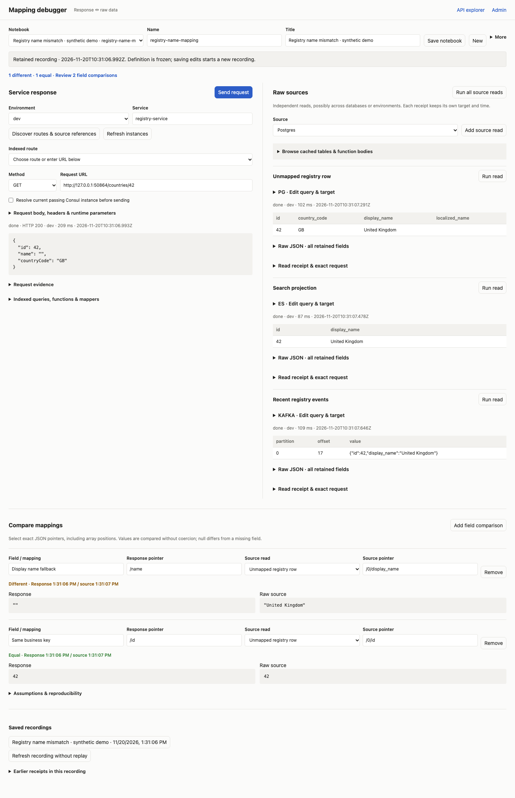

# Mapping debugger

Open **Admin → API client → Mapping debugger**, or `/mapping-debugger`. This is an extension of the backend API Explorer: service routes and responses on the left; editable Postgres, Elasticsearch and Kafka reads on the right. All sends use the existing authenticated WebSocket command transport, with its HTTP fallback, tracing, rate limits and cancellation.

1. Select environment/service and **Discover routes & source references**. This reads cached routes, source SQL (including retained internal-library findings), SQL-function calls, topic and index references. It does not query infrastructure. The UI reports bounded candidates, not every query observed in an API call.
2. Select a route, fill its path parameters and review the method/URL. **Send request** explicitly sends it. Follow Consul resolves a current passing instance before sending; **Refresh instances** never replays traffic. Manual URLs work with Follow disabled. Headers/body and runtime parameters are under the request disclosure; credentials use a runtime server-side bearer profile.
3. Add source reads with an explicit environment/database/index/topic. SQL uses bound `$1` parameters. **Browse cached tables & function bodies** offers table read drafts; inspect function signatures/bodies before writing a function invocation. **Find field & mapper lineage** uses the existing `field_trace` evidence, including expressions and source locations. Review generated SQL drafts before executing.
4. **Run read** or **Run all source reads**. The latter never sends the API request. Each receipt has its target, timestamps, duration, error, exact read and bounded raw data. HTTP error statuses remain visible; network errors keep the failed exchange and unknown-outcome diagnostic. Cancellation never retries.
5. **Add field comparison**. JSON pointers such as `/name` and `/0/display_name` select values on either side, with captured-path suggestions. Null, absent fields, number/string differences and object equality are handled separately. Expand raw JSON for nested data and columns outside the table preview. Record business-key, mapper, function and cache assumptions.
6. Save a readable notebook name. Reopen it without sending traffic. Changed definitions start fresh recordings; recordings freeze their definition, and repeated reads retain prior receipts in history. The same authenticated user can open notebooks/recordings from another chat. Other users and newly disallowed environments cannot read them.
7. **More → Open inline snapshot** creates the compact interactive comparison for chat and `/show`. Source results are collapsed; errors open. Local pointer edits work inside the sandbox. Fresh sends run in the authenticated debugger. **Name snapshot /show** gives the retained result a private readable alias; admins can explicitly publish using `named_view` with `scope=shared, share=true`. Export notebook produces the definition and reproducible tool calls, excluding runtime parameters/credentials. Inline **Export evidence** contains captured private data; review it before publication.

## Model tool

Use `tool_describe` for `mapping_debug`. Its actions are `discover`, `save`, `list`, `get`, `open`, `run`, `delete`. Save requires `expected_revision=null` when creating, or the current revision when editing. Delete requires the current revision. Run executes only explicit `steps`; `api` can mutate. No model request is made by this workbench.

```json
{
  "action": "save",
  "id": "registry-name-mapping",
  "expected_revision": null,
  "definition": {
    "version": 1,
    "title": "Investigate registry name fallback",
    "service": "registry-service",
    "env": "dev",
    "follow_service": true,
    "request": {"method":"GET","url":"http://selected-service/countries/42","headers":{},"body":{"kind":"none"}},
    "probes": [{"id":"registry","label":"Registry row","kind":"pg","db":"reference","sql":"select id, display_name, localized_name from registry.countries where id = $1 limit 20","params":[42],"limit":20}],
    "comparisons": [{"label":"Display name","probe":"registry","response_path":"/name","source_path":"/0/display_name"}],
    "assumptions": ["Same business key; independently timed reads may see different states."]
  }
}
```

Then explicitly run `{"action":"run","id":"registry-name-mapping","steps":["api","registry"]}`. Keep the returned recording ID. `get` is compact by default; `include_data=true` reads raw evidence without replay. `open` returns a retained inline view and live workbench link. Append selected receipts with `recording` only while the definition revision matches.

Definitions and bounded recordings live under `DT_HOME/mapping-debugger/<principal-hash>/`; back up this directory with other persistent task state. A small metadata index supports listing without parsing all raw recordings. Storage is private, not encrypted. Limits: 200 notebooks, 200 recordings, 256 MiB per user; 30 probes, 100 comparisons, 100 prior receipts, 1 MiB/result, 6 MiB/recording. Individual probes keep at most 100 rows/messages. Narrow queries and delete old recordings explicitly; no silent background pruning.

Independent observations are **not** a transactional snapshot or runtime lineage proof. Dynamic SQL, generated mappers, unresolved library versions and unsynchronized projections remain explicit gaps. Sensitive captured fields may be redacted before comparison. A retained `running` receipt after interruption means the outcome is unknown, so inspect the service before retrying.

## Reproducible showcase

Run `node demo/mapping-debugger.js` and open its printed URL. HTTP runs against a real local Node service; PG/ES/Kafka use explicitly synthetic adapters. The buggy fallback chooses an empty localized label instead of `United Kingdom`. The ID comparison passes while the display name differs. Append `?fixed=1` to the request URL, Send, then Run the registry read: the display name becomes equal. Earlier evidence remains available. `node dev/check-mapping-debugger.js` exercises the browser flow, cancellation, named snapshots, reload, editing and cross-environment reads.



[Retained verification](benchmarks/mapping-debugger-verification.json) records the full-suite counts, coverage gate, browser flows, review scope and infrastructure test limits.
