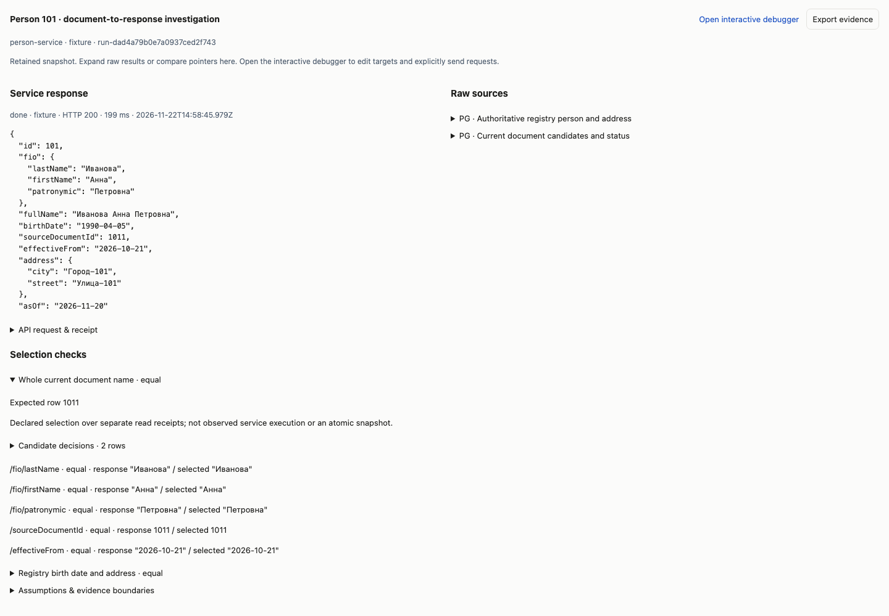

# Person-service mutation practice

This is a real Java 21 / Spring Boot 2.7.18 / Gradle service with one route,
`GET /person/{id}`, backed by disposable PostgreSQL. The runner creates an actual
Git repository and a separate owned workspace per fault. It exercises the same
workspace, query, mapping-debugger, semantic and test-run tools used by the app.
These are inference-time practice/evaluation runs, not model weight training.

## Observed results

| Run | Independently repaired |
| --- | --- |
| Qwen 4B, guided native-tool pilot | 2 / 3 |
| Qwen 4B, staged pilot | 2 / 3 |
| Qwen 27B, guided native-tool pilot | 3 / 3 |
| Qwen 27B, staged full corpus | **23 / 23**, one edit round each |

Every full-corpus repair passed a separate replay on 85 people (68 previously
unseen IDs/names plus 17 public regression people) and three UTC dates:
**5,934 HTTP checks**, without further model calls or repair feedback.
The 4B table-source fault also failed a later focused follow-up. Keep independent
verification gates and escalate unresolved cases to a stronger model or a human.
These development runs changed prompts/settings/tool revisions and have small
pilot samples; they are not a controlled A/B model comparison.

[Verification](benchmarks/person-mutation-verification.json),
[model patches and per-case results](benchmarks/person-mutation-model.json),
[fresh-data/date replay](benchmarks/person-mutation-holdout.json),
[positive and negative pilots](benchmarks/person-mutation-pilots.json), and
[real Joern comparisons](benchmarks/person-mutation-joern.json) retain the evidence.

The accepted rule is **the newest currently valid, active, non-annulled document's
whole ФИО**, with whole registry ФИО as fallback. Future changes cannot win.
Expiry is inclusive; rank effective date then greatest document ID. Family and
given names must be nonblank; patronymic is optional and never borrowed from a
different source. Birth date stays authoritative in the registry. Address must
belong to that person. The clock is fixed to a declared UTC date.

## Reproduce

Provide Java 21, Gradle 8.5 (or a compatible installed version), Docker and Node
22+. Parameters remain overridable; no local installation paths are baked in.

```sh
# Keep a standalone Git repository for manual exploration (refuses overwrites).
node dev/create-person-repo.js work/person-training-repo

# Baseline plus all mutations; no model, network service or Joern needed.
node dev/eval-person-mutations.js --gradle "$DT_TEST_GRADLE" --java-home "$JAVA_HOME"

# Real model, native tools. Remote/LAN endpoints require the explicit opt-in.
node dev/eval-person-mutations.js --gradle "$DT_TEST_GRADLE" --java-home "$JAVA_HOME" \
  --endpoint "$DT_MODEL_ENDPOINT" --allow-remote --model qwen3.5:4b \
  --guided --think true --max-turns 24 --max-tokens 6000 \
  --output work/person-mutations/model.json

# Staged evidence handoff: the harness collects real tool receipts first;
# the model authors edits, then receives rebuilt public HTTP feedback.
node dev/eval-person-mutations.js --gradle "$DT_TEST_GRADLE" --java-home "$JAVA_HOME" \
  --endpoint "$DT_MODEL_ENDPOINT" --allow-remote --model qwen3.8:27b \
  --staged --think false --max-turns 8 --max-rounds 3 --max-tokens 2400 \
  --output work/person-mutations/staged.json

# Opt-in live regression gate for the complete deterministic corpus.
DT_PERSON_MUTATIONS_LIVE=1 node --test test/person-mutations.live.test.js

# Replay exact candidate patches with fresh people and three UTC clock dates.
# No model receives these results or gets another repair attempt.
node dev/verify-person-candidates.js --replay work/person-mutations/staged.json \
  --gradle "$DT_TEST_GRADLE" --java-home "$JAVA_HOME" --seed 137 --copies 5 \
  --output work/person-mutations/fresh-holdout.json
```

`--cases` selects comma-separated fault names, including compound names joined by
`+`. `--seed`, `--copies`, `--gradle-user-home`, `--context-window`, `--timeout-ms`,
`--max-duration-ms`, `--max-turns`, `--max-calls`, `--max-rounds` and `--max-tokens`
are configurable. `--semantic-url` and `--semantic-token` enable the real Joern
worker in native-tool runs. No implicit model calls, retries or compaction occur
inside the mapping tool. The evaluator's explicit repair rounds have hard limits.
Rejected edits that leave source unchanged do not consume a repair round; model
turn/call/time limits still apply. The harness rereads the current file after a
failed exact edit. HTTP 500 feedback includes a bounded application-log excerpt,
so a real missing-column exception is visible instead of only a generic status.

## Faults and independent grading

| Layer | Mutations |
| --- | --- |
| SQL boundary | Archive instead of current table; document ID instead of person ID; wrong state join; wrong address join |
| ResultSet / DTO | Wrong document column; wrong registry column; first/last DTO swap; city/street swap; document birth date instead of registry |
| Selection | Inactive, annulled, future or expired documents accepted; expiry/effective-date boundary errors; incomplete names accepted |
| Ranking | Issue date instead of effective date; oldest instead of newest; reversed ID tie-break |
| Whole name | Registry patronymic mixed into a selected document |
| Combined | Three eligibility faults; column plus birth-date source; ranking plus tie-break |

The corpus has 20 single and three compound faults. At the default three copies,
each rebuilt candidate receives 51 person checks plus a 404 check. Additional
people have different IDs and name values, and document rows are permuted. Archive
names are independent decoys, so stripping a fixture marker cannot repair them.
The public regression sweep covers the 17 visible scenarios; additional people
are graded only at the end. SQL construction, mutation definitions and the
reference policy live outside the model-accessible repository. Tests and build
files are protected, hashed and checked after the run.

A mutation is killed only by a behavioral mismatch from a compiling, running
service. Build errors do not count as successful detection. Final verification
rebuilds current application sources, records their digest and calls the real
HTTP route. A passing tool invocation or a persuasive final answer is insufficient.
Reports distinguish model-authored edits from harness-collected evidence and
verification. Staged success is **not** autonomous tool-discovery success.

Each run owns one loopback-only PostgreSQL container and one JVM at a time. It
reuses those dependencies and Gradle caches between cases, and stops only resources
whose ownership label matches. SIGINT/SIGTERM and duration budgets trigger cleanup.
Model transcripts omit private thinking; retained evidence masks runner/home paths.
Review captures before sharing: this fixture is synthetic, but real notebooks may
contain sensitive database values.

## Investigation improvements

Start with `mapping_debug {"action":"discover","workspace":"<id>"}`. One bounded
read returns the entry call chain, SQL boundaries and copyable source files with
revisions. It follows the existing source graph without starting a network fetch
or Joern parse. Its gaps label overloads, dispatch, generated code and SQL semantics.

A notebook's optional `selections` declare predicates, ordering, mapped fields
and a whole-row fallback. Captured rows show eligibility/exclusion reasons and
the expected winner. Selected fields compare against the observed HTTP response.
Missing predicates, failed reads, truncated candidates and tied winners remain
inconclusive. Numeric, exact bigint and ISO-date orderings are explicit. Old
recordings freeze both rules and receipts; editing the notebook cannot reinterpret
earlier evidence. [Mapping debugger usage](mapping-debugger.md) describes the UI.

Joern complements this with exact-revision control/data paths, stream-filter
predicates and mapper source expressions. `semantic_index` on `work/<id>` snapshots
current files: omit `ref`; a file revision is not a Git commit. Poll a semantic
query with its `job`, without repeating `operation`. SQL/JDBC and generated
accessor gaps remain visible. Joern path evidence does not establish which row
won or whether the business behavior is correct; PG/HTTP tests do that.

## Interactive demo

```sh
node demo/person-investigation.js --gradle "$DT_TEST_GRADLE" --java-home "$JAVA_HOME"
# To show an actual independently passing model patch instead of reference repair:
node demo/person-investigation.js --gradle "$DT_TEST_GRADLE" --java-home "$JAVA_HOME" \
  --evaluation work/person-mutations/model.json --mutation annulled
```

Open the printed before/after `/show` links or the editable notebook. The demo
starts real PostgreSQL and Spring, captures the bug, rebuilds the repair and
captures the corrected result. Both recordings remain available until the demo
stops. Its output identifies a reference calibration separately from a model
repair. The surviving live JVM serves the repaired source; earlier recordings
remain immutable observations of the buggy source.

`node dev/check-person-investigation.js --gradle "$DT_TEST_GRADLE" --java-home
"$JAVA_HOME"` verifies the live and inline browser flows, saving/editing contracts,
passing-result collapse and mobile layout. Screenshots are written under
`work/person-mutations/screenshots/`.

Use `node dev/eval-person-paths.js --evaluation <model-report> --semantic-url
<worker-url> --semantic-token <worker-token>` to reparse actual model patches and
compare retained before/after Joern traces. It checks that the replayed source
digest matches the HTTP-graded candidate and bounds model previews to 8 KiB.
Pass its full report to the demo with `--path-report <report>` alongside the
matching `--evaluation` to open the retained Joern comparison inline. The demo
also accepts `--semantic-url` / `--semantic-token` for interactive new analyses.

The finite corpus can demonstrate particular failures and fixes. It cannot
guarantee all production bugs, dynamic dispatch, transactions, SQL functions,
timezone policies or arbitrary model behavior. Add a sanitized failing scenario
and independently verified expectation when a production incident exposes a gap.


