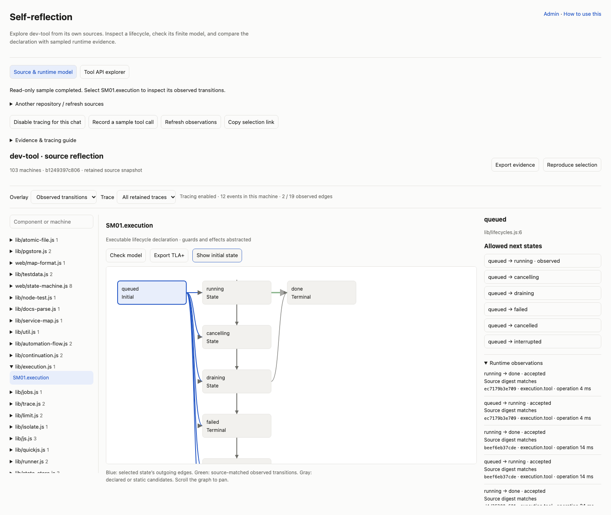
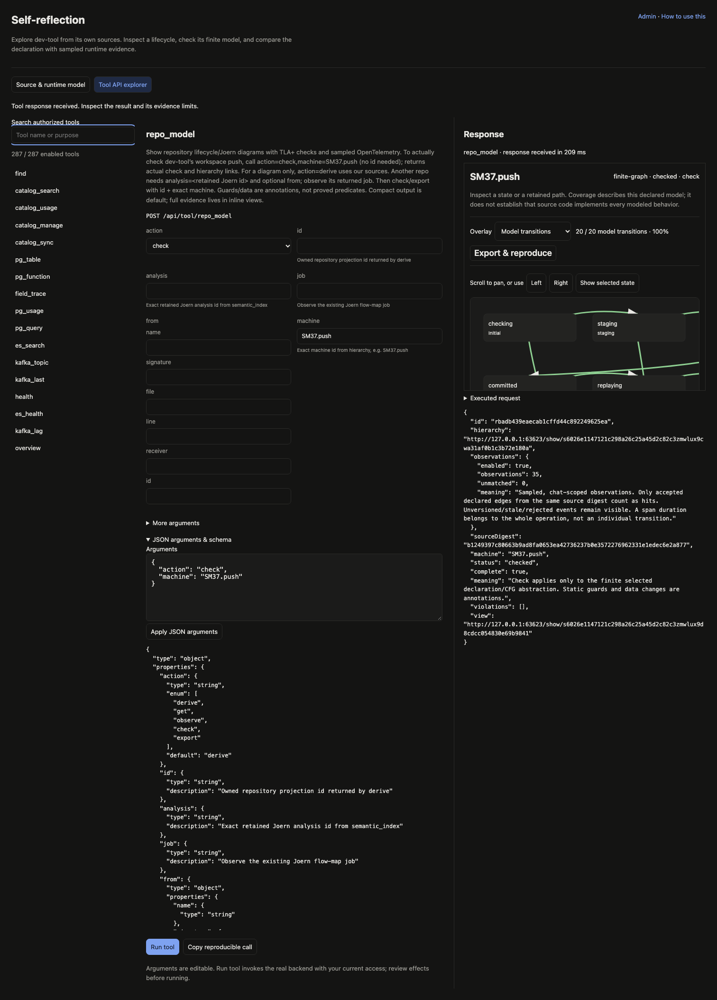

# Repository reflection: source → finite model → observations

Open **Admin → Self-reflection** or `/self-reflection`. This is a live workbench for our own source model and a backend API explorer for every enabled, authorized tool. The inline `repo-model` visualization retains a network-free snapshot.



Choose a component, machine and state. The diagram shows allowed next states, initial/terminal markers and matching observed edges. The evidence pane retains declaration file/line/hash, source excerpt, explicit consumer references, method data changes, assumptions and gaps. Joern call sites can navigate to retained candidate callee models with argument bindings. Containment is separate from dependencies: no connections between components are invented from names or ordering.

## Our own repository

The build extracts 103 trusted executable lifecycle declarations. Its source catalog is embedded in the standalone bundle, including relative source evidence. A source checkout, network access and Joern are unnecessary for this path. `npm run build` refreshes the catalog; `npm run build:check` rejects stale data.

```json
{"tool":"repo_model","arguments":{"action":"derive"}}
```

For a single-call own-source check, use `{"action":"check","machine":"SM37.push"}` without an id; it derives a snapshot and returns actual check and hierarchy links. Otherwise, keep the returned projection `id`. The summary previews a small selection, with the full hierarchy in `view`. Derivation alone is not a check. Execute the supplied next call with the real returned id:

```json
{"tool":"repo_model","arguments":{"action":"check","id":"returned-projection-id","machine":"SM37.push"}}
```

`engine=finite-graph` explores this finite declared graph without dependencies. `engine=tlc` uses the existing explicitly configured SHA256-pinned TLC jar. `action=export` returns a real TLA+ module, TLC configuration and action-to-source mapping. The UI downloads both files. An optional `forbidden` array tests existing states as a safety claim without editing the retained model. For example, forbidding `pushed` in `SM37.push` produces a counterexample; this is an illustration, not a valid product invariant.

## Runtime evidence

Enable tracing for the current chat, run a relevant tool and **Refresh observations**. **Record a sample tool call** invokes only `logic_model templates`; select `SM01.execution` for its actual observed lifecycle. Each event keeps trace/span ids, source-version match, accepted/rejected status and whole-operation duration. Trace selection filters retained observations without sending another tool request.

Only accepted declared edges with the same source digest count as hits. Rejected, older and unversioned events remain visible but do not count. Observations are sampled, bounded, chat-scoped diagnostics; absent events do not prove a path was unused. Dropped/limited events and uninstrumented remote services can leave gaps. Durations include waits and do not measure per-transition CPU cost. The underlying tracing configuration and OTLP export remain unchanged.

## Other repositories through Joern

Use `semantic_index` to discover or explicitly build an exact retained analysis. Choose it in **Another repository / refresh sources**, optionally enter an entry method, then **Derive from Joern**. The equivalent tool request is:

```json
{"tool":"repo_model","arguments":{"action":"derive","analysis":"exact-retained-analysis-id","from":{"name":"submit"}}}
```

If pending, retain `job` and observe it through the same tool; do not restart parsing. The tool reuses the cancellable, owned `semantic_query flowmap` job. A bounded map creates method-local models, grouped by source file, with short machine ids. Original native ids, exact analyses, source SHAs and the full static map stay in the evidence export.

Only local CFG/control edges become TLA transitions. Data-dependence and inter-method call edges remain distinct evidence. Branch conditions, loops, assignments and bindings are annotations, not executable state predicates. Unexpanded calls, exceptions, aliasing, omitted bodies and bounded extraction remain explicit gaps. Finite exploration can identify an abstraction deadlock without identifying a source defect. Independent charts are not a synchronized whole-program model; checks prove neither source equivalence, value semantics nor liveness. Use `semantic_trace` and behavioral tests for a change claim.

## Tool API explorer and sharing

The second work area lists every authorized enabled tool. Search by purpose/name, select it, edit schema fields or JSON arguments, then **Run tool**. Selecting and editing send no invocation. Requests run through the backend with current authentication and chat/principal scope. Responses show timing, errors, retained JSON and supported inline visualizations. The executed request records exact scope headers; copied requests preserve them without copying a bearer token. Editing arguments clears stale response evidence. **Stop waiting** disconnects the request; inspect an existing execution/job before retrying an uncertain effect.



**Copy selection link** preserves projection, machine and scope. It does not grant another user access to private data. **Export evidence** retains the full supplied snapshot. The inline view supports hierarchy, graph, source/assumption inspection and reproducible prepared check/export calls. Fresh reads and tool actions run in the authenticated live host; inline views retain their network sandbox.

## Reproduce the showcase

```sh
node demo/self-reflection.js
node dev/check-self-reflection-browser.js
node --test test/repo-model.test.js test/repo-model-ui.test.js
```

The demo uses real source declarations and spans from harmless local tool requests. Other service data in that disposable demo is synthetic. The Chromium check exercises mouse/keyboard navigation, backend checks, TLA+ downloads, trace filtering, API success/errors, Admin scope, inline snapshots, mobile and dark themes. Retained Java/loop/JavaScript fixtures come from an earlier real Joern run on synthetic test repositories; these replay tests do not claim a fresh worker parse.

`dev/eval-repo-model.js` runs two bounded real small-model conversations with only discovery tools exposed, the public source model and a replayed synthetic Joern analysis. Set `DT_EVAL_ENDPOINT`, `DT_EVAL_MODEL` and `DT_EVAL_OUTPUT` for your test server. No production systems or writes are authorized by the harness. Retained evidence describes the model, prompts, calls, byte sizes, results and limits; it is a narrow workflow check, not a general capability score.
