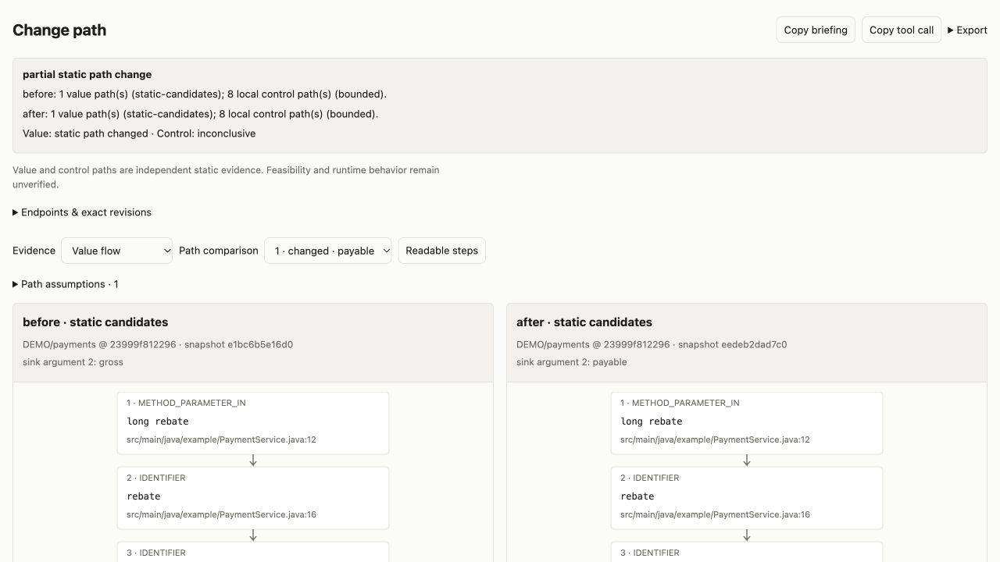

# Trace a change from entry to exit

`semantic_trace` prepares a change briefing and a visual comparison from retained Joern analyses. Select an entry method or ingress port, or an exact source expression at a line; select a call argument, exit/return, or another exact line as the target. One analysis explains a path. Two analyses, ordered **before, after**, compare independent snapshots of the same repository and frontend. A dirty workspace snapshot has its own source digest even when its base commit is unchanged.

Index the intended refs with `code_index` and `semantic_index` first. Missing indices produce a recovery message; tracing never implicitly reparses a repository. Admin → Joern & ports → **Compare change paths** prepares the tool. Workbench also exposes its typed endpoint and assumption fields. MCP, CLI and OpenAPI use the same tool.

```json
{
  "tool": "semantic_trace",
  "arguments": {
    "analyses": ["<before-analysis-id>", "<after-analysis-id>"],
    "from": {"kind":"method", "name":"submit", "parameter":"rebate"},
    "to": {"kind":"call", "name":"save", "argument":2},
    "assumptions": [{"expression":"rebate < 0 || rebate > gross", "holds":false}],
    "maxHops": 100,
    "waitMs": 1000
  }
}
```

The response keeps an owned job; observe it with `semantic_trace` and `{"job":"<returned-job-id>","waitMs":1000}`. Cancel through `job_cancel`. Retained full results and cached queries remain scoped to the requesting principal and story.

## Start or finish at a code line

Use `kind:"line"` with a repository-relative `file` and a positive `line`. This selects CPG expressions on that exact line, rather than the enclosing method. Several expressions can share a line. If selection is ambiguous, the result lists candidates and produces no paths. Narrow with an exact `code`, `nodeLabel`, `column`, or revision-local `nodeId` from the candidate list.

```json
{
  "analysis": "<retained-analysis-id>",
  "from": {"kind":"line", "file":"src/Payments.java", "line":20, "code":"gross", "nodeLabel":"IDENTIFIER"},
  "to": {"kind":"line", "file":"src/Payments.java", "line":22, "code":"payable", "nodeLabel":"IDENTIFIER"}
}
```

For moved lines or renamed endpoints, provide complete `after_from` and/or `after_to` selectors. They resolve independently in the after snapshot. Never reuse a CPG node ID across generations. For a composite analysis, specify `repo` in line selectors so identical library paths cannot collide. Matching paths ignores generation-local IDs and shifted line numbers, while preserving source expressions and conditions.

## Read the two evidence layers

**Value flow** shows Joern paths from selected source values to sink values. A method source selects its parameters (`parameter` narrows by name or one-based index); a method target selects its return; a call target selects its arguments (`argument` narrows by one-based index). Precise passport ports can bind entry parameters or exit call sites. Composed lineage retains local CPG segments and separately declared boundary mappings; it remains different from one Joern path.

**Local control flow** walks the retained CFG between endpoints within one method body. A method source starts at entry; a method target ends at return. Explicit throw continuations are excluded because exception routing is unresolved. Cross-method control requests report their unsupported boundary. Loops, aliasing, external effects and incomplete dispatch can remain gaps. Both layers have independent statuses: bounded control enumeration does not hide a supported value-path difference.

Assumptions are explicit user declarations. An exact predicate and its true/false polarity can match or contradict a displayed control candidate. Missing polarity or unmatched expressions stay unresolved. Assumptions do not constrain value-flow queries, establish satisfiability, or prove that independently displayed data and control paths describe the same execution. The default view includes all candidates; its optional filter hides only control candidates with recorded contradictions. Add/remove declarations using the mouse, then copy the tool call to reproduce them.

## Inspect and share

The inline result stays collapsed until needed, with errors/inconclusive evidence opened for recovery. Open its full view to compare paired graphs, select expressions for exact locators, switch to readable steps, and inspect assumptions and gaps. Highlighted expression occurrences differ between the displayed paths. Matching preserves their order and repetition: an extra occurrence can be highlighted even when the same expression appears elsewhere. Shifted line numbers and generation-local IDs do not count as expression changes.

**Copy briefing** includes the current operator assumptions, a replay call with those declarations, and the selected comparison's assumption evaluations recalculated against them. The retained assessment and reading remain the original static evidence. **Copy tool call** also uses the current declarations. Export full JSON, the current graph as SVG, or Mermaid. Exports retain static-evidence labels; JSON keeps all bounded paths, immutable identities and mappings, with current declarations recorded separately as `localAssumptions`.



The screenshot shows retained before/after payment snapshots. Open **Path assumptions** to declare a predicate, or select an expression to inspect its exact retained source locator.

Model replies default to a compact preview bounded to 16 KiB; `max_output_bytes` accepts 4–64 KiB. Preview omissions are explicit and separate from analysis truncation. The saved view retains the full result. Set `includeControl:false` when only a value slice is needed.

## What this can verify

A changed expression or guard on a selected static path is evidence that this path differs. It cannot prove execution, numerical equality, every-path enforcement, behavioral equivalence or release safety. `behaviorVerified` remains false. An empty bounded result is not proof of absence. Failed, ambiguous and incomplete layers remain inconclusive.

Use the briefing to create an entry-to-exit regression: choose accepted inputs satisfying the guards; assert values, identity and effect counts at the storage/message/API exits; assert rejected inputs cause no effects. Keep executable before/after evidence alongside the static comparison.

`test/semantic-path-trace.live.test.js` builds an actual Git payment fixture and retains a buggy snapshot plus its fix. It checks Joern sink expressions (`gross` → `payable`), false-polarity guards, arbitrary exact line endpoints, ambiguous-line recovery, a 4 KiB model preview and native saved-view routing. An independent Java oracle fails before the fix and passes afterward. Run it with `DT_SEMANTIC_LIVE_URL` and `DT_SEMANTIC_LIVE_TOKEN` set to an owned worker. This fixture uses in-process ledger/event adapters; it does not exercise a real database or broker.

## Collect assumptions and hidden library changes

`includeContext` defaults to true. **Collected assumptions & source changes** is a separate, initially collapsed panel in the inline view. Switch between assumptions, changed source facts and all collected facts. It records reachable conditions, loop bounds, assignments, call arguments, callback return expressions and method body digests, each with its retained source locator. These source changes can remain visible when the selected path count is exhausted. A reachable method fact does not establish that it executes or dominates the selected sink.

For a template method inherited from an internal library, index the service and its exact library sources together with `semantic_index` (`sourceRevisions`, `composite:true`). Select the intended receiver explicitly:

```json
{
  "from": {"kind":"method", "name":"handle", "receiver":"example.PaymentService", "parameter":"amount"},
  "to": {"kind":"call", "repo":"LIB/handlers", "name":"accept", "file":"src/internal/AbstractHandler.java", "line":7, "argument":2}
}
```

The retained type hierarchy resolves the inherited entry and implicit `this` calls. Sibling overrides incompatible with that receiver are excluded. If native value paths are unavailable, the result may compose three independently checked local slices: entry value → call argument, concrete implementation parameter → return, call result → sink value. The joins remain declared positional bindings under the selected receiver. This is labeled **composed static lineage**, rather than one Joern path or verified Spring dispatch. Missing or ambiguous bodies, unsupported segments and unsafe receiver exclusions remain gaps.

Loop cycles are reported as bounded; iterations, zero-iteration behavior and exit feasibility are not inferred by unrolling. Stream callback predicates and transformations are collected separately from pipeline stages. A method named `filter` alone is only a name-based pipeline candidate when the frontend cannot resolve its Java stream identity. Laziness, invocation count, ordering, exceptions and runtime bean/proxy wiring remain unverified.

Context collection is bounded to 40 bodies, 600 facts, depth 12 and a time budget. Projection facts, type scans and dispatch scans also have explicit caps. Old retained analyses without the new context projection ask for reindexing; their CPGs are not overwritten. Every assessment has `exhaustive:false`.

## Reproducible stress lab

[Run the seven-case lab](../demo/flow-stress/README.md) to explore each case in the same native inline visualization used by chat and Admin. It creates two local Git repositories, retains two independent composite analyses, and compiles/runs both revisions with an independent Java oracle. It never pushes the fixture repositories.

| Case | Deliberate change | Required evidence |
| --- | --- | --- |
| Conditional | `amount > 0` → `amount >= 0` | Changed guard; zero changes from 0 to 1 |
| Loop and continue | `i < limit` → `i <= limit` | Bound and bypass condition; iteration count unknown |
| Stream filter | `x > 0` → `x >= 0` | Actual callback predicate; invocation/outcome unknown |
| Stream mapping | `x * 2` → `x * 3` | Lambda return transformation, separately from pipeline syntax |
| Inherited library template | Changed arithmetic and helper predicate in two parent classes | Exact retained library bodies, selected service override, no sibling override |
| Late fanout | Changed argument at sink 28 with four selected paths | Source fact survives bounded path enumeration |
| Unchanged control | Same entry-to-exit behavior and source | No source-context or selected-path change noise |

`test/semantic-flow-stress.live.test.js` asserts these cases against a real worker, including a 4 KiB model preview, independent revisions and saved-view routing. Unit tests cover missing libraries, context budgets, failed local composition, callback-role preservation and UTF-8 preview bounds. Passing this finite corpus is regression evidence, not proof of complete Java path discovery.
