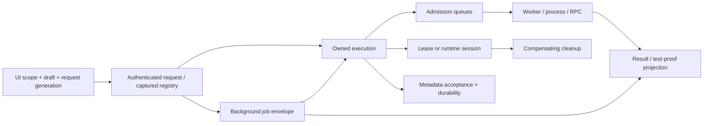
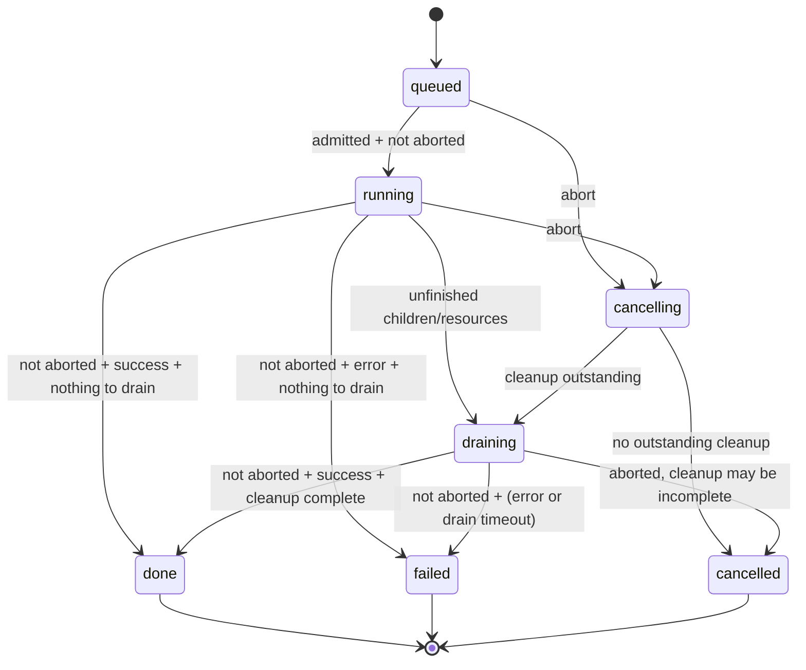

# State machines hidden in dev-tool

Static inventory of commit `5c330586fb3209d7d2560da34a718ee2700ed273`, reviewed 2026-11-05.

Found **78 substantive lifecycle/protocol/UI families** and **10 auxiliary parser/traversal automata** across 215 first-party runtime, entry-point and support files. These are grouped protocols, not a count of every boolean, enum value or possible product-state combination.

[Machine-readable inventory and file classifications](benchmarks/state-machines.json). Every machine has source anchors, reconstructed transitions, guards and recovery behavior.

The [runtime implementation map](state-machine-runtime.md) describes the subsequent
refactor. The audit below remains pinned to the source commit above.

## What counts

A machine exists here when the next legal action or accepted result depends on
what happened earlier. The state may be a string, an AbortSignal, a timestamp,
a set/map, a shared promise, a revision, a lock directory, an artifact’s presence
or an ordered combination of these. Named state labels still have implicit
transition rules when assignments and guards are spread across callbacks.

Transitions below use explanatory names such as “cold,” “prepared,” “published”
and “expired.” They are reconstructed from source and are not necessarily API
enum values. An expired lease, for example, can still store `state=active`.
UI families deliberately group repeated instances such as table filters and
folder selection; the implementation does not have one shared state store for
all of them.

The scan covers `lib/`, first-party `web/` JS/HTML, server/CLI and setup/build
entry points, including bundled starter-script definitions. Joern’s two vendored integration scripts are included at their
execution boundary. Generated `dist/` copies, third-party canvas internals,
dependencies, fixtures/challenge applications and external system internals are
outside this inventory. Dynamically loaded plugins can add more machines.
Related tests were located; their existence does not mean every transition is
covered, and this audit did not rerun them.

## The central finding: these are product states

The most important “state machines” are combinations of independent machines:

| Surface or object | Independent axes that must not collapse into one status |
| --- | --- |
| Tool call | invocation × application assertions × saved-result/capture success |
| Background job | job label × execution cancellation × cleanup completeness × result hydration |
| Owned execution | queued/running/draining/terminal × AbortSignal × children/resources × known/unknown outcome |
| Database lease | stored state × expiry clock × ownership markers × physical resources |
| Native fixture | startup/readiness × stop request × TTL × expectations armed × observed effects |
| Indexed source | exact immutable revision × mutable latest alias × cache residency × publication ticket |
| Editor | applied scope × loaded revision × dirty draft × pending request × response generation |

This is why “cancelled,” “done,” “ready,” “saved,” “passed” and “fresh” are not
interchangeable. A cancelled job can still be draining; an archived file can
still have its source retained; a successful invocation can contain failed
assertions; an active lease can be expired; a passing Node test run can be
missing from the patch’s proof projection.

The arrows mean actual coordination/ownership paths, not one global linear
lifecycle. Each node has its own state and failure behavior.

## Highest-value candidates to make explicit

| Priority | Machines | Why the hidden transition matters | Useful invariant/transition tests |
| --- | --- | --- | --- |
| 1 | SM01–SM03, SM06–SM08 | Job, execution, worker and cell disagree about terminal state and cleanup by design; callbacks settle at different times. | Immediate cancel before callback; cancel during drain; late completion after cancel; cleanup timeout → unknown; no child outlives owner. |
| 2 | SM21–SM30, SM75 | Readiness, ownership, lease expiry, action history and physical resources are independent. | Expiry during start; stop during startup; ownership mismatch; partial allocation; retry cleanup; duplicate action; reset compensation. |
| 3 | SM11–SM15 | Accepted metadata and active configuration are not the same as durable writes or a new validated registry generation. | Worker dies before/after commit; retained batch retry; close failure/retry; invalid config with last-good active; reload changes during build. |
| 4 | SM41–SM49 | Temporary output, immutable versions and latest pointers form a publication protocol. | Concurrent writers; interrupted staging; late older job; cancellation before alias update; reader sees generation switch; old version remains readable. |
| 5 | SM53–SM57 | Revision checks and locks implement editing and multi-step transfer protocols. | Stale CAS; conflict preserves draft; archive saved but source removal fails; stale lock; orphan revision before head update. |
| 6 | SM33–SM35, SM38 | Primary errors, assertions, skipped work, retries and cleanup affect the result independently. | Failed before hook; fail-fast remainder skipped; cleanup fails after green checks; unknown outcome never auto-retried; same-selector red/green. |
| 7 | SM62–SM73 | Counters and booleans form repeated editor/request protocols without a common reducer. | Scope change while loading; stale success/error/finally; edit while fetch/save pending; failed save retains draft; invalidated selection. |
| 8 | SM17–SM20, SM59–SM60, SM76–SM78 | Transport completion is separate from business completion and request/capture correlation. | Partial frame; missing final reply; delayed response after close; init fails after session ID; lost action reply remains unknown. |

These are refactoring/test priorities, not newly established defects. The
[task-based novice review](handbook/novice-task-review.md) separately confirmed
one actual state-handoff gap: Node runs have real history while
`workspace_patch` can show `tests:[]` (SM38 → SM37/SM61). It also confirmed
misleading Node preparation advice; neither issue is fixed by this inventory.

## A representative reconstructed lifecycle

Source: SM01. `cleanupIncomplete` and `outcome=unknown` are orthogonal to the
terminal label. Persisted formerly live records can become `interrupted`
after restart (SM02/SM13); that is a recovery transition, not a normal callback
completion in the diagram.

## Inventory by area

- [Execution](#execution): SM01, SM02, SM03, SM04, SM05, SM06, SM07, SM08, SM09, SM10, SM78
- [Persistence](#persistence): SM11, SM12, SM13
- [Configuration](#configuration): SM14, SM15, SM16
- [Transport](#transport): SM17, SM18, SM19, SM20, SM76
- [Resources](#resources): SM21, SM22, SM23, SM24, SM25, SM26, SM27, SM28, SM29, SM30, SM31, SM32, SM75
- [Automation](#automation): SM33, SM34, SM35
- [Source and tests](#source-and-tests): SM36, SM37, SM38, SM39, SM40, SM41, SM42, SM43, SM44, SM52, SM77
- [Semantic](#semantic): SM45, SM46, SM47
- [Knowledge](#knowledge): SM48, SM49, SM50, SM51
- [Authored artifacts](#authored-artifacts): SM53, SM54, SM55, SM56, SM57, SM58, SM61
- [API](#api): SM59, SM60
- [Frontend](#frontend): SM62, SM63, SM64, SM65, SM66, SM67, SM68, SM69, SM70, SM71, SM72, SM73
- [Setup](#setup): SM74
- [Parser/algorithm](#parser-algorithm): P01, P02, P03, P04, P05, P06, P07, P08, P09, P10

## Execution

| ID | Machine | State encoding | Main source |
| --- | --- | --- | --- |
| [SM01](#sm01) | Owned invocation and cleanup | labels + signal + resource sets | [lib/execution.js:44](../lib/execution.js#L44) |
| [SM02](#sm02) | Background job wrapper and recovery | labels + process liveness + promise | [lib/jobs.js:42](../lib/jobs.js#L42) |
| [SM03](#sm03) | Trace spans and process-tree termination | maps + callbacks + timers | [lib/trace.js:51](../lib/trace.js#L51) |
| [SM04](#sm04) | Fair CPU/code/build admission | queue/order/counters | [lib/limit.js:19](../lib/limit.js#L19) |
| [SM05](#sm05) | Per-target network admission | next timestamp + cancellation | [lib/limit.js:4](../lib/limit.js#L4) |
| [SM06](#sm06) | Heap-limited worker pool | busy/pending/maps/heap | [lib/isolate.js:30](../lib/isolate.js#L30) |
| [SM07](#sm07) | Node sandbox session and tool RPC | child/wait/busy/queue | [lib/js.js:163](../lib/js.js#L163) |
| [SM08](#sm08) | Owned code cell, output cursor and observation | labels + sequence/watchers/budgets | [lib/js.js:266](../lib/js.js#L266) |
| [SM09](#sm09) | QuickJS worker settlement | settled boolean + worker events | [lib/quickjs.js:5](../lib/quickjs.js#L5) |
| [SM10](#sm10) | Remote build runner and endpoint circuit | process map + stream done + cooldown clock | [lib/runner.js:46](../lib/runner.js#L46) |
| [SM78](#sm78) | Offline scenario/experiment program realm and RPC budget | fresh realm + request map + pending helpers + counters | [lib/offline-js.js:17](../lib/offline-js.js#L17) |

### SM01 · Owned invocation and cleanup

**Encoded in:** labels + signal + resource sets.

**Transitions:** queued → running → done/failed; abort → cancelling; unfinished work → draining → cancelled/failed/done.

**Guard:** AbortSignal, child/pending/resource/cleanup sets and drain deadline all influence the terminal result.

**Recovery/limit:** A drain timeout retains cleanupIncomplete and outcome=unknown; persisted live records can later be interrupted.

**Independent axes:** state × aborted × cleanup completeness × owner.

Sources: [lib/execution.js:44](../lib/execution.js#L44), [lib/execution.js:23](../lib/execution.js#L23).

Related tests (located, not a coverage claim): [test/execution.test.js](../test/execution.test.js).

### SM02 · Background job wrapper and recovery

**Encoded in:** labels + process liveness + promise.

**Transitions:** absent → running → done/failed/cancelled; dead-process live record → interrupted.

**Guard:** Deduplicate running key within owner scope; cancellation cannot let a late promise publish a done result.

**Recovery/limit:** cancel changes job state immediately; execution cleanup remains a separate machine. Large results may be reference-only until hydrated.

**Independent axes:** job.state × execution.state × result hydrated.

Sources: [lib/jobs.js:42](../lib/jobs.js#L42), [lib/jobs.js:24](../lib/jobs.js#L24), [lib/tools-code.js:18](../lib/tools-code.js#L18).

Related tests (located, not a coverage claim): [test/execution.test.js](../test/execution.test.js).

### SM03 · Trace spans and process-tree termination

**Encoded in:** maps + callbacks + timers.

**Transitions:** untracked → active trace/span/process → completed; stop → TERM → exit or KILL.

**Guard:** Active span/child ownership and process-group identity govern cancellation.

**Recovery/limit:** Escalate after grace period; finishing a leader is not evidence descendants exited.

Sources: [lib/trace.js:51](../lib/trace.js#L51), [lib/trace.js:79](../lib/trace.js#L79), [lib/process-tree.js:13](../lib/process-tree.js#L13).

Related tests (located, not a coverage claim): [test/execution.test.js](../test/execution.test.js).

### SM04 · Fair CPU/code/build admission

**Encoded in:** queue/order/counters.

**Transitions:** submitted → queued → admitted → settled; queued abort → removed; capacity → rejected.

**Guard:** Resource slots, global queue limit and per-story rotation; async-local scope is bound at submission.

**Recovery/limit:** Release a running slot in finally and drain the next owner; queued cancellation removes only that item.

Sources: [lib/limit.js:19](../lib/limit.js#L19), [lib/limit.js:47](../lib/limit.js#L47).

Related tests (located, not a coverage claim): [test/execution.test.js](../test/execution.test.js), [test/execution-worker.test.js](../test/execution-worker.test.js).

### SM05 · Per-target network admission

**Encoded in:** next timestamp + cancellation.

**Transitions:** eligible → reserved future slot → waiting → admitted; excess wait → rejected.

**Guard:** Target key and live rate configuration; cancellation interrupts sleep.

**Recovery/limit:** A cancelled reservation does not automatically rewind the next timestamp.

Sources: [lib/limit.js:4](../lib/limit.js#L4).

Related tests (located, not a coverage claim): [test/execution.test.js](../test/execution.test.js).

### SM06 · Heap-limited worker pool

**Encoded in:** busy/pending/maps/heap.

**Transitions:** absent → idle → busy → idle; heap/config mismatch/cancel/error → terminate → replacement.

**Guard:** One call per worker; CPU admission bounds concurrency; owner carried into worker executions.

**Recovery/limit:** OOM rejects pending calls and marks remote executions interrupted; oversized warm workers are recycled.

**Independent axes:** worker × pending RPCs × remote executions.

Sources: [lib/isolate.js:30](../lib/isolate.js#L30), [lib/isolate.js:50](../lib/isolate.js#L50), [lib/isolate.js:70](../lib/isolate.js#L70).

Related tests (located, not a coverage claim): [test/execution-worker.test.js](../test/execution-worker.test.js), [test/memory.test.js](../test/memory.test.js).

### SM07 · Node sandbox session and tool RPC

**Encoded in:** child/wait/busy/queue.

**Transitions:** child absent → spawned idle → busy request → result → idle; timeout/abort/exit → killed → respawnable.

**Guard:** Single active Session.run; active-child cap; one reply per RPC; same-child checks reject stale replies.

**Recovery/limit:** kill rejects current wait; deadline also drains nested host work; next code chunk can start a fresh child.

**Independent axes:** session × child process × in-flight RPC × deadline.

Sources: [lib/js.js:163](../lib/js.js#L163), [lib/js.js:44](../lib/js.js#L44), [lib/js.js:91](../lib/js.js#L91).

Related tests (located, not a coverage claim): [test/code.test.js](../test/code.test.js), [test/execution.test.js](../test/execution.test.js).

### SM08 · Owned code cell, output cursor and observation

**Encoded in:** labels + sequence/watchers/budgets.

**Transitions:** queued → underlying execution states → done/failed/cancelled; retained terminal → evicted.

**Guard:** Monotonic output cursor; owner access; 32 active cells; result and retention budgets.

**Recovery/limit:** A wait timeout leaves the cell running; cancel is separate; restart loses the in-memory cell map.

**Independent axes:** execution × cell result status × output availability.

Sources: [lib/js.js:266](../lib/js.js#L266), [lib/js.js:267](../lib/js.js#L267), [lib/js.js:282](../lib/js.js#L282).

Related tests (located, not a coverage claim): [test/execution.test.js](../test/execution.test.js).

### SM09 · QuickJS worker settlement

**Encoded in:** settled boolean + worker events.

**Transitions:** queued → worker active → result/error/timeout/exit → terminated.

**Guard:** finish settles once; CPU scheduling and enclosing execution own termination.

**Recovery/limit:** Error/exit/timeout paths terminate the worker; capability status prototype is static, not a lifecycle state.

Sources: [lib/quickjs.js:5](../lib/quickjs.js#L5), [lib/quickjs-worker.js:1](../lib/quickjs-worker.js#L1).

Related tests (located, not a coverage claim): [test/execution.test.js](../test/execution.test.js).

### SM10 · Remote build runner and endpoint circuit

**Encoded in:** process map + stream done + cooldown clock.

**Transitions:** request → process/output stream → done; disconnect/deadline → killed; endpoint error → cooldown → retry eligible.

**Guard:** Authenticated runner, process ID, final done record and deadline; local fallback depends on target policy.

**Recovery/limit:** A stream ending without done is runnerError; unreachable endpoint is suppressed until downUntil.

Sources: [lib/runner.js:46](../lib/runner.js#L46), [lib/runner.js:96](../lib/runner.js#L96), [lib/runner.js:109](../lib/runner.js#L109).

Related tests (located, not a coverage claim): [test/runner.test.js](../test/runner.test.js), [test/runner.live.test.js](../test/runner.live.test.js).

### SM78 · Offline scenario/experiment program realm and RPC budget

**Encoded in:** fresh realm + request map + pending helpers + counters.

**Transitions:** bootstrap fresh realm → execute bounded program → allowed JSON bridge calls → settle pending helpers → result/error → realm discarded.

**Guard:** JSON-only crossings, allowlisted onTool and parent-enforced deadlines; this program realm is separate from the host Session.

**Recovery/limit:** Failure/timeout remains local evidence; trusted-program constraints are not an OS security boundary.

Sources: [lib/offline-js.js:17](../lib/offline-js.js#L17), [lib/offline-js.js:154](../lib/offline-js.js#L154).

Related tests (located, not a coverage claim): [test/offline-js.test.js](../test/offline-js.test.js).

## Persistence

| ID | Machine | State encoding | Main source |
| --- | --- | --- | --- |
| [SM11](#sm11) | Operational-store owner worker lifecycle | starting/pumping/closing/closed flags | [lib/state-store.js:57](../lib/state-store.js#L57) |
| [SM12](#sm12) | Metadata acceptance, projection and durability | queue + cursors + durable flag | [lib/state-store.js:153](../lib/state-store.js#L153) |
| [SM13](#sm13) | SQLite migration and restart reconciliation | migration cursor + transactions + instance identity | [lib/state-worker.js:97](../lib/state-worker.js#L97) |

### SM11 · Operational-store owner worker lifecycle

**Encoded in:** starting/pumping/closing/closed flags.

**Transitions:** unstarted → starting → ready; worker failure → not-ready/restartable; close requested → flushing → closing → closed.

**Guard:** Shared startup/close promises; writes rejected after closeRequested; pending request cap.

**Recovery/limit:** Failed close clears its request/promise so retry is possible; failure rejects pending RPCs.

**Independent axes:** ready × worker presence × durable × closing flags.

Sources: [lib/state-store.js:57](../lib/state-store.js#L57), [lib/state-store.js:121](../lib/state-store.js#L121), [lib/state-store.js:232](../lib/state-store.js#L232).

Related tests (located, not a coverage claim): [test/state-store.test.js](../test/state-store.test.js).

### SM12 · Metadata acceptance, projection and durability

**Encoded in:** queue + cursors + durable flag.

**Transitions:** rejected OR accepted/pending projection → batch in flight → SQLite commit → durable projection.

**Guard:** Count/byte budgets; pending:N cursors differ from durable sequence; queue removed only after acknowledgement.

**Recovery/limit:** Failed batch stays queued for explicit retry; retry metadata writes, never replay external tool effects.

**Independent axes:** accepted ≠ persisted ≠ visible projection ≠ flushed.

Sources: [lib/state-store.js:153](../lib/state-store.js#L153), [lib/state-store.js:170](../lib/state-store.js#L170), [lib/state-store.js:193](../lib/state-store.js#L193).

Related tests (located, not a coverage claim): [test/state-store.test.js](../test/state-store.test.js).

### SM13 · SQLite migration and restart reconciliation

**Encoded in:** migration cursor + transactions + instance identity.

**Transitions:** legacy rows → bounded import batches → saved cursor → imported; recovered active operations → interrupted.

**Guard:** Transactional row/cursor advance; source inode/offset and schema version determine continuation.

**Recovery/limit:** Truncated/malformed/oversized legacy input is reported; imported live work is not restarted.

Sources: [lib/state-worker.js:97](../lib/state-worker.js#L97), [lib/state-worker.js:177](../lib/state-worker.js#L177), [lib/state-worker.js:201](../lib/state-worker.js#L201).

Related tests (located, not a coverage claim): [test/state-store.test.js](../test/state-store.test.js).

## Configuration

| ID | Machine | State encoding | Main source |
| --- | --- | --- | --- |
| [SM14](#sm14) | Configuration last-good generation and pinned calls | memo/signature/lastGood/lastError/snapshot | [lib/config.js:98](../lib/config.js#L98) |
| [SM15](#sm15) | Tool registry and remote plugin activation | per-scope maps + build promise + signature | [lib/tools.js:965](../lib/tools.js#L965) |
| [SM16](#sm16) | Authenticated request scope and result handoff | request context + cookie + capability binding | [lib/access.js:34](../lib/access.js#L34) |

### SM14 · Configuration last-good generation and pinned calls

**Encoded in:** memo/signature/lastGood/lastError/snapshot.

**Transitions:** cold → validated generation; file signature change → revalidate → new generation OR retained last-good + error.

**Guard:** Validate candidate before activation; calls pin captured snapshots; control-plane edits use revision/lock.

**Recovery/limit:** An invalid edit can coexist with an active last-good generation; server write admission treats configuration error separately.

**Independent axes:** on-disk validity × active revision × call-pinned revision.

Sources: [lib/config.js:98](../lib/config.js#L98), [lib/config.js:107](../lib/config.js#L107), [lib/config.js:123](../lib/config.js#L123), [lib/admin.js:53](../lib/admin.js#L53).

Related tests (located, not a coverage claim): [test/config.test.js](../test/config.test.js).

### SM15 · Tool registry and remote plugin activation

**Encoded in:** per-scope maps + build promise + signature.

**Transitions:** missing/stale → fetching/building → activated; changed during build → retry; failed reload → prior registry retained.

**Guard:** Per-scope build dedupe; signature fencing; captured registry stays with invocation; plugin-origin failures can reject reload.

**Recovery/limit:** Keep prior generation with reloadErrors; new calls still pass current access/policy checks.

**Independent axes:** registry revision × config revision × current permissions.

Sources: [lib/tools.js:965](../lib/tools.js#L965), [lib/tools.js:879](../lib/tools.js#L879), [lib/tools.js:982](../lib/tools.js#L982), [lib/workflows.js:6](../lib/workflows.js#L6).

Related tests (located, not a coverage claim): [test/tool-contracts.test.js](../test/tool-contracts.test.js), [test/config.test.js](../test/config.test.js).

### SM16 · Authenticated request scope and result handoff

**Encoded in:** request context + cookie + capability binding.

**Transitions:** unauthenticated → authenticated principal/story → pinned scoped call; keyed read-only result restores saved owner under rules.

**Guard:** Token role/story binding, optional admin principal override, explicit story headers and saved-result ownership.

**Recovery/limit:** Rejected identity/scope does not become a fallback user; a UI selection is not authorization.

Sources: [lib/access.js:34](../lib/access.js#L34), [lib/access.js:10](../lib/access.js#L10), [server.js:362](../server.js#L362), [lib/results.js:73](../lib/results.js#L73).

Related tests (located, not a coverage claim): [test/runtime-resource-isolation.test.js](../test/runtime-resource-isolation.test.js), [test/server.test.js](../test/server.test.js).

## Transport

| ID | Machine | State encoding | Main source |
| --- | --- | --- | --- |
| [SM17](#sm17) | Server MCP request correlation and disconnect cancellation | request map + controller + response lifecycle | [server.js:14](../server.js#L14) |
| [SM18](#sm18) | Playwright MCP session handshake and requests | session ID/sequence/definitions | [lib/browser-mcp.js:8](../lib/browser-mcp.js#L8) |
| [SM19](#sm19) | SFTP connection and stream operation lifetime | ready/closed/ended + pending promises | [lib/files.js:84](../lib/files.js#L84) |
| [SM20](#sm20) | Read-only PG connection and cancellable transaction | connection cache + query set + cancelled set | [lib/pg.js:11](../lib/pg.js#L11) |
| [SM76](#sm76) | Outgoing HTTP, read-host failover and one-shot adapter outcome | AbortSignal/deadline + chosen host + correlated response | [lib/util.js:23](../lib/util.js#L23) |

### SM17 · Server MCP request correlation and disconnect cancellation

**Encoded in:** request map + controller + response lifecycle.

**Transitions:** received → registered/in flight → reply/error → removed; cancellation/disconnect → controller aborted.

**Guard:** Map key combines owner scope, session and request ID; HTTP response completion gates disconnect abort.

**Recovery/limit:** Remove listeners/map entry in finally; initialize reply is not a stateful authorization grant.

Sources: [server.js:14](../server.js#L14), [server.js:60](../server.js#L60), [server.js:348](../server.js#L348).

Related tests (located, not a coverage claim): [test/server.test.js](../test/server.test.js), [test/execution.test.js](../test/execution.test.js).

### SM18 · Playwright MCP session handshake and requests

**Encoded in:** session ID/sequence/definitions.

**Transitions:** no ID → initialize → initialized notification → callable; DELETE close → no ID.

**Guard:** Session ID presence currently stands in for handshake completion; requests correlate IDs and discover schema variants.

**Recovery/limit:** close clears local ID even if remote DELETE fails; initialization failures/races need separate treatment from a fully ready session.

Sources: [lib/browser-mcp.js:8](../lib/browser-mcp.js#L8).

Related tests (located, not a coverage claim): [test/api-client.test.js](../test/api-client.test.js), [test/scripts.test.js](../test/scripts.test.js).

### SM19 · SFTP connection and stream operation lifetime

**Encoded in:** ready/closed/ended + pending promises.

**Transitions:** connecting → ready/SFTP channel → operations → closing → closed; read → end OR premature close.

**Guard:** Timeout, execution cancellation and operation completion must settle the same owned connection.

**Recovery/limit:** Abort rejects setup/pending work and destroys connection; close escalates after bounded wait.

Sources: [lib/files.js:84](../lib/files.js#L84), [lib/files.js:113](../lib/files.js#L113).

Related tests (located, not a coverage claim): [test/files-archive.test.js](../test/files-archive.test.js).

### SM20 · Read-only PG connection and cancellable transaction

**Encoded in:** connection cache + query set + cancelled set.

**Transitions:** pool absent → connected → read-only transaction → statements → commit/rollback; abort → cancel outstanding queries.

**Guard:** Statement timeout is reset inside each transaction; readers for capture hold snapshots until release.

**Recovery/limit:** closeAll or capture-reader close releases connections; a captured per-DB snapshot is not a distributed snapshot.

Sources: [lib/pg.js:11](../lib/pg.js#L11), [lib/pg.js:29](../lib/pg.js#L29), [lib/reproduction-sources.js:5](../lib/reproduction-sources.js#L5).

Related tests (located, not a coverage claim): [test/pg-cancel.test.js](../test/pg-cancel.test.js), [test/reproduction.live.test.js](../test/reproduction.live.test.js).

### SM76 · Outgoing HTTP, read-host failover and one-shot adapter outcome

**Encoded in:** AbortSignal/deadline + chosen host + correlated response.

**Transitions:** request → response body → decoded result OR timeout/abort/error; retry-eligible read-host error → next host; adapter loss → unknown outcome.

**Guard:** Host failover accepts only selected transport errors; replacement adapters carry request/owner context and do not blindly retry.

**Recovery/limit:** A lost/invalid adapter response may follow a completed action; report unknown rather than repeating it.

Sources: [lib/util.js:23](../lib/util.js#L23), [lib/es.js:5](../lib/es.js#L5), [lib/logs.js:6](../lib/logs.js#L6), [lib/adapter-port.js:11](../lib/adapter-port.js#L11).

Related tests (located, not a coverage claim): [test/adapter-scope.test.js](../test/adapter-scope.test.js), [test/runner.test.js](../test/runner.test.js).

## Resources

| ID | Machine | State encoding | Main source |
| --- | --- | --- | --- |
| [SM21](#sm21) | Scratch-cluster initialization and ownership adoption | schema/comment/cluster UUID/SQL lock | [lib/testdb.js:27](../lib/testdb.js#L27) |
| [SM22](#sm22) | Scratch database and application-role lifecycle | SQL resource states + external PG objects | [lib/testdb.js:66](../lib/testdb.js#L66) |
| [SM23](#sm23) | Immutable PostgreSQL template lifecycle | SQL state + frozen resources + fingerprints | [lib/testdb-templates.js:109](../lib/testdb-templates.js#L109) |
| [SM24](#sm24) | Private DB lease and expiry | SQL labels + expires_at + ownership | [lib/testdb-templates.js:183](../lib/testdb-templates.js#L183) |
| [SM25](#sm25) | Lease reset and template/lease garbage collection | multi-object compensation + clocks/pins | [lib/testdb-templates.js:249](../lib/testdb-templates.js#L249) |
| [SM26](#sm26) | Native PG/Kafka/ES fixture runtime | session label + startup marker + stop request + TTL | [lib/reproduction-runtime.js:149](../lib/reproduction-runtime.js#L149) |
| [SM27](#sm27) | Native fixture independent-effect contract | expectations/baseline/result fields | [lib/reproduction-runtime.js:239](../lib/reproduction-runtime.js#L239) |
| [SM28](#sm28) | Scenario container session lifecycle | session status + TTL + container identity | [lib/scenario-runtime.js:207](../lib/scenario-runtime.js#L207) |
| [SM29](#sm29) | Scenario per-action execution and request emulation | actions array + HTTP exchange counters + operation lock | [lib/scenario-runtime.js:270](../lib/scenario-runtime.js#L270) |
| [SM30](#sm30) | Temporal assertion quiet-window protocol | deadline + quietStart + sampled checks | [lib/scenario-runtime.js:319](../lib/scenario-runtime.js#L319) |
| [SM31](#sm31) | Capture → validate → export → replay | artifact presence/hashes + read-state closure | [lib/reproduction.js:218](../lib/reproduction.js#L218) |
| [SM32](#sm32) | Scenario binding, emulation and portable package | state records + inventory/package fingerprints | [lib/scenario-state.js:17](../lib/scenario-state.js#L17) |
| [SM75](#sm75) | Elasticsearch point-in-time capture lifetime | PIT identifier + response successor + finally close | [lib/reproduction-es.js:17](../lib/reproduction-es.js#L17) |

### SM21 · Scratch-cluster initialization and ownership adoption

**Encoded in:** schema/comment/cluster UUID/SQL lock.

**Transitions:** uninitialized → initialize ownership registry → usable; foreign/mismatched marker → refused.

**Guard:** Dedicated scratch configuration, ownership marker and actual cluster identity must agree; advisory lock serializes control.

**Recovery/limit:** Never adopt an unmarked existing control schema or source environment as scratch.

Sources: [lib/testdb.js:27](../lib/testdb.js#L27), [lib/testdb.js:58](../lib/testdb.js#L58).

Related tests (located, not a coverage claim): [test/template.test.js](../test/template.test.js), [test/template.live.test.js](../test/template.live.test.js).

### SM22 · Scratch database and application-role lifecycle

**Encoded in:** SQL resource states + external PG objects.

**Transitions:** absent → creating → ready/failed; owned drop → removed OR cleanup-failed.

**Guard:** Registry resource UUID, DB comment, owner and app-role marker must agree before deletion.

**Recovery/limit:** Partial create/drop leaves explicit registry/error evidence; retry only owned cleanup.

**Independent axes:** registry state × DB existence × ownership × role existence.

Sources: [lib/testdb.js:66](../lib/testdb.js#L66), [lib/testdb.js:82](../lib/testdb.js#L82), [lib/testdb.js:138](../lib/testdb.js#L138).

Related tests (located, not a coverage claim): [test/template.test.js](../test/template.test.js), [test/template.live.test.js](../test/template.live.test.js).

### SM23 · Immutable PostgreSQL template lifecycle

**Encoded in:** SQL state + frozen resources + fingerprints.

**Transitions:** absent → building → ready/failed; underlying template resource → frozen; verification/invalidate → invalid.

**Guard:** Input digest, snapshot/migration mode, compatibility and independent verification; only ready valid bases clone.

**Recovery/limit:** Failed/invalid bases require inspection/GC; pinning and live leases constrain deletion.

Sources: [lib/testdb-templates.js:109](../lib/testdb-templates.js#L109), [lib/testdb-templates.js:93](../lib/testdb-templates.js#L93), [lib/testdb-templates.js:180](../lib/testdb-templates.js#L180).

Related tests (located, not a coverage claim): [test/template.test.js](../test/template.test.js), [test/template.live.test.js](../test/template.live.test.js).

### SM24 · Private DB lease and expiry

**Encoded in:** SQL labels + expires_at + ownership.

**Transitions:** absent → creating → active → released/cleanup-failed; active + expired timestamp → unusable.

**Guard:** Owner scope, template validity, idempotency request hash and unexpired active state govern credentials/bindings.

**Recovery/limit:** Failed clone compensates through releaseOwned; cleanup-failed is retryable, not released.

**Independent axes:** lease state × clock expiry × resource set × request hash.

Sources: [lib/testdb-templates.js:183](../lib/testdb-templates.js#L183), [lib/testdb-templates.js:230](../lib/testdb-templates.js#L230), [lib/testdb-templates.js:248](../lib/testdb-templates.js#L248).

Related tests (located, not a coverage claim): [test/template.test.js](../test/template.test.js), [test/template.live.test.js](../test/template.live.test.js).

### SM25 · Lease reset and template/lease garbage collection

**Encoded in:** multi-object compensation + clocks/pins.

**Transitions:** old active → create fresh private lease → release old → replacement; release failure → compensate new.

**Guard:** Never reset by mutating shared base; GC retains pinned templates and active-or-unreleased leases.

**Recovery/limit:** Reset can fail with cleanupError; expired records need verified owned cleanup, not a label flip.

Sources: [lib/testdb-templates.js:249](../lib/testdb-templates.js#L249), [lib/testdb-templates.js:254](../lib/testdb-templates.js#L254).

Related tests (located, not a coverage claim): [test/template.test.js](../test/template.test.js), [test/template.live.test.js](../test/template.live.test.js).

### SM26 · Native PG/Kafka/ES fixture runtime

**Encoded in:** session label + startup marker + stop request + TTL.

**Transitions:** starting → ready; startup failure → compensating stop; ready/cleanup-failed → stopped; live startup + stop request → inferred stopping.

**Guard:** Reservation/operation locks, owner labels, image IDs, manifest/profile digests, TTL and starting PID.

**Recovery/limit:** Live startup owns compensation; stale reservation cleanup is distinct; stop verifies ownership before resource deletion.

**Independent axes:** status × starting PID × stopRequestedAt × TTL × actual containers.

Sources: [lib/reproduction-runtime.js:149](../lib/reproduction-runtime.js#L149), [lib/reproduction-runtime.js:163](../lib/reproduction-runtime.js#L163), [lib/reproduction-runtime.js:274](../lib/reproduction-runtime.js#L274).

Related tests (located, not a coverage claim): [test/reproduction-native.test.js](../test/reproduction-native.test.js), [test/fixture-runtime-bridge.test.js](../test/fixture-runtime-bridge.test.js).

### SM27 · Native fixture independent-effect contract

**Encoded in:** expectations/baseline/result fields.

**Transitions:** ready/unarmed → independently armed → application action → observed → checked.

**Guard:** Arm only once; verify the same owned runtime/source/profile; check requires expectations and an observation.

**Recovery/limit:** An application success report cannot substitute for independently observed writes; create a fresh runtime to change expectations.

**Independent axes:** lifecycle readiness × contract armed × actual application/effect proof.

Sources: [lib/reproduction-runtime.js:239](../lib/reproduction-runtime.js#L239), [lib/reproduction-runtime.js:241](../lib/reproduction-runtime.js#L241), [lib/fixture-runtime-bridge.js:10](../lib/fixture-runtime-bridge.js#L10).

Related tests (located, not a coverage claim): [test/reproduction-native.test.js](../test/reproduction-native.test.js), [test/fixture-runtime-bridge.test.js](../test/fixture-runtime-bridge.test.js).

### SM28 · Scenario container session lifecycle

**Encoded in:** session status + TTL + container identity.

**Transitions:** preflight/probe → starting → ready/failed → stopped; ready + expired clock → blocked.

**Guard:** Profile/package hashes, capacity reservation, owned Docker identity; stopped save is monotonic.

**Recovery/limit:** Startup failure compensates; stop may retain cleanupError; cleanup permits inspection of stopped/expired sessions.

**Independent axes:** status × lease expiry × physical container × cleanupError.

Sources: [lib/scenario-runtime.js:207](../lib/scenario-runtime.js#L207), [lib/scenario-runtime.js:28](../lib/scenario-runtime.js#L28), [lib/scenario-runtime.js:35](../lib/scenario-runtime.js#L35), [lib/scenario-runtime.js:353](../lib/scenario-runtime.js#L353).

Related tests (located, not a coverage claim): [test/scenario-runtime.test.js](../test/scenario-runtime.test.js).

### SM29 · Scenario per-action execution and request emulation

**Encoded in:** actions array + HTTP exchange counters + operation lock.

**Transitions:** unperformed action → in flight → recorded response/error; repeated recorded action → refused.

**Guard:** Action ID and declared entry/bindings; fixture responders track consumed request/exchange counts.

**Recovery/limit:** An action error is retained; deterministic replay requires a fresh session rather than silent repetition.

Sources: [lib/scenario-runtime.js:270](../lib/scenario-runtime.js#L270), [lib/scenario-container.js:5](../lib/scenario-container.js#L5), [lib/scenario-runtime.js:58](../lib/scenario-runtime.js#L58).

Related tests (located, not a coverage claim): [test/scenario-runtime.test.js](../test/scenario-runtime.test.js).

### SM30 · Temporal assertion quiet-window protocol

**Encoded in:** deadline + quietStart + sampled checks.

**Transitions:** unchecked → sampling → first matching state → continuous quiet window → passed; mismatch resets quiet clock; deadline → failed.

**Guard:** Bounded deadline/quiet period and independent observer decide stability; a single matching sample is insufficient.

**Recovery/limit:** Retain sample/temporal evidence; quiet stability does not prove all future effects or distributed guarantees.

Sources: [lib/scenario-runtime.js:319](../lib/scenario-runtime.js#L319).

Related tests (located, not a coverage claim): [test/scenario-runtime.test.js](../test/scenario-runtime.test.js).

### SM31 · Capture → validate → export → replay

**Encoded in:** artifact presence/hashes + read-state closure.

**Transitions:** planned reads → bounded capture → completeness validation → hashed files/manifest → verified load → owned replay.

**Guard:** Tuple/FK correlation, coverage limits, required reads, export overwrite guard and manifest hashes.

**Recovery/limit:** Partial replay compensates created DBs; incomplete capture must remain explicit; snapshot readers release on success/error.

**Independent axes:** coverage × capture completeness × export validity × replay resources.

Sources: [lib/reproduction.js:218](../lib/reproduction.js#L218), [lib/reproduction.js:492](../lib/reproduction.js#L492), [lib/reproduction.js:534](../lib/reproduction.js#L534), [lib/reproduction.js:565](../lib/reproduction.js#L565), [lib/reproduction-sources.js:5](../lib/reproduction-sources.js#L5).

Related tests (located, not a coverage claim): [test/reproduction.test.js](../test/reproduction.test.js), [test/reproduction.live.test.js](../test/reproduction.live.test.js).

### SM32 · Scenario binding, emulation and portable package

**Encoded in:** state records + inventory/package fingerprints.

**Transitions:** inventory → resolved bindings → captured/missing/failed state → emulated assertions → exported/imported verified package.

**Guard:** Required state/action/expectation identities, contract gaps, extracted file hashes and immutable package digest.

**Recovery/limit:** Missing/ambiguous state cannot become complete proof; failed package verification stops runtime start.

Sources: [lib/scenario-state.js:17](../lib/scenario-state.js#L17), [lib/scenario-state.js:108](../lib/scenario-state.js#L108), [lib/scenario-state.js:176](../lib/scenario-state.js#L176), [lib/scenario-package.js:76](../lib/scenario-package.js#L76), [lib/scenario-package.js:130](../lib/scenario-package.js#L130).

Related tests (located, not a coverage claim): [test/scenario.test.js](../test/scenario.test.js), [test/scenario-complex.test.js](../test/scenario-complex.test.js).

### SM75 · Elasticsearch point-in-time capture lifetime

**Encoded in:** PIT identifier + response successor + finally close.

**Transitions:** mapping/settings observed → PIT opened → exact-count bounded search → retained documents → PIT closed.

**Guard:** Concrete index/mapping identity, exact hit counts, safe numeric decoding and changing response PIT ID.

**Recovery/limit:** Close the current PIT in finally; truncated documents and mapping-read timing remain explicit, not a distributed snapshot.

Sources: [lib/reproduction-es.js:17](../lib/reproduction-es.js#L17).

Related tests (located, not a coverage claim): [test/reproduction.test.js](../test/reproduction.test.js).

## Automation

| ID | Machine | State encoding | Main source |
| --- | --- | --- | --- |
| [SM33](#sm33) | Script scope/hooks/steps/finally lifecycle | step log + depth + deadlines + cleaning flag | [lib/scripts.js:543](../lib/scripts.js#L543) |
| [SM34](#sm34) | Script retry/poll subprotocol | attempt log + delay + idempotency flag | [lib/scripts.js:429](../lib/scripts.js#L429) |
| [SM35](#sm35) | Collection run, inherited hook scopes and cases | run status + per-case result + entered-scope stack | [lib/collections.js:174](../lib/collections.js#L174) |

### SM33 · Script scope/hooks/steps/finally lifecycle

**Encoded in:** step log + depth + deadlines + cleaning flag.

**Transitions:** params → before hook → ordered steps/after hooks → finally cleanup → classified result.

**Guard:** Nested depth, cancellation and run deadline; detached cleanup has a separate deadline and error collection.

**Recovery/limit:** Cancellation/timeout can mean unknown in-flight outcome; finally may run after primary failure and can itself fail.

**Independent axes:** primary outcome × cleanup outcome × assertions × browser/session.

Sources: [lib/scripts.js:543](../lib/scripts.js#L543), [lib/scripts.js:452](../lib/scripts.js#L452), [lib/scripts.js:419](../lib/scripts.js#L419), [lib/scripts.js:634](../lib/scripts.js#L634).

Related tests (located, not a coverage claim): [test/scripts.test.js](../test/scripts.test.js), [test/collections.test.js](../test/collections.test.js).

### SM34 · Script retry/poll subprotocol

**Encoded in:** attempt log + delay + idempotency flag.

**Transitions:** attempt → matched success OR retryable failure/unmatched poll → bounded delay → next attempt; final/deadline/unknown → stop.

**Guard:** At most 20 attempts; only GET/HEAD or explicitly idempotent tools repeat.

**Recovery/limit:** Never automatically retry cancellation/deadline/unknown-outcome side effects.

Sources: [lib/scripts.js:429](../lib/scripts.js#L429).

Related tests (located, not a coverage claim): [test/collections.test.js](../test/collections.test.js).

### SM35 · Collection run, inherited hook scopes and cases

**Encoded in:** run status + per-case result + entered-scope stack.

**Transitions:** validation invalid → no actions; otherwise running → passed/failed/cancelled; cases → passed/failed/error/skipped.

**Guard:** Frozen plan/definitions, per-case var isolation, ordered scope entry and reverse cleanup, fail-fast/deadline.

**Recovery/limit:** Remaining cases become skipped after failure; cleanup errors prevent passed even if all executed cases passed.

**Independent axes:** run status × cases × hooks × cancellation × cleanup.

Sources: [lib/collections.js:174](../lib/collections.js#L174), [lib/collections.js:170](../lib/collections.js#L170), [lib/collections.js:172](../lib/collections.js#L172).

Related tests (located, not a coverage claim): [test/collections.test.js](../test/collections.test.js).

## Source and tests

| ID | Machine | State encoding | Main source |
| --- | --- | --- | --- |
| [SM36](#sm36) | Git resolution, reuse and fallback | refs/head/markers + attempted candidates | [lib/git.js:50](../lib/git.js#L50) |
| [SM37](#sm37) | Workspace edit/index/patch/push/base/expiry | metadata + dirty flag + Git index/head + timestamps | [lib/workspace.js:31](../lib/workspace.js#L31) |
| [SM38](#sm38) | Test execution and retained red/green/differential proof | run phases + historical fingerprints + output verdicts | [lib/testrun.js:244](../lib/testrun.js#L244) |
| [SM39](#sm39) | Fast Maven preparation and incremental compilation | state file/buildKey/source inventory/stamp | [lib/fastrun.js:211](../lib/fastrun.js#L211) |
| [SM40](#sm40) | Warm compiler, classpath warmup and compile fixes | daemon/waiters/preparing promise + check metadata | [lib/javacheck.js:99](../lib/javacheck.js#L99) |
| [SM41](#sm41) | Immutable code-index publication and lazy cache ownership | staging dir + revision key + atomic latest alias + LRU | [lib/codeindex.js:106](../lib/codeindex.js#L106) |
| [SM42](#sm42) | PG catalog generations, migration and lazy pages | header/manifest/revision + FDs + byte-bounded caches | [lib/pgstore.js:95](../lib/pgstore.js#L95) |
| [SM43](#sm43) | Environment sync and derived-index freshness | source stamps/errors + job + cached derived outputs | [lib/indexer.js:34](../lib/indexer.js#L34) |
| [SM44](#sm44) | Passport build and internal-library resolution | cached passport + candidates/visited/attempts + exact/fallback metadata | [lib/passport/index.js:339](../lib/passport/index.js#L339) |
| [SM52](#sm52) | Generated TestData versus manually retained resources | manifest/input hash + existing edited files | [lib/testdata.js:1229](../lib/testdata.js#L1229) |
| [SM77](#sm77) | Search backend availability and indexed/raw fallback | indexed/raw selection + sticky unavailable-command set | [lib/code-search.js:12](../lib/code-search.js#L12) |

### SM36 · Git resolution, reuse and fallback

**Encoded in:** refs/head/markers + attempted candidates.

**Transitions:** unresolved ref → remote/local candidate → exact checkout OR bounded history/default-branch fallback.

**Guard:** Safe repo/ref syntax, local SHA match, shallow repository repair, captured fallback provenance.

**Recovery/limit:** An unavailable exact SHA may yield default branch with fallback; that state is not exact source proof.

Sources: [lib/git.js:50](../lib/git.js#L50), [lib/git.js:186](../lib/git.js#L186), [lib/git.js:236](../lib/git.js#L236).

Related tests (located, not a coverage claim): [test/git.test.js](../test/git.test.js), [test/passport-resolution.test.js](../test/passport-resolution.test.js).

### SM37 · Workspace edit/index/patch/push/base/expiry

**Encoded in:** metadata + dirty flag + Git index/head + timestamps.

**Transitions:** absent → checkout/indexed → edited/dirty → reindexed → patch exported; authorized push → commit/replay → remote updated → new base.

**Guard:** Owned workspace, safe paths, requested unprotected destination, remote tip, test proof and use timestamp are separate guards.

**Recovery/limit:** Push conflict/failure retains recoverable checkout; patch exports without publishing; sweep/drop removes owned disposable state.

**Independent axes:** source base × dirty files × index revision × Git staging × last use.

Sources: [lib/workspace.js:31](../lib/workspace.js#L31), [lib/workspace.js:150](../lib/workspace.js#L150), [lib/workspace.js:174](../lib/workspace.js#L174), [lib/workspace.js:197](../lib/workspace.js#L197), [lib/workspace.js:287](../lib/workspace.js#L287).

Related tests (located, not a coverage claim): [test/push.test.js](../test/push.test.js), [test/code.test.js](../test/code.test.js).

### SM38 · Test execution and retained red/green/differential proof

**Encoded in:** run phases + historical fingerprints + output verdicts.

**Transitions:** selector/target validated → optional writes/compile → dependencies → process → reports → cleanup → outcome; run history → failing/green-only/red-green.

**Guard:** Single active workspace test, exact selector/fingerprint/target, real report counts, independent baseline/candidate observations.

**Recovery/limit:** No-tests, skip-only, compile-error, timeout and cleanup errors are distinct; patch attachment is another projection and can omit Node proof.

**Independent axes:** invocation × application assertions × source/test fingerprint × target × cleanup.

Sources: [lib/testrun.js:244](../lib/testrun.js#L244), [lib/testrun.js:467](../lib/testrun.js#L467), [lib/differential.js:47](../lib/differential.js#L47), [lib/experiments.js:29](../lib/experiments.js#L29).

Related tests (located, not a coverage claim): [test/node-targets.test.js](../test/node-targets.test.js), [test/code.index.test.js](../test/code.index.test.js), [test/experiments.test.js](../test/experiments.test.js), [test/testout.test.js](../test/testout.test.js).

### SM39 · Fast Maven preparation and incremental compilation

**Encoded in:** state file/buildKey/source inventory/stamp.

**Transitions:** unprepared/stale → project prepare → reusable classpath/launcher → changed-source compile → test → updated stamp.

**Guard:** Preparation identity includes build inputs/target; missing outputs or removed sources invalidate reuse.

**Recovery/limit:** Prepare/compile failures remain distinct phases; stale artifacts must not be treated as a current successful build.

Sources: [lib/fastrun.js:211](../lib/fastrun.js#L211), [lib/fastrun.js:191](../lib/fastrun.js#L191), [lib/fastrun.js:296](../lib/fastrun.js#L296).

Related tests (located, not a coverage claim): [test/fastrun.test.js](../test/fastrun.test.js).

### SM40 · Warm compiler, classpath warmup and compile fixes

**Encoded in:** daemon/waiters/preparing promise + check metadata.

**Transitions:** classpath cold → preparing → ready/error; daemon absent → warm → request/reply; check → diagnostics → applied fixes/suggestions → recheck.

**Guard:** Per-JDK daemon, module/build hash and timeout; pending compilation is not a completed validation.

**Recovery/limit:** Exit/timeout settles waiting compiles; ambiguous imports remain suggestions; fix=false separates review from application.

Sources: [lib/javacheck.js:99](../lib/javacheck.js#L99), [lib/javacheck.js:504](../lib/javacheck.js#L504), [lib/javacheck.js:618](../lib/javacheck.js#L618).

Related tests (located, not a coverage claim): [test/javacheck.test.js](../test/javacheck.test.js), [test/javacheck.live.test.js](../test/javacheck.live.test.js).

### SM41 · Immutable code-index publication and lazy cache ownership

**Encoded in:** staging dir + revision key + atomic latest alias + LRU.

**Transitions:** missing version → build staging → atomic immutable revision → latest alias; loaded metadata → lazy postings/graph → evicted/stale.

**Guard:** Source SHA/digest and input manifest pin revisions; aliases are mutable and separate from retained versions.

**Recovery/limit:** Concurrent publish keeps immutable winners; readers reload changed identity; bounded LRU controls ownership.

Sources: [lib/codeindex.js:106](../lib/codeindex.js#L106), [lib/codeindex.js:216](../lib/codeindex.js#L216), [lib/codeindex.js:250](../lib/codeindex.js#L250), [lib/codegraph-read.js:37](../lib/codegraph-read.js#L37), [lib/service-map.js:107](../lib/service-map.js#L107).

Related tests (located, not a coverage claim): [test/code.index.test.js](../test/code.index.test.js), [test/codegraph-read.test.js](../test/codegraph-read.test.js).

### SM42 · PG catalog generations, migration and lazy pages

**Encoded in:** header/manifest/revision + FDs + byte-bounded caches.

**Transitions:** legacy JSON → streamed migration → compact published generation; open → lazy page/large field → eviction/reload.

**Guard:** Record/chunk budgets, file identity, manifest revision and FD stamps must agree across one read.

**Recovery/limit:** Generation races retry boundedly; malformed/truncated data fails instead of constructing an unbounded catalog object.

Sources: [lib/pgstore.js:95](../lib/pgstore.js#L95), [lib/pgstore.js:148](../lib/pgstore.js#L148), [lib/pgstore.js:225](../lib/pgstore.js#L225), [lib/pgindex.js:150](../lib/pgindex.js#L150).

Related tests (located, not a coverage claim): [test/pgstore.test.js](../test/pgstore.test.js), [test/pgindex.test.js](../test/pgindex.test.js).

### SM43 · Environment sync and derived-index freshness

**Encoded in:** source stamps/errors + job + cached derived outputs.

**Transitions:** not configured/missing/stale → source refresh → success/error → catalog/usage rebuild from available cache.

**Guard:** Source refresh is different from derived rebuild; partial source failures are recorded; repo metadata freshness affects library resolution.

**Recovery/limit:** Retained cache can coexist with a failed refresh; a done job does not imply every source refreshed.

Sources: [lib/indexer.js:34](../lib/indexer.js#L34), [lib/indexer.js:86](../lib/indexer.js#L86), [lib/indexer.js:68](../lib/indexer.js#L68), [lib/bbindex.js:57](../lib/bbindex.js#L57).

Related tests (located, not a coverage claim): [test/catalog-sync.test.js](../test/catalog-sync.test.js).

### SM44 · Passport build and internal-library resolution

**Encoded in:** cached passport + candidates/visited/attempts + exact/fallback metadata.

**Transitions:** cached hit OR build request → resolve service/repo/deployed ref → extract → resolve libraries → publish passport; remote graph marker → reused/rebuilt.

**Guard:** Bounded candidate/ref search, Maven/Gradle declared versions and cancellation; exact versus fallback is explicit provenance.

**Recovery/limit:** Missing library returns a gap/fallback, not an endless search or a claim about the deployed artifact.

Sources: [lib/passport/index.js:339](../lib/passport/index.js#L339), [lib/passport/index.js:318](../lib/passport/index.js#L318), [lib/tools.js:377](../lib/tools.js#L377).

Related tests (located, not a coverage claim): [test/passport-resolution.test.js](../test/passport-resolution.test.js), [test/passport-modules.test.js](../test/passport-modules.test.js).

### SM52 · Generated TestData versus manually retained resources

**Encoded in:** manifest/input hash + existing edited files.

**Transitions:** not generated → discovered code/DB inputs → generated resources; existing edited resources → retained/reported differences.

**Guard:** Generated identity and user edits determine overwrite/retain decisions; source dictionary reads remain distinct from authored resources.

**Recovery/limit:** Hand-edited data is not blindly regenerated; changing enum/DTO/topic sources yields differences to review.

Sources: [lib/testdata.js:1229](../lib/testdata.js#L1229), [lib/testdata.js:294](../lib/testdata.js#L294).

Related tests (located, not a coverage claim): [test/testdata.test.js](../test/testdata.test.js), [test/testdata.live.test.js](../test/testdata.live.test.js).

### SM77 · Search backend availability and indexed/raw fallback

**Encoded in:** indexed/raw selection + sticky unavailable-command set.

**Transitions:** selector → retained indexed revision OR mutable raw checkout → rg candidate enumeration OR native fallback.

**Guard:** Immutable selectors must not fall back to mutable source; dirty workspaces use current files; failed executable availability is memoized.

**Recovery/limit:** Unavailable rg falls back to local search; this process-local availability memo is separate from an index freshness decision.

Sources: [lib/code-search.js:12](../lib/code-search.js#L12), [lib/code-search.js:37](../lib/code-search.js#L37).

Related tests (located, not a coverage claim): [test/code-glob.test.js](../test/code-glob.test.js), [test/code-revisions.test.js](../test/code-revisions.test.js).

## Semantic

| ID | Machine | State encoding | Main source |
| --- | --- | --- | --- |
| [SM45](#sm45) | Remote Joern admission/upload/parse/query job | labels + admission reservations + instance + process groups | [lib/semantic-worker.js:35](../lib/semantic-worker.js#L35) |
| [SM46](#sm46) | Local retained analysis and latest-generation publication | request ticket + lock + temp dir + manifest/alias | [lib/semantic-code.js:158](../lib/semantic-code.js#L158) |
| [SM47](#sm47) | Semantic query, worker budgets and continuation | selected analyses + job + query/overlay hash + cursor | [lib/semantic-query.js:4](../lib/semantic-query.js#L4) |

### SM45 · Remote Joern admission/upload/parse/query job

**Encoded in:** labels + admission reservations + instance + process groups.

**Transitions:** uploading → queued → parsing → enriching → ready; query queued → querying → ready; cancellation → cancelling → cancelled; errors → failed; old instance → interrupted.

**Guard:** Separate parse/query slots share weighted memory and fair owner rotation; query requires ready parse.

**Recovery/limit:** Deadline aborts owned subprocesses; restart does not resume raw work; partial uploads fail without becoming ready analyses.

**Independent axes:** job label × memory/slot reservation × process × worker instance.

Sources: [lib/semantic-worker.js:35](../lib/semantic-worker.js#L35), [lib/semantic-worker.js:62](../lib/semantic-worker.js#L62), [lib/semantic-worker.js:103](../lib/semantic-worker.js#L103).

Related tests (located, not a coverage claim): [test/semantic-runtime.test.js](../test/semantic-runtime.test.js), [test/semantic.live.test.js](../test/semantic.live.test.js).

### SM46 · Local retained analysis and latest-generation publication

**Encoded in:** request ticket + lock + temp dir + manifest/alias.

**Transitions:** resolve exact source → reuse OR submit → observe remote → stream bounded result → publish retained analysis → conditional latest alias.

**Guard:** Identity digest binds source/dependencies/parser; latest alias advances only for winning request ticket.

**Recovery/limit:** Reparse preserves last good generation; cancellation waits for remote cleanup; cleanup failure remains unknown.

Sources: [lib/semantic-code.js:158](../lib/semantic-code.js#L158), [lib/semantic-code.js:75](../lib/semantic-code.js#L75), [lib/semantic-code.js:81](../lib/semantic-code.js#L81).

Related tests (located, not a coverage claim): [test/semantic-runtime.test.js](../test/semantic-runtime.test.js), [test/semantic.live.test.js](../test/semantic.live.test.js).

### SM47 · Semantic query, worker budgets and continuation

**Encoded in:** selected analyses + job + query/overlay hash + cursor.

**Transitions:** select immutable analyses → local bounded query OR deep-query job → result/truncated continuation.

**Guard:** Mode, exact analyses, overlays, source/target selectors and cursor identity must stay aligned; deep queries require supported ready CPG.

**Recovery/limit:** Missing coverage returns gaps; budget exhaustion is not no-path proof; changed identity invalidates a cursor.

Sources: [lib/semantic-query.js:4](../lib/semantic-query.js#L4), [lib/semantic-query-engine.js:207](../lib/semantic-query-engine.js#L207), [lib/semantic-code.js:236](../lib/semantic-code.js#L236), [vendor/file-projections/joern/query.sc:10](../vendor/file-projections/joern/query.sc#L10).

Related tests (located, not a coverage claim): [test/semantic-query.test.js](../test/semantic-query.test.js), [test/semantic.live.test.js](../test/semantic.live.test.js).

## Knowledge

| ID | Machine | State encoding | Main source |
| --- | --- | --- | --- |
| [SM48](#sm48) | Confluence incremental refresh, retries and reconciliation | serialized pending promise + per-space watermark + old page/version | [lib/docs-cache.js:172](../lib/docs-cache.js#L172) |
| [SM49](#sm49) | Configured knowledge-source revision and evidence cache | source model/status file + revision + memo | [lib/semantic-knowledge.js:97](../lib/semantic-knowledge.js#L97) |
| [SM50](#sm50) | Operational architecture observation freshness | timestamp + per-resource stale/error fields | [lib/architecture-observations.js:45](../lib/architecture-observations.js#L45) |
| [SM51](#sm51) | Self-context generated refresh and capture/save split | generated files + immutable notes-once rule + ok/saved/saveError | [lib/handbook.js:14](../lib/handbook.js#L14) |

### SM48 · Confluence incremental refresh, retries and reconciliation

**Encoded in:** serialized pending promise + per-space watermark + old page/version.

**Transitions:** queued sync → incremental/reconcile selection → page/attachment updates → derived search build → watermark commit.

**Guard:** Source URL, page versions, bounded 429 retries and full-reconcile interval; advance watermark only without errors.

**Recovery/limit:** Failed update retains cached evidence; serialization chain survives rejection; embeddings/vision are cached enrichments, not requirements proof.

Sources: [lib/docs-cache.js:172](../lib/docs-cache.js#L172), [lib/docs-cache.js:221](../lib/docs-cache.js#L221), [lib/docs-cache.js:54](../lib/docs-cache.js#L54), [lib/docs-search.js:38](../lib/docs-search.js#L38).

Related tests (located, not a coverage claim): [test/confluence.test.js](../test/confluence.test.js).

### SM49 · Configured knowledge-source revision and evidence cache

**Encoded in:** source model/status file + revision + memo.

**Transitions:** missing/stale → update → updated/unchanged; update error → failed status with previous model retained.

**Guard:** Source revision/type select reuse; search graph cache incorporates source/status identities.

**Recovery/limit:** Retained previous model remains readable with a source-update-failed gap; stated/verified/inferred are evidence classes, not execution states.

Sources: [lib/semantic-knowledge.js:97](../lib/semantic-knowledge.js#L97), [lib/semantic-knowledge.js:114](../lib/semantic-knowledge.js#L114), [lib/docs-search.js:8](../lib/docs-search.js#L8).

Related tests (located, not a coverage claim): [test/semantic-knowledge.test.js](../test/semantic-knowledge.test.js).

### SM50 · Operational architecture observation freshness

**Encoded in:** timestamp + per-resource stale/error fields.

**Transitions:** no observation → collected observation → stale by age; refresh failure → previous observation marked stale; dossier enrichments → reused/disabled/unconfigured/job/ready/failed.

**Guard:** Environment/time/source identity and independently available instrumentation; dossier stages have separate gaps.

**Recovery/limit:** Failed telemetry retains old values with stale/error flags; source code and observations never silently become runtime dependency proof.

Sources: [lib/architecture-observations.js:45](../lib/architecture-observations.js#L45), [lib/architecture-observations.js:8](../lib/architecture-observations.js#L8), [lib/service-architecture.js:103](../lib/service-architecture.js#L103), [lib/showcase.js:22](../lib/showcase.js#L22).

Related tests (located, not a coverage claim): [test/architecture.test.js](../test/architecture.test.js), [test/service-architecture.test.js](../test/service-architecture.test.js).

### SM51 · Self-context generated refresh and capture/save split

**Encoded in:** generated files + immutable notes-once rule + ok/saved/saveError.

**Transitions:** read briefing → optionally open context → CAS-refresh generated files; notes absent → create once; tool executed → result capture success/failure.

**Guard:** Generated snapshot revisions differ from operator notes; tool invocation and capture have independent success.

**Recovery/limit:** Partial snapshot/capture failure preserves available files; capture failure must not cause repeating a side effect.

**Independent axes:** tool outcome × save outcome × generated revision × human-note revision.

Sources: [lib/handbook.js:14](../lib/handbook.js#L14), [lib/context.js:264](../lib/context.js#L264).

Related tests (located, not a coverage claim): [test/handbook.test.js](../test/handbook.test.js), [test/context.test.js](../test/context.test.js).

## Authored artifacts

| ID | Machine | State encoding | Main source |
| --- | --- | --- | --- |
| [SM53](#sm53) | Context creation/reuse/status and revision editing | index/file revisions + active/paused/done labels | [lib/context.js:108](../lib/context.js#L108) |
| [SM54](#sm54) | Archive/move with verified copy and compensation | source/destination/holding path + sourceRemoved | [lib/files.js:333](../lib/files.js#L333) |
| [SM55](#sm55) | Passport metadata/typed-port overlay revisions | immutable history + head + lock + detected/manual/disabled sets + snapshot stamp | [lib/passport/overrides.js:95](../lib/passport/overrides.js#L95) |
| [SM56](#sm56) | Map-adjustment revision publication | revision precondition + encoded overlay + atomic rename | [lib/map-adjustments.js:9](../lib/map-adjustments.js#L9) |
| [SM57](#sm57) | Shared architecture publish/archive/history | document status + immutable revision + atomic head + PID lock | [lib/architecture-store.js:70](../lib/architecture-store.js#L70) |
| [SM58](#sm58) | Saved scripts, seeded starters and custom-view activation | definition files/markers + registry/render selection | [lib/scripts.js:205](../lib/scripts.js#L205) |
| [SM61](#sm61) | Retained result expiry and signed/keyed view access | result file/owner + TTL prune + signing secret | [lib/results.js:33](../lib/results.js#L33) |

### SM53 · Context creation/reuse/status and revision editing

**Encoded in:** index/file revisions + active/paused/done labels.

**Transitions:** missing → create; existing identity → reuse/ambiguous candidates; read revision → edited file/metadata OR conflict; active/paused/done are manually set.

**Guard:** Metadata revision excludes unrelated file captures; file writes/edit use their own expected revision; identity link arrays replace.

**Recovery/limit:** Conflicts preserve current data and UI draft; context_open reuse is not general metadata update.

**Independent axes:** metadata status × metadata revision × each file revision × discovery links.

Sources: [lib/context.js:108](../lib/context.js#L108), [lib/context.js:204](../lib/context.js#L204), [lib/context.js:218](../lib/context.js#L218), [lib/context.js:187](../lib/context.js#L187).

Related tests (located, not a coverage claim): [test/context.test.js](../test/context.test.js), [test/context-ui.test.js](../test/context-ui.test.js).

### SM54 · Archive/move with verified copy and compensation

**Encoded in:** source/destination/holding path + sourceRemoved.

**Transitions:** source read → revision checked → destination saved/verified → source held → source removed; failure → source restored OR recovery path.

**Guard:** Destination durability and exact source revision precede removal; context-local move and cross-store transfer differ.

**Recovery/limit:** archived=true may coexist with sourceRemoved=false; preserve both good copies/recovery coordinates on partial failure.

Sources: [lib/files.js:333](../lib/files.js#L333), [lib/files.js:318](../lib/files.js#L318), [lib/context.js:242](../lib/context.js#L242).

Related tests (located, not a coverage claim): [test/files-archive.test.js](../test/files-archive.test.js).

### SM55 · Passport metadata/typed-port overlay revisions

**Encoded in:** immutable history + head + lock + detected/manual/disabled sets + snapshot stamp.

**Transitions:** detected/manual active → corrected/disabled/restored; manual active → removed; draft revision → published immutable overlay + head.

**Guard:** Exact source identity, expected revision, reason/author and operation-specific port rules.

**Recovery/limit:** Live/stale process lock checks and CAS preserve drafts; source detections are retained separately from manual overlays. Edge snapshots cache by file stamp, retain last-good data with a stale gap after invalid edits, and evict deleted passports.

Sources: [lib/passport/overrides.js:95](../lib/passport/overrides.js#L95), [lib/passport/overrides.js:85](../lib/passport/overrides.js#L85), [lib/passport/ports.js:7](../lib/passport/ports.js#L7), [lib/passport/edges.js:12](../lib/passport/edges.js#L12).

Related tests (located, not a coverage claim): [test/passport-overrides.test.js](../test/passport-overrides.test.js).

### SM56 · Map-adjustment revision publication

**Encoded in:** revision precondition + encoded overlay + atomic rename.

**Transitions:** base inferred graph → declared overlay draft → revision-checked publish → merged current view.

**Guard:** Overlay source/env and expected revision; manual evidence differs from detected/observed relationships.

**Recovery/limit:** Conflict requires re-read/reconcile; atomic replacement is publication, not a distributed transaction lock.

Sources: [lib/map-adjustments.js:9](../lib/map-adjustments.js#L9), [lib/service-map.js:107](../lib/service-map.js#L107).

Related tests (located, not a coverage claim): [test/service-map.test.js](../test/service-map.test.js).

### SM57 · Shared architecture publish/archive/history

**Encoded in:** document status + immutable revision + atomic head + PID lock.

**Transitions:** new/existing draft → admin publication → immutable revision + head; active ↔ archived through new publication.

**Guard:** Admin role, expected head revision, author/reason; process/stale lock gates concurrent publication.

**Recovery/limit:** A revision may exist before head publication; orphan revision is not active until head points to it.

Sources: [lib/architecture-store.js:70](../lib/architecture-store.js#L70), [lib/architecture-store.js:69](../lib/architecture-store.js#L69).

Related tests (located, not a coverage claim): [test/architecture.test.js](../test/architecture.test.js).

### SM58 · Saved scripts, seeded starters and custom-view activation

**Encoded in:** definition files/markers + registry/render selection.

**Transitions:** absent → save/seed → discover/render/expose; custom override → remove → built-in fallback; seeded deletion remains deleted.

**Guard:** Scope, valid definition/schema/name, tool exposure flag and starter marker determine activation.

**Recovery/limit:** A context script file is not registered; invalid definitions do not become callable; edits to seeded content survive reseeding.

Sources: [lib/scripts.js:205](../lib/scripts.js#L205), [lib/scripts.js:272](../lib/scripts.js#L272), [lib/scripts.js:166](../lib/scripts.js#L166), [lib/views.js:53](../lib/views.js#L53), [lib/views.js:35](../lib/views.js#L35).

Related tests (located, not a coverage claim): [test/scripts.test.js](../test/scripts.test.js), [test/views.test.js](../test/views.test.js), [test/tool-contracts.test.js](../test/tool-contracts.test.js).

### SM61 · Retained result expiry and signed/keyed view access

**Encoded in:** result file/owner + TTL prune + signing secret.

**Transitions:** tool result → retained keyed artifact → scoped read/sandbox render → expired/pruned unavailable.

**Guard:** Saved owner/capability and view CSP; file lifetime is distinct from live execution lifetime.

**Recovery/limit:** A result link is neither an active execution nor a permanent archive; metadata/history may outlive body artifacts.

Sources: [lib/results.js:33](../lib/results.js#L33), [lib/results.js:19](../lib/results.js#L19), [lib/results.js:73](../lib/results.js#L73), [lib/views.js:91](../lib/views.js#L91).

Related tests (located, not a coverage claim): [test/views.test.js](../test/views.test.js), [test/runtime-resource-isolation.test.js](../test/runtime-resource-isolation.test.js).

## API

| ID | Machine | State encoding | Main source |
| --- | --- | --- | --- |
| [SM59](#sm59) | Sanitized exchange → prepared request → explicit send/save | stored exchange + prepared template + parameter/auth bindings | [lib/api-client.js:83](../lib/api-client.js#L83) |
| [SM60](#sm60) | Browser API capture session and pending responses | session map/TTL + installed/native mode + seen/pending/buffer | [lib/api-client.js:203](../lib/api-client.js#L203) |

### SM59 · Sanitized exchange → prepared request → explicit send/save

**Encoded in:** stored exchange + prepared template + parameter/auth bindings.

**Transitions:** import/capture → sanitized retained exchange → editable prepared draft → explicit replay → persisted response OR saved script.

**Guard:** Credentials become references; HTTP allowlist, named auth scope and required bindings gate send; preparation never sends.

**Recovery/limit:** Successful request and failed route/capture persistence are different outcomes; redirect/body gaps remain explicit.

Sources: [lib/api-client.js:83](../lib/api-client.js#L83), [lib/api-client.js:136](../lib/api-client.js#L136), [lib/api-client.js:164](../lib/api-client.js#L164), [lib/api-client.js:180](../lib/api-client.js#L180).

Related tests (located, not a coverage claim): [test/api-client.test.js](../test/api-client.test.js).

### SM60 · Browser API capture session and pending responses

**Encoded in:** session map/TTL + installed/native mode + seen/pending/buffer.

**Transitions:** capacity check → browser open → capture armed → navigate/actions → bounded pending responses → drain capture → close/expire.

**Guard:** Owner, idle TTL, capture support mode, response/body limits and seen-set determine next available operation.

**Recovery/limit:** Late/incomplete native response can be retried on next capture; overflow records drops; sessions/cookies stay ephemeral.

Sources: [lib/api-client.js:203](../lib/api-client.js#L203), [lib/api-client.js:204](../lib/api-client.js#L204), [lib/api-client.js:268](../lib/api-client.js#L268), [lib/api-client.js:290](../lib/api-client.js#L290).

Related tests (located, not a coverage claim): [test/api-client.test.js](../test/api-client.test.js), [test/api-client.live.test.js](../test/api-client.live.test.js).

## Frontend

| ID | Machine | State encoding | Main source |
| --- | --- | --- | --- |
| [SM62](#sm62) | Admin identity/environment scope frontier | runtimeScopeVersion + per-panel generation + dirty/pending guards | [web/admin-runtime.js:228](../web/admin-runtime.js#L228) |
| [SM63](#sm63) | Context editor files/metadata/scratchpad/results | independent dirty bits + edit/select counters + busy controls | [web/admin-context.js:3](../web/admin-context.js#L3) |
| [SM64](#sm64) | Runtime polling, selected execution and metadata annotation | poll timer + selected ID + request/edit sequence + revision | [web/admin-runtime.js:122](../web/admin-runtime.js#L122) |
| [SM65](#sm65) | Semantic workbench and job observation | loaded/pending/dirty/job/version/hash flags | [web/admin-semantic.js:2](../web/admin-semantic.js#L2) |
| [SM66](#sm66) | Graph/list port CRUD editor | selected/draft/dirty/pending/sequence + readonly | [web/port-editor.js:6](../web/port-editor.js#L6) |
| [SM67](#sm67) | Architecture publication and dossier editor | generation/selected/dirty/pending + job handles | [web/admin-architecture.js:2](../web/admin-architecture.js#L2) |
| [SM68](#sm68) | Map host bridge, selection and tool inspector | generation/detail/search counters + handshake + activeRequest | [web/map.js:4](../web/map.js#L4) |
| [SM69](#sm69) | API explorer request/auth/send/save draft | dirty + selected/prepared/activeRoute + authVersion + bindings | [web/api-client.html:5](../web/api-client.html#L5) |
| [SM70](#sm70) | Script/collection/view/config editor drafts and runs | selected definition + dirty/saved text + dragging + hooks + job | [web/admin-scripts.js:50](../web/admin-scripts.js#L50) |
| [SM71](#sm71) | Handbook draft, applied scope and persistent briefing | generation/pending/dirty + activeStory/activeEnv + read chapters | [web/handbook.js:6](../web/handbook.js#L6) |
| [SM72](#sm72) | Result selection, folder tree, filters, diff and graph interaction | selected IDs/expanded sets/page/sort/filter/pan/zoom/tab | [web/inline.js:167](../web/inline.js#L167) |
| [SM73](#sm73) | Disclosures, overflow menus, keyboard focus and iframe resize | details.open/popover/focus + embed + last height | [web/inline.js:6](../web/inline.js#L6) |

### SM62 · Admin identity/environment scope frontier

**Encoded in:** runtimeScopeVersion + per-panel generation + dirty/pending guards.

**Transitions:** active scope → pending/draft navigation gate → apply new story/principal/env → clear old panels → reload.

**Guard:** Response may commit only to its captured request scope/generation; identity selection still requires server authorization.

**Recovery/limit:** Late response ignored; dirty state may require explicit discard; tab-local scope differs from persistent files.

Sources: [web/admin-runtime.js:228](../web/admin-runtime.js#L228), [web/admin.html:392](../web/admin.html#L392), [web/admin-ux.js:56](../web/admin-ux.js#L56).

Related tests (located, not a coverage claim): [test/admin-runtime.test.js](../test/admin-runtime.test.js), [test/runtime-resource-isolation.test.js](../test/runtime-resource-isolation.test.js).

### SM63 · Context editor files/metadata/scratchpad/results

**Encoded in:** independent dirty bits + edit/select counters + busy controls.

**Transitions:** unselected → loading → selected clean → file/meta dirty → saving → clean OR retained draft/conflict; scratchpad → captured result → preview.

**Guard:** Metadata and file saves must not erase each other; selection/edit sequence and scope fence responses.

**Recovery/limit:** Revision failure retains draft; successful tool but failed capture remains visible; archive requires saved-file revision.

Sources: [web/admin-context.js:3](../web/admin-context.js#L3), [web/admin-context.js:109](../web/admin-context.js#L109), [web/admin-context.js:144](../web/admin-context.js#L144).

Related tests (located, not a coverage claim): [test/context-ui.test.js](../test/context-ui.test.js).

### SM64 · Runtime polling, selected execution and metadata annotation

**Encoded in:** poll timer + selected ID + request/edit sequence + revision.

**Transitions:** poll/load → selected execution/detail → cancel requested → observed terminal; metadata clean → edit → save/conflict.

**Guard:** Scope/selection/version guards; metadata CAS; displayed cancel request is not completed cleanup.

**Recovery/limit:** Keep drafts on conflict and stale requests out of current selection; automatic refresh and open disclosures are separate UI state.

Sources: [web/admin-runtime.js:122](../web/admin-runtime.js#L122), [web/admin-runtime.js:64](../web/admin-runtime.js#L64), [web/admin-runtime.js:171](../web/admin-runtime.js#L171).

Related tests (located, not a coverage claim): [test/admin-runtime.test.js](../test/admin-runtime.test.js).

### SM65 · Semantic workbench and job observation

**Encoded in:** loaded/pending/dirty/job/version/hash flags.

**Transitions:** scope/retained list → prepared args → running → job handle → observing/cancelling → result; edits → dirty draft.

**Guard:** Source/analysis selection, edit generation and task scope fence preparation/results; port editing uses its own CAS.

**Recovery/limit:** Observe existing job instead of launching another; stale response cannot overwrite a newer draft/scope.

Sources: [web/admin-semantic.js:2](../web/admin-semantic.js#L2), [web/admin-semantic.js:105](../web/admin-semantic.js#L105), [web/admin-semantic.js:136](../web/admin-semantic.js#L136).

Related tests (located, not a coverage claim): [test/admin-semantic.test.js](../test/admin-semantic.test.js), [test/semantic-ui.test.js](../test/semantic-ui.test.js).

### SM66 · Graph/list port CRUD editor

**Encoded in:** selected/draft/dirty/pending/sequence + readonly.

**Transitions:** loaded → select/add → typed draft → dirty → save → refreshed clean; conflict/error → dirty retained; cancel → clean.

**Guard:** Reason, exact source/overlay revision, manual versus detected port, readonly and pending guards.

**Recovery/limit:** Discard requires confirmation; late load/save guarded by sequence; hide/restore differs from manual deletion.

Sources: [web/port-editor.js:6](../web/port-editor.js#L6), [web/port-editor.js:34](../web/port-editor.js#L34), [web/port-editor.js:35](../web/port-editor.js#L35), [web/passport.html:201](../web/passport.html#L201).

Related tests (located, not a coverage claim): [test/passport-overrides.test.js](../test/passport-overrides.test.js), [test/semantic-ui.test.js](../test/semantic-ui.test.js).

### SM67 · Architecture publication and dossier editor

**Encoded in:** generation/selected/dirty/pending + job handles.

**Transitions:** list → selected revision → edited draft → admin publish → current revision OR retained conflict; collect/refresh → job observation.

**Guard:** Current revision/role, scope generation and draft leave checks; public view requests have sequence/abort.

**Recovery/limit:** Reader can inspect but not publish; failed/stale responses must not replace newer selection/draft.

Sources: [web/admin-architecture.js:2](../web/admin-architecture.js#L2), [web/admin-architecture.js:10](../web/admin-architecture.js#L10), [web/architecture-ui.js:22](../web/architecture-ui.js#L22).

Related tests (located, not a coverage claim): [test/architecture.test.js](../test/architecture.test.js).

### SM68 · Map host bridge, selection and tool inspector

**Encoded in:** generation/detail/search counters + handshake + activeRequest.

**Transitions:** graph load → selected node → tool draft → host-authorized request → correlated result/error; snapshot/read-only modes restrict actions.

**Guard:** Map/result ID, message source window, allowed tool/action, request ID and host story determine accepted messages.

**Recovery/limit:** Stale node/search results ignored; missing host blocks tool run; cancellation/timeout is separate from graph display.

Sources: [web/map.js:4](../web/map.js#L4), [web/map.js:11](../web/map.js#L11), [web/map.js:40](../web/map.js#L40), [web/admin-map.js:42](../web/admin-map.js#L42).

Related tests (located, not a coverage claim): [test/service-map.test.js](../test/service-map.test.js), [test/semantic-ui.test.js](../test/semantic-ui.test.js).

### SM69 · API explorer request/auth/send/save draft

**Encoded in:** dirty + selected/prepared/activeRoute + authVersion + bindings.

**Transitions:** route/capture chosen → prepared editable request → auth/parameter selection → explicit Send → response OR Save script.

**Guard:** Changing route may discard draft; auth response generation prevents wrong-origin prefill; No authentication remains selectable.

**Recovery/limit:** Preserve argument draft/error; named auth readiness does not authorize sending; preparation and execution must stay visibly separate.

Sources: [web/api-client.html:5](../web/api-client.html#L5), [web/api-explorer.js:3](../web/api-explorer.js#L3), [web/api-explorer.js:13](../web/api-explorer.js#L13).

Related tests (located, not a coverage claim): [test/api-client.test.js](../test/api-client.test.js).

### SM70 · Script/collection/view/config editor drafts and runs

**Encoded in:** selected definition + dirty/saved text + dragging + hooks + job.

**Transitions:** load/select → edit → save/validate → preview/run/observe; editor move/drag/drop changes ordered draft; config reload activates a generation.

**Guard:** Editor identity, saved revision/text, valid step/schema and explicit action; scripts and views have different preview effects.

**Recovery/limit:** Failed save keeps draft; running/previewing is distinct from persisted definition; current config and edited candidate may differ.

Sources: [web/admin-scripts.js:50](../web/admin-scripts.js#L50), [web/admin.html:510](../web/admin.html#L510), [web/admin.html:370](../web/admin.html#L370), [web/admin-scripts.js:463](../web/admin-scripts.js#L463).

Related tests (located, not a coverage claim): [test/scripts.test.js](../test/scripts.test.js), [test/config.test.js](../test/config.test.js), [test/views.test.js](../test/views.test.js).

### SM71 · Handbook draft, applied scope and persistent briefing

**Encoded in:** generation/pending/dirty + activeStory/activeEnv + read chapters.

**Transitions:** load guide → choose chapter/example → prepared draft → explicit run → native/raw result; self-context read → explicit save; changed inputs → apply scope.

**Guard:** Scope/generation fence responses; source variables for pinned calls must be supplied; current input differs from applied scope.

**Recovery/limit:** Errors preserve tool draft; scope change blocked while pending; persistent handoff carries story/env/context/file.

Sources: [web/handbook.js:6](../web/handbook.js#L6), [web/handbook.js:20](../web/handbook.js#L20), [web/handbook.js:43](../web/handbook.js#L43), [web/admin-handbook.js:2](../web/admin-handbook.js#L2).

Related tests (located, not a coverage claim): [test/handbook.test.js](../test/handbook.test.js), [test/handbook-http.test.js](../test/handbook-http.test.js).

### SM72 · Result selection, folder tree, filters, diff and graph interaction

**Encoded in:** selected IDs/expanded sets/page/sort/filter/pan/zoom/tab.

**Transitions:** loaded evidence → initial/default selection (often a failure in test views) → supported filter/page/expand/navigation/pan action → updated detail.

**Guard:** Selection must remain valid after filtering/paging; graph focus and evidence certainty remain separate; empty selection has a meaningful state.

**Recovery/limit:** Filter changes may reset selection/page; local UI state does not mutate stored evidence or execute a tool.

**Independent axes:** interaction patterns across the 20 native view types and legacy pages; each view implements a subset.

Sources: [web/inline.js:167](../web/inline.js#L167), [web/view.html:121](../web/view.html#L121), [web/logs.html:59](../web/logs.html#L59), [web/files.html:43](../web/files.html#L43), [web/pr.html:48](../web/pr.html#L48), [web/architecture-dossier.js:7](../web/architecture-dossier.js#L7), [web/views/tests.html:86](../web/views/tests.html#L86), [web/views/semantic-analysis.html:61](../web/views/semantic-analysis.html#L61).

Related tests (located, not a coverage claim): [test/inline-views.test.js](../test/inline-views.test.js), [test/views.test.js](../test/views.test.js).

### SM73 · Disclosures, overflow menus, keyboard focus and iframe resize

**Encoded in:** details.open/popover/focus + embed + last height.

**Transitions:** closed summary → opened detail/menu → focus/selection → outside click/Escape/scroll → closed; iframe height change → parent notification.

**Guard:** Failure-driven default disclosure, one overflow menu open, focus ownership and last-posted iframe height. Message validation belongs to the relevant host bridge (SM68).

**Recovery/limit:** Native details remain usable without popover support; menu close restores focus. Resize notifications are asynchronous and do not imply tool completion.

Sources: [web/inline.js:6](../web/inline.js#L6), [web/inline.js:115](../web/inline.js#L115), [web/ui.js:26](../web/ui.js#L26), [web/map.js:63](../web/map.js#L63).

Related tests (located, not a coverage claim): [test/inline-views.test.js](../test/inline-views.test.js).

## Setup

| ID | Machine | State encoding | Main source |
| --- | --- | --- | --- |
| [SM74](#sm74) | Launcher/install/build/config-layout lifecycle | file presence/checksum/profile flags + ordered shell steps | [run.sh:16](../run.sh#L16) |

### SM74 · Launcher/install/build/config-layout lifecycle

**Encoded in:** file presence/checksum/profile flags + ordered shell steps.

**Transitions:** unconfigured/legacy → resolve config/secrets/profile → provision required paths/tokens → bundled build identity → compose services; migration → backups/new layout.

**Guard:** Home/config selection, explicit tools-only/no-webui modes, bundle/check mode and existing secret/profile overrides.

**Recovery/limit:** Build check refuses stale dist; migration keeps backups; Docker/container internals remain external machines.

Sources: [run.sh:16](../run.sh#L16), [install.sh:1](../install.sh#L1), [build.js:11](../build.js#L11), [lib/migrate.js:91](../lib/migrate.js#L91).

Related tests (located, not a coverage claim): [test/dist.test.js](../test/dist.test.js), [test/config.test.js](../test/config.test.js).

## Parser/algorithm

| ID | Machine | State encoding | Main source |
| --- | --- | --- | --- |
| [P01](#p01) | Bounded JSON streaming and deferred-field scanning | quoted/escaped/depth/position/chunks/budgets | [lib/pgstore.js:50](../lib/pgstore.js#L50) |
| [P02](#p02) | Packed map/string-table binary cursor | offset/tag/count/version bounds | [web/map-format.js:3](../web/map-format.js#L3) |
| [P03](#p03) | Java/Kotlin/source/config lexical scanners | quote/comment/bracket/depth/indent/section stacks | [lib/passport/extract.js:11](../lib/passport/extract.js#L11) |
| [P04](#p04) | SQL statement splitter and DDL dependency walk | single quote/dollar quote/buffer + seen/depth | [lib/testrun.js:483](../lib/testrun.js#L483) |
| [P05](#p05) | MCP SSE and sandbox newline JSON framing | buffer/decoder/request correlation | [lib/browser-mcp.js:27](../lib/browser-mcp.js#L27) |
| [P06](#p06) | Node/JUnit report event aggregation | pending nesting levels/failed files/XML suites | [lib/node-test.js:29](../lib/node-test.js#L29) |
| [P07](#p07) | Confluence document tree/headings/block identity | tag stack/headings/offset/previous-block matching | [lib/docs-parse.js:10](../lib/docs-parse.js#L10) |
| [P08](#p08) | Bounded graph traversal, path feasibility and export layout | visited/frontier/path/depth/budget/cursor | [lib/impact.js:11](../lib/impact.js#L11) |
| [P09](#p09) | Bounded page enumeration and batch-worker cursors | next/start/page + item/output counters | [lib/atlassian.js:12](../lib/atlassian.js#L12) |
| [P10](#p10) | Stack/log folding and source diagnostic parsing | header/folded frames/block count/message count | [lib/testout.js:11](../lib/testout.js#L11) |

### P01 · Bounded JSON streaming and deferred-field scanning

**Encoded in:** quoted/escaped/depth/position/chunks/budgets.

**Transitions:** outside value → primitive/string/container scan → complete record; chunk boundary → continue; EOF/budget/malformed → failure.

**Guard:** Quote escape and nesting survive chunk boundaries; no unbounded whole-catalog JSON parse.

**Recovery/limit:** Truncated record or excessive nesting/bytes aborts the record; file-generation validity is SM42.

Sources: [lib/pgstore.js:50](../lib/pgstore.js#L50), [lib/pgstore.js:163](../lib/pgstore.js#L163), [lib/codegraph-read.js:8](../lib/codegraph-read.js#L8), [lib/fixture-json.js:11](../lib/fixture-json.js#L11).

Related tests (located, not a coverage claim): [test/pgstore.test.js](../test/pgstore.test.js), [test/codegraph-read.test.js](../test/codegraph-read.test.js).

### P02 · Packed map/string-table binary cursor

**Encoded in:** offset/tag/count/version bounds.

**Transitions:** header → string/node/edge tables → decoded map; invalid version/length/index → reject.

**Guard:** Every offset/count references bounded buffer data; this is parsing state, not a service lifecycle.

**Recovery/limit:** Reject malformed bytes; graph fetch supersession belongs to SM68.

Sources: [web/map-format.js:3](../web/map-format.js#L3), [lib/service-map.js:107](../lib/service-map.js#L107).

Related tests (located, not a coverage claim): [test/service-map.test.js](../test/service-map.test.js).

### P03 · Java/Kotlin/source/config lexical scanners

**Encoded in:** quote/comment/bracket/depth/indent/section stacks.

**Transitions:** code → quoted/comment/config block → code; nested delimiters/indent stack → completed declaration/shape.

**Guard:** Escapes, comments and balanced scopes affect method/config/source attribution.

**Recovery/limit:** Unresolved/dynamic source becomes analysis gaps; parser state is separate from semantic proof.

Sources: [lib/passport/extract.js:11](../lib/passport/extract.js#L11), [lib/codegraph.js:24](../lib/codegraph.js#L24), [lib/testdata.js:19](../lib/testdata.js#L19).

Related tests (located, not a coverage claim): [test/passport.test.js](../test/passport.test.js), [test/code.test.js](../test/code.test.js), [test/testdata.test.js](../test/testdata.test.js).

### P04 · SQL statement splitter and DDL dependency walk

**Encoded in:** single quote/dollar quote/buffer + seen/depth.

**Transitions:** outside SQL string → quoted/dollar body → outside → statement boundary; dependency unseen → visited.

**Guard:** Semicolons inside bodies do not split; visited/depth bounds stop cycles when ordering dependencies.

**Recovery/limit:** Parse/unsupported SQL must not be mistaken for a successful schema replay.

Sources: [lib/testrun.js:483](../lib/testrun.js#L483), [lib/ddl.js:72](../lib/ddl.js#L72), [lib/pgindex.js:1](../lib/pgindex.js#L1).

Related tests (located, not a coverage claim): [test/code.index.test.js](../test/code.index.test.js).

### P05 · MCP SSE and sandbox newline JSON framing

**Encoded in:** buffer/decoder/request correlation.

**Transitions:** partial bytes → framed event/line → decoded correlated message → next frame; EOF without final reply → error.

**Guard:** UTF-8 decoder, complete event delimiters and matching request ID; output events differ from final replies.

**Recovery/limit:** Keep incomplete tail until more bytes; closed incomplete stream cannot become successful completion.

Sources: [lib/browser-mcp.js:27](../lib/browser-mcp.js#L27), [lib/js.js:89](../lib/js.js#L89), [lib/runner.js:115](../lib/runner.js#L115).

Related tests (located, not a coverage claim): [test/api-client.test.js](../test/api-client.test.js), [test/runner.test.js](../test/runner.test.js).

### P06 · Node/JUnit report event aggregation

**Encoded in:** pending nesting levels/failed files/XML suites.

**Transitions:** raw events/report → leaf test case → suite/file aggregate suppression → counts/failures; malformed/oversized → error.

**Guard:** Node suite/container events must not double-count leaves; skipped is distinct from passed.

**Recovery/limit:** No report/empty report becomes no-tests outcome, not green; source-path normalization is separate.

Sources: [lib/node-test.js:29](../lib/node-test.js#L29), [lib/testrun.js:146](../lib/testrun.js#L146), [lib/testout.js:11](../lib/testout.js#L11).

Related tests (located, not a coverage claim): [test/node-targets.test.js](../test/node-targets.test.js), [test/code.index.test.js](../test/code.index.test.js).

### P07 · Confluence document tree/headings/block identity

**Encoded in:** tag stack/headings/offset/previous-block matching.

**Transitions:** markup tokens → nested tree → headings/blocks → retained/matched block identities.

**Guard:** Heading level/parent stack and page version control passage identity and verifiable quotes.

**Recovery/limit:** Malformed/unsupported markup remains bounded parser input; a ranked block is not a verified requirement.

Sources: [lib/docs-parse.js:10](../lib/docs-parse.js#L10), [lib/docs-parse.js:47](../lib/docs-parse.js#L47).

Related tests (located, not a coverage claim): [test/confluence.test.js](../test/confluence.test.js).

### P08 · Bounded graph traversal, path feasibility and export layout

**Encoded in:** visited/frontier/path/depth/budget/cursor.

**Transitions:** unseen/frontier → visited/path candidate → next hop → completed OR truncated continuation.

**Guard:** Graph identity, overlay hash, hop/path/record/byte/time bounds and feasibility/proof mode.

**Recovery/limit:** Truncation/unsupported control/dataflow remains a gap; seen nodes do not prove a feasible runtime path.

Sources: [lib/impact.js:11](../lib/impact.js#L11), [lib/semantic-query-engine.js:207](../lib/semantic-query-engine.js#L207), [lib/service-architecture.js:46](../lib/service-architecture.js#L46), [web/architecture-layout.js:4](../web/architecture-layout.js#L4), [vendor/file-projections/joern/enrich-project.sc:11](../vendor/file-projections/joern/enrich-project.sc#L11).

Related tests (located, not a coverage claim): [test/semantic-query.test.js](../test/semantic-query.test.js), [test/code.index.test.js](../test/code.index.test.js), [test/architecture.test.js](../test/architecture.test.js).

### P09 · Bounded page enumeration and batch-worker cursors

**Encoded in:** next/start/page + item/output counters.

**Transitions:** next page/item → in-flight fetch/work → accumulate → next cursor → final page/cap/error.

**Guard:** API end markers, maximum rows and batch concurrency; per-scope fairness is a different scheduler in SM04.

**Recovery/limit:** Stop on last page/limits; per-item failures may be retained without throwing the aggregate.

Sources: [lib/atlassian.js:12](../lib/atlassian.js#L12), [lib/kafka.js:21](../lib/kafka.js#L21), [lib/util.js:8](../lib/util.js#L8), [lib/docs-cache.js:99](../lib/docs-cache.js#L99).

Related tests (located, not a coverage claim): [test/catalog-sync.test.js](../test/catalog-sync.test.js).

### P10 · Stack/log folding and source diagnostic parsing

**Encoded in:** header/folded frames/block count/message count.

**Transitions:** message/header → stack block → framework-frame fold OR retained source frame → bounded compact diagnostic.

**Guard:** Causal stack blocks, message/frame limits and repository membership govern what is preserved.

**Recovery/limit:** Formatting/truncation must not change the underlying test status or fabricate executed assertions.

Sources: [lib/testout.js:11](../lib/testout.js#L11), [lib/testout.js:99](../lib/testout.js#L99).

Related tests (located, not a coverage claim): [test/testout.test.js](../test/testout.test.js).

## Patterns that are not separate execution machines

- `health`/Consul/Kafka/ES status labels report an external observation or compute a summary. They do not implement the external service’s lifecycle.
- `stated`, `declared`, `inferred`, `candidate`, `verified`, `unavailable` and semantic proof/feasibility labels classify evidence; a string assignment alone is not a new job transition.
- `ok`, HTTP status, test counts, metadata durability and archive/source-removal flags answer different questions. Neither `ok=true` nor HTTP 200 establishes behavioral success.
- Read-only formatting, normalization, graph construction and recursive validation are transformations. Their parser/traversal state is grouped separately under P01–P10 when relevant.
- Elementary create/edit/delete of a plain note is supporting artifact behavior, not an additional constrained lifecycle; it is grouped with authored definitions.

## File coverage and audit limits

The JSON inventory records every scanned file, its content hash, lexical candidates and assigned machine families. A file may support several machines; a mapped file is not necessarily the machine’s transition owner. The state-token search was a discovery aid, not the classification rule. Ordinary flag protocols were also inspected where no state/status field exists.

Remaining support/transform files without a separate substantive machine identified:

- [lib/confluence-auth.js](../lib/confluence-auth.js)
- [lib/diff.js](../lib/diff.js)
- [lib/consul.js](../lib/consul.js)
- [lib/dashboard.js](../lib/dashboard.js)
- [lib/doctor.js](../lib/doctor.js)
- [lib/execution-privacy.js](../lib/execution-privacy.js)
- [lib/passport/present.js](../lib/passport/present.js)

This is a source-level inventory at the recorded commit. It is not formal proof of reachability, absence of races, or exhaustive behavior of plugins/external systems. No runtime mutation, refactor or new execution evidence is implied.
