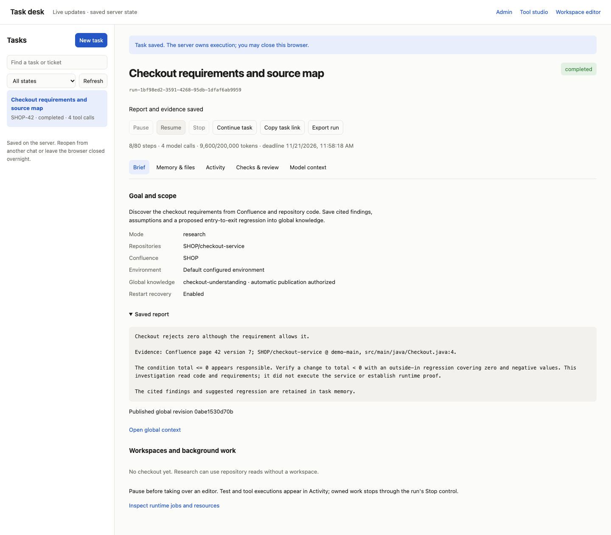
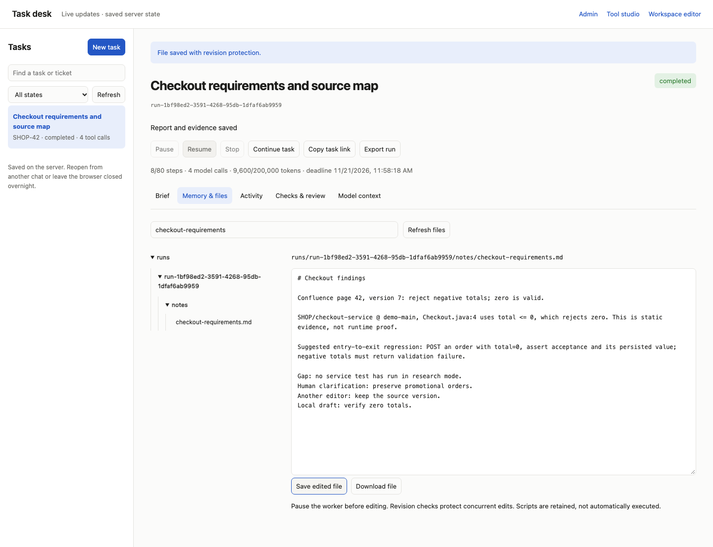

# Autonomous web task desk

Open **Admin → Task desk** (`/tasks`). All ordinary task operations are available
in the browser; CLI and MCP use the same `task_run_*` contracts. The supervisor
runs on the server, not in a browser tab or an Open WebUI conversation.

## Leave a research task overnight

1. Configure the OpenAI-compatible model in Admin: `llm.baseUrl`, `llm.model`,
   optional key and the actual served `llm.contextWindow`. Connection secrets
   remain in configuration. No model request runs simply by opening the desk.
2. Choose **New task**, enter a title, optional ticket and a concrete goal.
   Include expected outputs, page references, services or unresolved questions.
3. Choose **Research**, select/filter repositories or enter `PROJECT/repository`,
   add Confluence space keys and an environment when relevant. A repository is
   optional for research: a task can be a context folder and notes alone.
4. Choose a global context name. An admin can check **Publish the report, notes
   and cited evidence to this global context automatically** to grant this run
   permission to save those findings there.
   Everyone can read published knowledge; private task files stay owner-only.
5. Review the deadline, total model/tool steps and token budget. Leave restart
   recovery enabled for unattended work, then **Start autonomous task**.
6. Close the browser if desired. Reopen its task link, or find the ticket in the
   inbox. **Memory & files** contains retained notes, scripts, query text, tool
   receipts, request manifests and the report. Scripts are stored, not executed.

The worker starts with a small set of source tools. It can discover additional
permitted PG/ES/Kafka/Consul, semantic or CI reads as needed. It searches existing
knowledge and cached names, reads Confluence/repository evidence, and saves
findings as it works. Admin-authorized note checkpoints are published **during**
the run, labelled in progress. A budget stop therefore does not lose already
published findings. Completion publishes the final report as another immutable
revision. Existing shared prose, service graphs and files are preserved.

Continuing a task explicitly reuses its stable continuation and task memory.
**Continue task** prepares a new run and budget without executing immediately.
The model receives a retained briefing and can search/read earlier files; source
versions and assumptions must still be verified. This does not silently attach
unrelated chats or another user's context.

To edit a retained note, open **Memory & files**, select its file and pause an
active worker before changing the text. **Save edited file** checks the revision
you opened. If another editor has changed it, your unsaved draft stays in the
editor and **Compare and reconcile the retained draft** opens:

1. Choose **Load latest server revision** to read the server copy below your
   draft without replacing it.
2. Merge the changes manually in the editor, then choose **Use latest revision
   for my merged draft**. This accepts the revision for the next save; it does
   not save or merge text for you.
3. Review the result and choose **Save edited file** again. A further concurrent
   edit triggers another revision check.

Unsaved drafts live in the current browser page. Use **Download file** to keep a
copy before closing or reloading it; only a successful save persists the edit.

## Prepare a fix, publish and iterate

Choose **Prepare change** and explicit `PROJECT/repository` scope. Its worker can
open/reuse task-owned workspaces, edit files and run real tests. The editor and
bounded command terminal open directly from the task. A task-scoped bridge
preserves principal and concrete-tool grants, including story-bound credentials.
Pause the worker before editing its workspace; active worker writes are locked.

For unattended publication, check **Push checked changes…** and choose a dedicated
`codex/` branch. Enable `push.enabled` and `bitbucket.allowDraftCreate` in Admin
first. The task principal must retain grants for `workspace_push`,
`bitbucket_pr_create` and `bitbucket_pr_status`, and those tools must remain
enabled. Admission and publication recheck this access. An omitted PR destination
uses the verified remote default branch. Native draft capability is checked by
the existing Bitbucket adapter.

The supervisor requires passing, nonempty tests against the exact candidate
Git tree. Changed production code also requires complete changed-line/branch
coverage. The current measurement is JVM-focused; unsupported instrumentation
is a visible blocker, never a fabricated percentage. Maven/Gradle retain their
real annotation-processor lifecycle, including Lombok. Prefer a regression from
entry point to observable response/data/message effects.

Checked publication uses a separate candidate index, excludes `.dt`, retains
commit/push receipts, never forces and never automatically replays onto a moved
branch. A moved branch or changed candidate requires reconciliation and fresh
checks. A lost acknowledgement is reconciled using the same receipt and remote
SHA. Existing direct `workspace_push` semantics are unchanged.

After pushing, the worker creates/reuses a native draft PR and registers a
durable exact-SHA review/check watch. It wakes on relevant changed evidence,
reads failures/comments, edits and tests again, then publishes another checked
candidate. Old-SHA approvals and absent checks cannot make it ready. Merging
remains manual. PR activity pagination gaps remain explicit limitations of the
existing review adapter; inspect them rather than treating partial feedback as
complete coverage.

## Progress, steering and context

- **Activity** records admitted model/tool work, retained result paths, failures,
  publication and control acknowledgements. Existing telemetry and Admin
  observability also record registry/model requests, durations and failures.
- **Pause** applies at a safe boundary. **Stop** cancels owned work and drains
  background jobs. It stops local observation; it does not claim to cancel a
  remote Jenkins build. Browser disconnection does not stop the task.
- **Steer** saves an attributed message and applies it at the next safe boundary.
  Errors explain whether an operation is waiting for acknowledgement.
- **Model context** shows the retained active messages and the exact last
  outgoing request, without authentication headers. Token estimates are labelled.
  Provider usage is used when available.
- **Save checkpoint** is explicit and requires a paused/blocked run. The old
  transcript is retained, and the supplied checkpoint becomes working context.
  There is no automatic transcript compaction. Uncertain effects must be
  reconciled first.
- **Record verified outcome** resolves an uncertain call without repeating it.
  Inspect its original arguments and the external system before recording an
  outcome. Starting a fresh run does not establish what an interrupted write did.

CI/review waits have persisted deadlines, pinned Jenkins build numbers and
deduplicated observation signatures. Unchanged polls and UI refreshes make no
model requests. Temporary model overload/timeouts use at most three persisted
backoffs; remaining failures become needs-attention. A provider worker is shared
conservatively and long waits release it. Runs yield between bounded slices.

## Persistence and operational limits

Retain the configured home on durable storage. Existing Compose mounts the whole
home, so ordinary container replacement preserves these directories:

| Data | Location under the configured home |
| --- | --- |
| Run state, journal, control commands and writer ownership | `task-harness/` |
| Stable task manifests and chat selections | `continuations/`, `continuation-attachments/` |
| Notes, tool evidence, requests and transcripts | `contexts/` through the stable task context |
| Shared immutable publications and retained blobs | `project-contexts/` |
| Checked publication receipts | `workspace-publications/` |
| Checkouts, test results and coverage | `work/`, `cache/` |

Run records and controls use atomic replacement, file/directory fsync and
cross-process ownership locks. External publication has separate durable receipts;
an interrupted mutation is not automatically repeated. On restart only admitted
auto-resume runs recover, with their original deadlines/budgets and current
credential/tool permissions. Credential revocation/rotation suspends execution.
One corrupt neighbor is skipped so other runs remain discoverable. Back up the
records, contexts, receipts and referenced artifacts together. Runtime directories
are ignored by Git.

This release uses the existing durable file-store primitive, **not** the planned
dedicated SQLite task schema. The supported topology is one coordinator with
its local durable home and existing runners. Locks prevent competing controllers
from owning the same record; they are not a distributed scheduling service.

Defaults: 12-hour wall deadline, 80 total model/tool steps, 200,000 model tokens,
one active provider worker; adjustable ceilings are seven days, 500 steps and
two million tokens. Per-run state is bounded to 8 MiB, the UI journal to 1,000
events, model-facing tool excerpts to about 12,000 characters and full tool
artifacts to about 1.5 MiB. Existing context budgets also apply. Retention refuses
new admission at 200 runs per principal and preserves old evidence. Expired
budgets require a new explicitly admitted run on the same task.

The terminal remains the existing bounded inspection/build runner; an arbitrary
interactive PTY is not delivered by this slice. Multi-server failover, automatic
merge, automatic resolution/reply of review threads, broader language coverage
adapters and richer terminal/process reattachment remain follow-up work from the
[design brief](harness-ui.md).

## Tools, demo and verification

`task_run_catalog`, `task_run_start`, `task_run_list`, `task_run_status`,
`task_run_control`, `task_run_memory` and `task_run_action` are registry tools.
The `harness` profile exposes a small discovery set. Search for “overnight” or
“autonomous task” to find the start/catalog actions. Status is read-only;
`view:true` creates a passive inline snapshot linking to the live desk.

```sh
node demo/task-harness.js
node --test test/task-harness.test.js test/workspace-publication.test.js
DT_TEST_BROWSER=1 node --test test/task-harness-ui.test.js
```

The disposable demo uses a **synthetic model and synthetic Confluence/Bitbucket
REST fixtures**, with real HTTP, registry execution, storage, UI and publication.
The browser journey creates research entirely through controls, checks global
publication, edits a retained note and verifies reopening does not rerun the model.
Other tests kill a real worker process, check restart recovery and unchanged
Jenkins polling, isolate principals, revoke credentials and exercise publication
against a real local Git remote. These do not claim that a production model
successfully repairs an arbitrary service or that real Jenkins/Bitbucket were
contacted. Run deployment-specific model and native JVM/coverage checks before
enabling unattended publication there.

## Screenshots

These captures use the disposable synthetic demo described above.

Task brief, retained report and global publication:



Searchable memory and revision-protected editing:



Also available: [mobile creation](screenshots/task-desk-mobile.png) and the
[passive inline snapshot](screenshots/sample-task-run.png).
