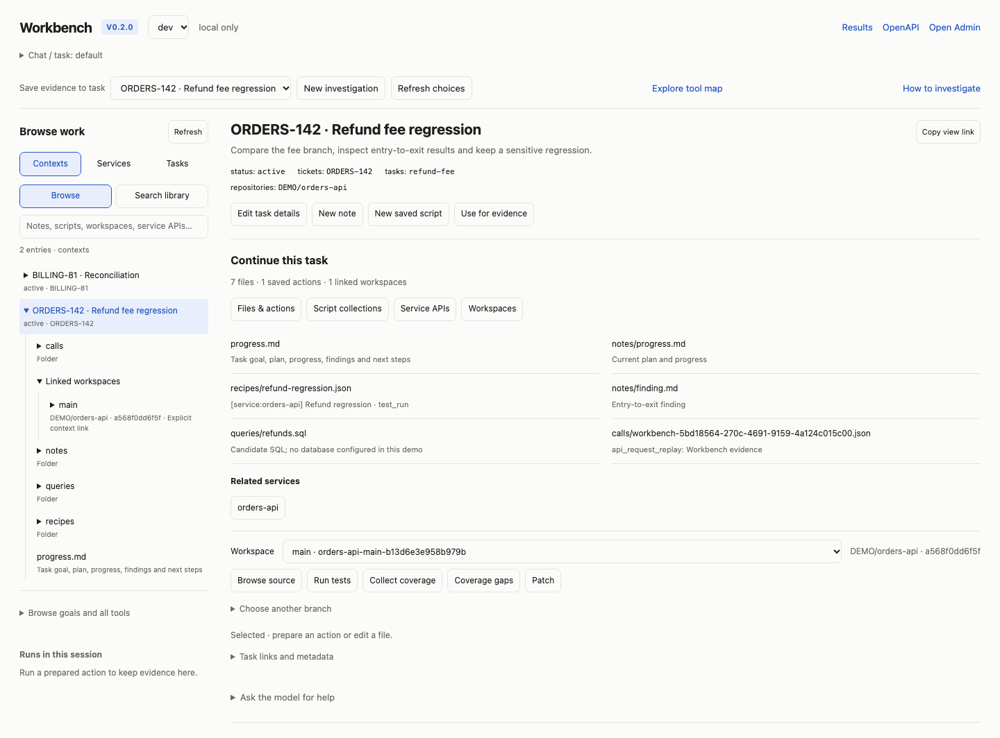
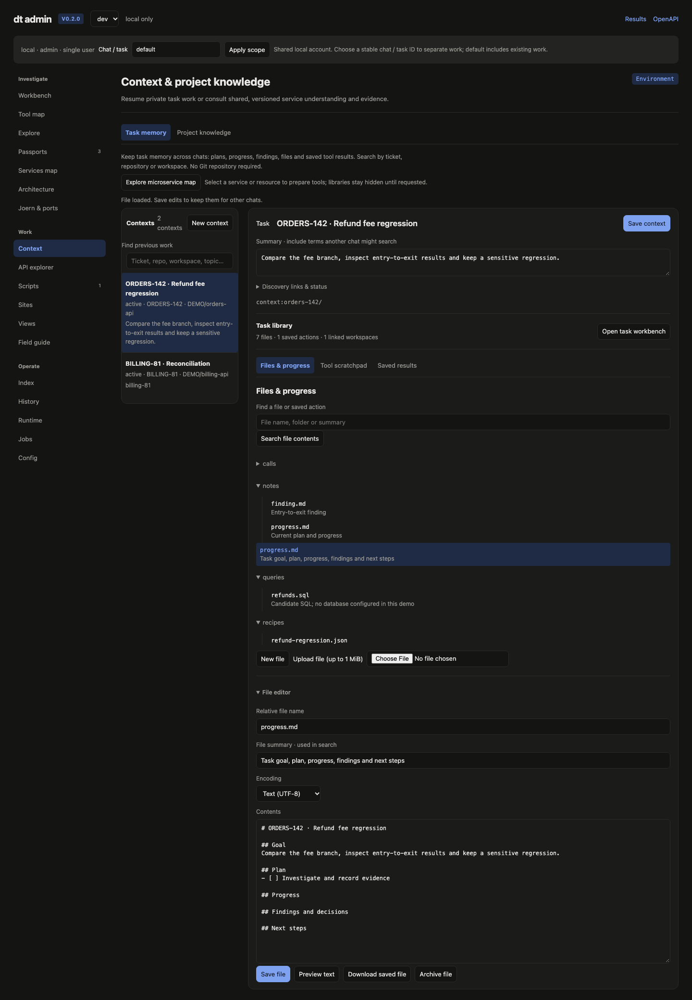
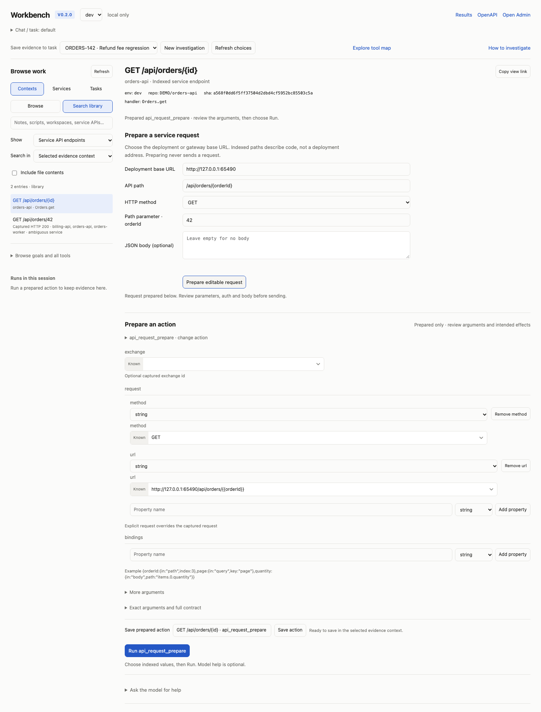

# A task library for people and tools

Start in **Admin → Workbench**, choose **Contexts** or **Tasks**, then open the
task you are working on. The overview brings together files, saved actions,
linked workspaces, service script collections and indexed service APIs.



**Context & scratchpad** remains the place to edit discovery metadata, upload
files and keep notes. Files now follow their folder hierarchy and can be filtered
by path or summary. The file editor and tool scratchpad have separate disclosures.
**Open task workbench** continues the same context without running anything.

## Find and reuse previous work

Use **Search library**, or type in the navigator search. Filter by files/actions,
workspaces, scripts/collections or service API endpoints. **All work** searches the
current authenticated story; **Selected evidence context** follows its explicit
workspace/repository/service links. Scripts are associated by their service-named
collection prefix, with that limitation shown in the results. All work finds
other collections as well.

The default search covers retained names, descriptions, file summaries, ticket
links, workspace branches and API paths/handlers. **Include file contents** scans
text inside an explicitly selected context or workspace. Context scans stop at
16 MiB; workspace scans stop at 1,000 files/directories or 16 MiB and skip build
output, hidden files, binary data and files over 64 KiB. Results report clipping.
Search never silently refreshes an index or calls a model or live service.

Open a file to edit it with its original revision. A concurrent change keeps the
draft and requires reconciliation. Open a script collection to browse its saved
scripts; **Open collection editor** and **Open script editor** use the existing
native editors. Prepared actions can be saved to the evidence context for reuse;
saving and executing are separate actions.



## Prepare requests from service APIs

**Service APIs** lists retained passport endpoints and related captured
exchanges. Indexed endpoints stay separate even when several services expose the
same method/path. An endpoint shows its service, repository/SHA and source handler.

Choose a deployment base URL, review the indexed path/method, fill path parameters
and optionally enter a JSON body. An unambiguous owned capture can offer an
observed origin; it is still an explicit choice. The tool never invents a
deployment host or chooses a service from an ambiguous path match.

**Prepare editable request** prepares `api_request_prepare` below the selection.
Run that action to produce a request contract; it sends nothing. Then choose
**Prepare send request**, review parameters/auth/body, and explicitly **Run action**.
Authentication profiles, rate limits, cancellation and
timeouts apply. The result shows HTTP status/timing and is retained in the selected
evidence context. Check the saved-file receipt separately from the HTTP outcome.
**Save request as script** creates a reusable collection entry without sending it.



## The same workflow from a model

```json
{"tool":"workbench_search","arguments":{"context":"orders-142","kind":"all","query":"refund"}}
```

Use a returned node ID with `workbench_inspect` to read evidence and available
actions, or `workbench_open` to show the retained inline navigator and its
authenticated live continuation. The node is a selector: every read checks the
current user's story, environment and underlying tool grants again.

For text inside files, explicitly use `content:true` and an exact `context` or
`workspace`. Search previews are bounded; use `context_read` or `workspace_read`
to inspect complete source before changing it. Use `workbench_save` for reusable
tool arguments and `context_run` when the result must be retained as evidence.

Copy view links preserve selection, library query/category/scope and story, with
no credential in the URL. Recipients still need normal access; a link does not
grant access or execute anything.

## Reproduce the UI checks

```sh
node dev/check-task-library-browser.js work/task-library/screenshots
node --test test/workbench-explorer.test.js test/workbench-explorer-ui.test.js test/context-ui.test.js
```

The browser scenario uses real local Git, revision-checked files and HTTP requests.
Passports and service infrastructure are disposable fixtures. It does not claim
live production service verification or a fresh semantic index.

The [verification report](benchmarks/task-library-verification.json) retains test
counts, coverage, browser checks, review scope and evidence limits.
