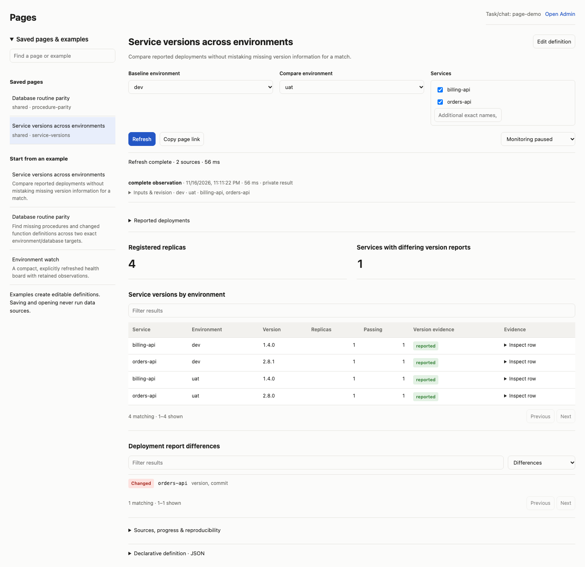
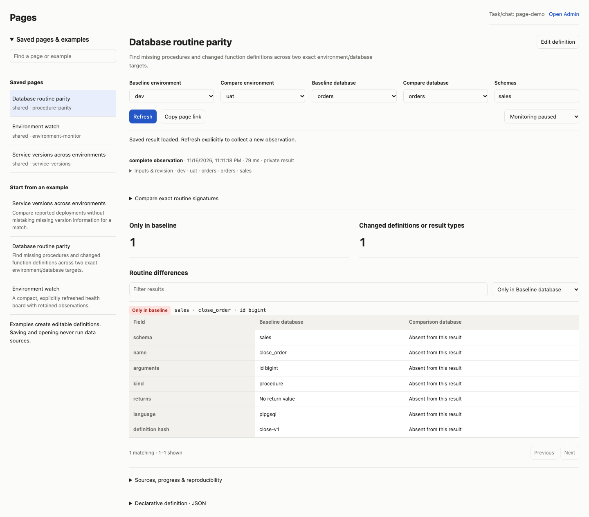

# Declarative pages

Open **Admin → Pages**, or `/pages`. Choose an example, select targets, save the
definition, then **Refresh**. Pages combine ordinary read tools with a small JSON
language. They do not execute HTML, JavaScript or model calls from definitions.

Definitions are **shared by default**. Admins publish shared definitions; other
users can save a private task/chat copy. Each viewer refreshes with their own
tool/environment permissions and retains their own execution results.

## Three ready-to-use examples

| Example | Question | Evidence |
| --- | --- | --- |
| Service versions across environments | Which replicas and reported versions differ between dev and UAT? | Exact Consul registrations, available `/version` payloads and Consul metadata; mixed and unreported versions remain explicit. |
| Database routine parity | Is a procedure absent in UAT, or has its definition changed? | Two exact environment/database targets, bound schema filters, overload-aware identity arguments and server-computed definition hashes. |
| Environment watch | Which services need attention, and what are ES/Kafka reporting? | Existing health, Elasticsearch and consumer-lag read tools; explicit refresh and optional monitoring. |

The [example definitions](../demo/pages/README.md) are editable JSON, also returned
by `ui_page` with `action=templates`. Names such as `dev`, `uat`, `orders` and
`orders-api` are examples. The browser starter substitutes configured targets
where available; review them before refreshing.





Screenshots use a disposable Consul-compatible HTTP fixture and synthetic scoped
PostgreSQL/ES/Kafka read adapters. They are not production observations.

## Create and reuse through tools

```json
{"action":"templates"}
```

Call `ui_page` with that argument to discover templates, primitives and enabled
source tools. Read one complete definition with:

```json
{"action":"templates","template":"procedure-parity"}
```

Save its `definition` with `action=save`, an `id`, and `expected_revision:null`.
Updates require the current revision returned by `action=get`; conflicting saves
keep the previous definition. Use `scope=private` for a task draft. `action=open`
returns an inline retained snapshot and a live-page URL, without reading sources.

An explicit refresh can also be run from a model or CLI:

```sh
node cli.js tool ui_page '{"action":"run","id":"procedure-parity","params":{"left_env":"dev","right_env":"uat","left_db":"orders","right_db":"orders","schemas":["sales"]},"waitMs":30000}'
```

If it returns `state=running`, observe the same job using
`{"action":"run","job":"<returned job>"}`. Use `job_cancel` to stop it. Runs
with identical inputs/revision deduplicate while active. Sources execute
sequentially through the normal registry, rate limits, telemetry and cancellation.
Saving, opening, reloading, filtering and exporting never initiate those reads.

## The language

A page has `version:1`, `title`, optional `description`/`inputs`, `sources`,
optional `datasets`, and `widgets`:

```json
{
  "version": 1,
  "title": "Orders needing attention",
  "inputs": {"env": {"type": "environment", "label": "Environment", "default": "dev"}},
  "sources": [{"id": "health", "tool": "health", "arguments": {"env": {"$param": "env"}, "only_unhealthy": true}}],
  "datasets": [],
  "widgets": [{"id": "services", "type": "table", "title": "Services needing attention", "data": "health", "span": 2,
    "columns": [{"field": "service", "label": "Service"}, {"field": "status", "label": "Status", "format": "status"}]}]
}
```

Inputs support `string`, `number`, `boolean`, `environment`, `database`,
`services` and `strings`. `options` creates a select; `required:false` allows an
omitted value. Database inputs can name an environment input with
`environment:"left_env"`; both UI choices and execution validate that binding.
Exact `{"$param":"name"}` references preserve types. They are not text templates:
SQL uses `params` with `$1` placeholders, never string interpolation. Credentials
belong in configured integrations, not page definitions or share links.

Sources use an enabled supported read tool and `arguments`. `select` selects a
response path (`rows` by default; `summary`, `instances` or an empty path for the
whole object are also useful). A source may instead declare up to 200 `rows` for
an expected checklist/reference dataset. Declared records are labeled separately
from tool observations in provenance.

| Primitive | Main fields | Behavior |
| --- | --- | --- |
| `text` | `text` | Escaped plain text. `collapsed:true` keeps instructions nearby. |
| `metric` | `data`, `op`, optional `field`, `where`, `unit` | `count`, `sum` or the first row's `value`; unavailable data never becomes zero. |
| `table` | `data`, optional `columns:[{field,label,format}]` | Filter all retained records, page 50 rows at a time and inspect row evidence. |
| `comparison` | `data`, optional `leftLabel`, `rightLabel` | Filter differences/same/unknown/one-sided records and expand before/after fields. |

All widgets have unique `id`, `title`, optional `description`, `span:1|2` and
`collapsed`. Column formats are `text`, `number`, `status`, `json` and `time`;
JSON/time retain their source representation. These are rendering hints, not
executable expressions. Layout follows declaration order and adapts on mobile.

Datasets reference earlier sources/datasets, so cycles are invalid:

| Operation | Fields | Result |
| --- | --- | --- |
| `select` | `from`, `fields:{output:"source.path",label:{value:"constant"}}` | Project fields and declared literals. |
| `concat` | `from:["a","b"]` | Combine rows; preserve incomplete-source warnings. |
| `filter` | `from`, `where:{field,op,value}` | `eq`, `ne`, `contains`, `gt`, `lt`, `exists`. Values can be parameter references. |
| `compare` | `left`, `right`, `key:[...]`, `fields:[...]`, optional `required:[...]` | Exact keyed comparison; duplicate/missing identities fail explicitly. |

`compare` returns `same`, `changed`, `only-left`, `only-right` or `unknown`, with
`key`, `before`, `after` and changed field names. Routine keys include schema,
name **and identity arguments**. Required values such as a version cannot be null
on either side of an equality claim. A failed source blocks its comparison;
truncated reads leave unmatched identities unknown. A definition-hash difference
establishes different definitions, not equivalent/different runtime behavior.

## Refresh, monitor and share

**Refresh** creates a retained observation with the definition revision, actual
inputs, timing, per-source outcomes and gaps. Changing controls keeps the previous
observation visible with its saved-input receipt until the next explicit refresh.
Cancellation keeps the last completed observation. Failed progress polling offers
**Retry progress** instead of silently starting another run.

Monitoring starts paused. The optional 30s/1m/5m interval schedules after the
previous run completes, stops while hidden and does not persist in copied links.
There is no server-side unattended monitor or overlapping polling fan-out.

**Copy page link** shares a pinned definition that readers can refresh with their
own access. **Copy result link** deliberately shares one immutable snapshot using
the existing unguessable result-link mechanism; it cannot execute tools or browse
the creator's other results. Inline chat snapshots are collapsed unless the
observation needs attention. Open the authenticated live page to refresh.

**Download definition & results** retains the portable JSON, inputs and observed
data. **Copy rerun command** pins the definition revision and typed inputs. The
definition must exist on the target installation; import the exported definition
with `action=save` before running it elsewhere. Revision history is retained;
the UI shows up to 20 revisions and 20 recent observations. Normal result
retention may expire a snapshot, while leaving the definition refreshable.

Definitions live under `DT_HOME/pages/shared` or the task-scoped
`DT_HOME/pages/private` tree. Page execution history lives in scoped cache
metadata; large results use the existing retained-result store. No credentials
are added to page links.

## Bounds and verification

Each page supports 12 inputs, 16 sources, 24 derived datasets and 30 widgets in a
128 KiB definition. Each dataset retains at most 2,000 rows / 2 MiB, and combined
datasets are limited to 6 MiB. Reads and comparisons report clipping. Narrow the
query before interpreting absence. The routine source computes hashes in
PostgreSQL and returns signatures rather than large procedure bodies.

Run the [demo browser check](../demo/pages/README.md) for actual page/inline/Admin
interactions. `test/ui-pages.live.test.js` optionally verifies the query against a
dedicated scratch PostgreSQL cluster selected by `DT_TEST_PG_URL`; it creates and
removes only its own UUID-named databases. The normal fixture tests use scoped
HTTP adapters, not a live database.

The [retained verification report](benchmarks/ui-pages-verification.json) records
the source-matched full suite, coverage gate, browser checks and their limits.
