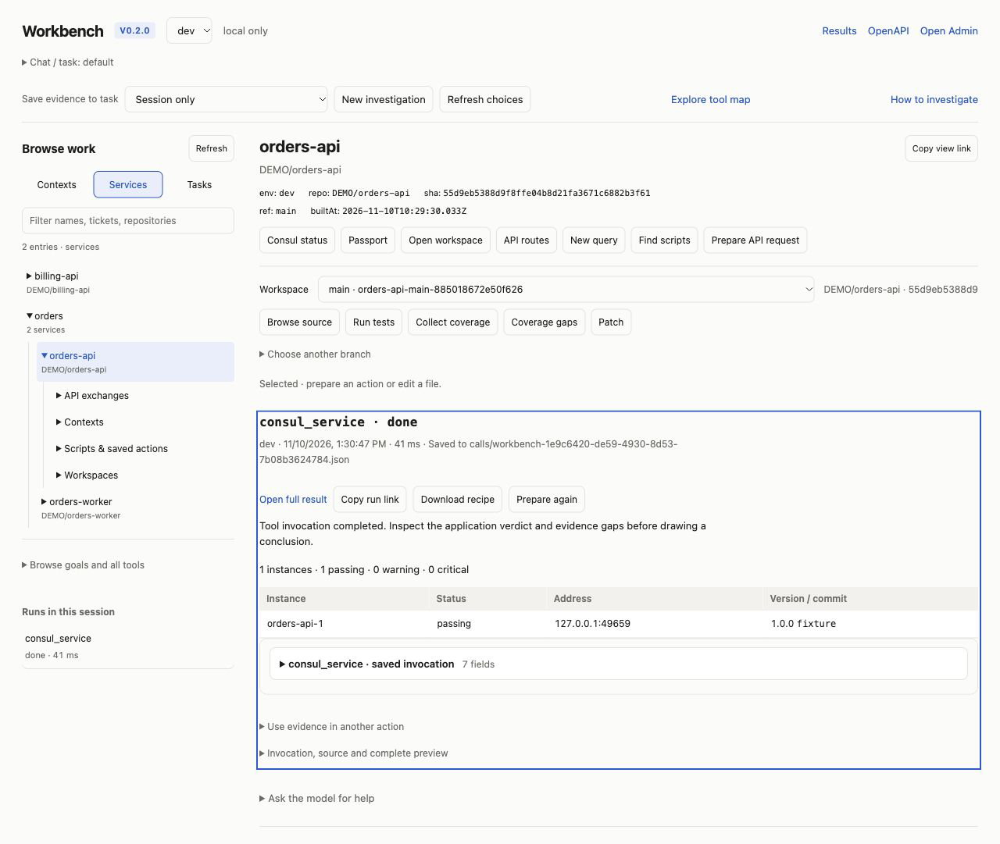
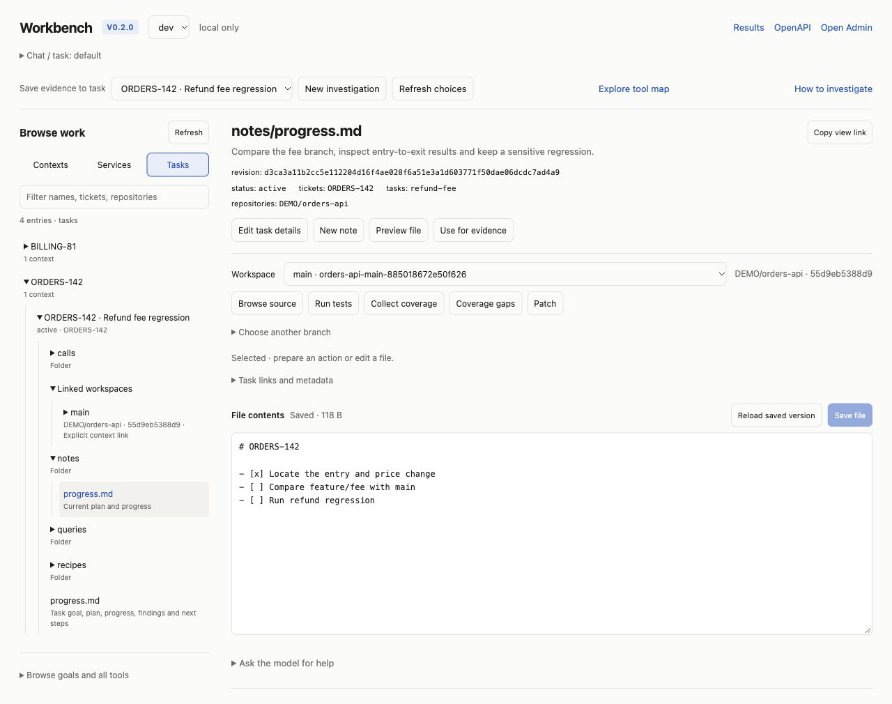

# Browse contexts, services and tasks

Open **Admin → Workbench**, or `/workbench` for the compact standalone page.
`workbench_open` opens the same live interface from chat/MCP; supply `mode`
(`contexts`, `services`, `tasks`) and optionally an exact `context`, `service` or
`task`. Chat renders a retained navigator with switchable lenses, nested names and
selected evidence. **Open live workbench** continues into the authenticated page
for editing or execution. The snapshot cannot make network calls or authorize
writes. The live page uses the browser's own authentication; shared links never
grant execution permission. Sign in in a normal tab when needed.

The left navigator is a vertical, expandable folder list:

- **Contexts:** owned notes, nested folders, saved actions, queries, captures and
  explicitly linked workspaces. A selected context becomes the evidence folder.
- **Services:** cached service/passport names, grouped by common name prefix;
  related contexts, repository workspaces, saved actions/scripts and attributed
  API exchanges. Browsing makes no live infrastructure calls.
- **Tasks:** ticket and task IDs from context metadata, with their contexts and
  explicitly linked workspaces. These are task groups, separate from run jobs.
  Use **Edit task details** to correct ticket, repository or workspace links.

Choose a row to see its identity, available actions and relevant source. Search
filters retained names and discovery metadata. Expand a folder lazily; Load more
continues large lists. A missing passport, context or association remains visible
as an empty state; names alone do not establish a service relationship.

## Work through a service change

1. Choose **Services**, expand a prefix, and select the service. Inspect the
   environment, source SHA/ref and retained passport timestamp.
2. Select an evidence context, or choose **New investigation**. Actions and
   results can be captured there; **Session only** leaves the result in retained
   run history without promising durable task notes.
3. Select a workspace. **Run tests** and **Collect coverage** prepare tool forms;
   add a test and browse actual test files/class selectors. Review the selector
   and execution target, then choose **Run**. Progress, cancel, application
   outcome and the native result stay in the same workbench.
4. **Choose another branch → Refresh remote branches** explicitly reads remote
   Git refs. Browse a known branch or enter an exact ref, prepare it, then Run.
   `workspace_branch` opens/reuses a separate owned checkout; it preserves dirty
   sources in the original workspace. **Attach to evidence context** prepares a
   revision-checked metadata update so the task tree can rediscover it.
5. **Consul status** prepares a live status call with the exact service/env.
   Run it to inspect instance health, address and reported version evidence.
   Passport source identity and observed deployment version remain different.
6. Expand **Scripts & saved actions** or **API exchanges**. Read script steps
   before running. Prepare an exchange to edit parameters; **Send request**
   prepares an explicitly effectful replay. Requests keep the existing HTTP
   allowlist and optional server-side bearer profiles.

A successful tool invocation is separate from a passing application test or
HTTP status. Long tools can return a background job: refresh that job or cancel
it using the displayed follow-up, preserving the exact job ID. Saving failure
is separate from execution success; do not repeat a mutation just to save it.

## Edit and retain useful work

Select a text file to preview and edit it beside the folder tree. Unsaved drafts
survive navigation within the current user/task scope. Saves use the revision
originally read and reject a concurrent update. Reload preserves a dirty draft
and shows the saved version for reconciliation; accept the current revision only
after reviewing it. Java workspace saves retain compiler feedback and suppress
automatic source fixes for that direct editor save.

The compact editor supports UTF-8 text up to 64 KiB, with at most 12 dirty drafts.
Larger, binary or non-UTF8 files stay read-only; preview context files through the
file-browser action. Scope changes clear private drafts and previews.

For a saved `.sql` file, **Prepare SQL from draft** transfers the current text
into the query form, where indexed tables and databases remain selectable.
Context JavaScript can prepare an explicit sandbox run through `code`.
Saving a script file does not register it or execute it automatically.

**Save prepared action** stores the current tool/arguments as a JSON recipe in
the selected context's `recipes/` folder. Give it a name. A selected service
adds an explicit service/repository association. Reopening the recipe prepares
editable arguments; Run remains explicit. Overwrites require the current file
revision, and credentials are redacted. A redacted recipe needs fresh secret
values or a configured auth profile before reuse.

Scripts in a collection matching the service name are labeled candidates;
verify their relevance. Explicit recipe associations and declared context
repository/service links are shown separately from that naming convention.
Saved-action discovery has a 500-file/4 MiB read budget; its gaps direct you to
browse an exact context when more evidence exists.

## Share and reproduce

**Copy view link** reopens a live selection in the same environment/task scope.
It shows current retained data rather than freezing history. The recipient
still needs the appropriate identity and tool grants. **Copy run link** reopens
owned retained invocation/result evidence without replaying a call. **Download
recipe** exports the exact arguments for deliberate review and later execution.
No bearer tokens or passwords are put in navigation links.

Optional model assistance stays under **Ask the model for help**. Suggestions
and interpretations use the existing configured model and remain editable;
opening a folder, view or suggestion never executes the proposed action.

## Small-model discovery

For an interactive task session, select the `workbench` tool profile
(`DT_TOOL_PROFILE=workbench`, or `tools.profile` in configuration). It exposes
14 tools, including discovery, existing-context lookup, prepared actions,
separate branch checkouts and captured deployment evidence. Other enabled
capabilities remain reachable through `tool_search` → `tool_describe` →
`tool_execute`. Profiles do not change permissions. Calling `tool_profiles`
only lists choices; configure the client/server profile for a new session.

The real Qwen 3.5 4B fixture evaluation completed **6/6 tasks** with this
profile. The five-tool `lean-find` profile still struggled with discovery and
multi-step retention; use the focused profile for this workflow. This is an
exploratory, single-sample evaluation of six prompts used during iteration,
not a general model reliability score. See [the recorded evidence and limits](benchmarks/workbench-discoverability.json).

The evaluated tasks cover ticket/service/context navigation, saving a future
deployment check without executing it, preserving dirty sources while opening
another branch, and retaining an actual status response. Folder IDs come from
`context_find`; ticket IDs belong in `workbench_open.task`. Omit `mode` to infer
the lens from the selected object. Unknown tool groups and missing selections
now report explicit recovery instructions rather than an apparently empty
success. Opening a navigator saves no live evidence.

Use `workbench_save` for prepared arguments that should run later. Use
`context_run` to execute once and retain the actual response. Check its `ok`
and `saved` independently; a successful capture returns `workbenchUrl` for the
authenticated live investigation. The optional `next` prepares a retained chat
navigator. Failed storage never claims a saved investigation, and a disabled
Workbench is not advertised. Never repeat a mutation merely to save its result.

Reproduce against an explicitly selected Ollama native API:

```sh
node dev/eval-workbench-model.js --endpoint http://127.0.0.1:11434 --model qwen3.5:4b --profile workbench --output work/workbench-model/workbench.json
node dev/eval-workbench-model.js --endpoint http://127.0.0.1:11434 --model qwen3.5:4b --profile lean-find --output work/workbench-model/lean.json
node --test test/workbench-discovery.test.js test/workbench-model-eval.test.js
```

Remote endpoints require explicit `--allow-remote`. Only disposable fixture
questions, tool schemas and fixture outputs are sent. Git branching and file
persistence execute locally for real; Consul is simulated. Each case has a fresh
conversation, with 12 turns, 30 calls and bounded context/output. Success is
graded from retained artifacts and real checkout contents, never model claims.
`--scripted` labels a transport/fixture contract check and is not model evidence.
Raw transcripts remain in ignored `work/`; the published report omits machine
paths, endpoint addresses and fixture ports.

## Reproduce the demo and tests

```sh
node demo/workbench-explorer/run.js
node --test test/workbench-explorer.test.js test/workbench-explorer-ui.test.js test/workbench-explorer-view.test.js
```

The disposable demo has two real Git branches and a real Node regression. The
main branch passes; `feature/fee` changes the result and fails the unchanged
assertion. Consul and HTTP records are local fixtures, not production claims.
Its second port provides a 390px document-frame preview, not a mobile browser
simulation. Ctrl-C stops owned servers and removes the temporary home.

## Captured examples





[390px live-page preview](screenshots/workbench-explorer-mobile.png) ·
[Native chat navigator](screenshots/sample-workbench.png) ·
[390px native-view preview](screenshots/workbench-explorer-inline-mobile.png). These images
use the disposable fixture above; Git/Node execution is real, infrastructure
observations are simulated.
